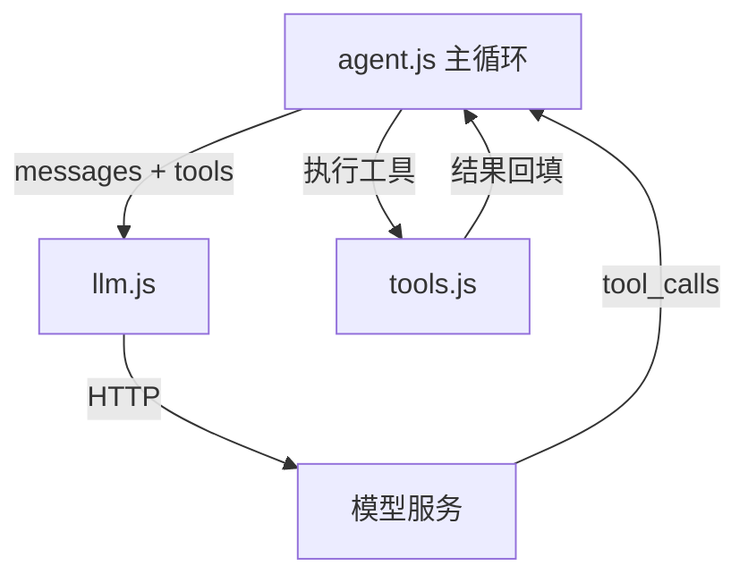
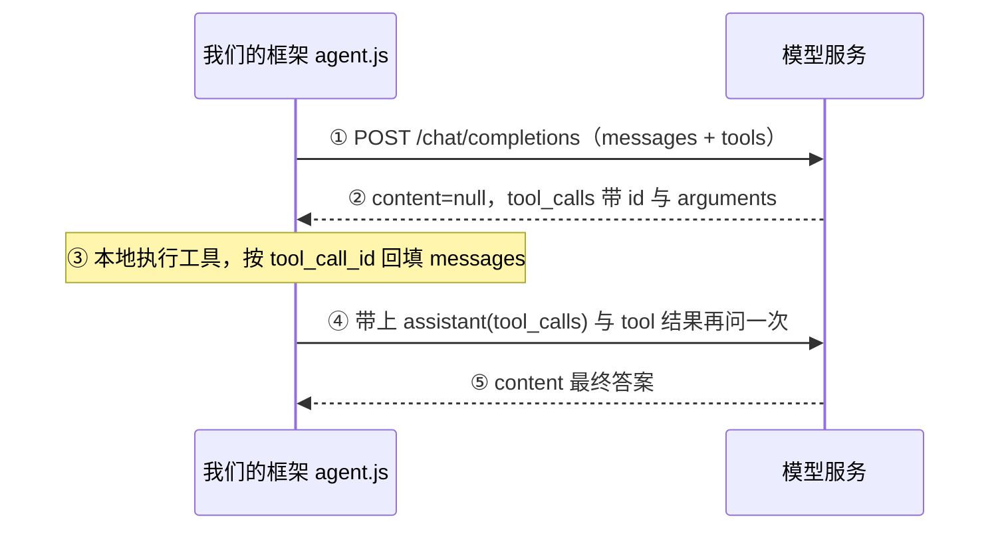

# 第 1 章 · 最小 Agent 循环（Node 版）

## 这一章做什么

本章写一个命令行程序：输入"今天的天气和美食"，它不直接回答，而是让 LLM 自己决定先查"我在哪个城市"，再拿城市去查天气、查美食，最后合成一句话。代码里没有一行写着"先调 get_city"，调用顺序和循环几轮都由模型推理出来。

为什么需要它？把"今天北京天气怎么样"直接发给 `/chat/completions`，模型的知识停在训练截止那天，它不知道今天几度，于是要么回"我无法获取实时天气"，要么给一个像模像样的"今天晴，18 度"。这类请求的共同点是数据在模型之外，而模型唯一的输出通道是文本，它自己取不到，需要我们的代码去取、取完再喂回去。

本章在整个项目里的位置：它是地基。全书 13 章共用一份代码框架，每章在上一章基础上加一层能力，本章的 4 个文件在后面每一章都会继续被改动。

课程全景和章节先后关系见[入门者学习指南](../../docs/beginner-guide.md)。

第一次学习本章，先按本章 README 的“快速开始”运行离线版本，再读本页开头的问题和流程，沿调用关系打开入口文件，最后完成文末练习。逐文件说明和完整测试列表可以留作查阅，不必第一遍从头读完。

学完本章你应该能做到：不看代码画出主循环；说清一次工具调用的完整报文；解释为什么 `messages` 数组就是"记忆"；指出本章故意留下的两个缺口以及为什么留。

**建议先按请求顺序读主教程**：[`request-response-walkthrough.md`](request-response-walkthrough.md) 从普通聊天对照开始，逐次展示 Agent 发出的 `messages + tools`、模型返回的 `tool_calls`、本地工具执行、`role: "tool"` 结果回填和最终回答。读完再回到本篇看原理、完整文件讲解和练习。

## 四个文件

```
lesson01-minimal-agent/
├── llm.js         57 行   模型层：用 fetch 调 /chat/completions（怎么"说话"）
├── tools.js       94 行   工具层：说明书 TOOLS（给模型看）+ 执行器 call_tool（给框架用）
├── agent.js       48 行   ★ 主循环：想 → 做 → 回填 → 再想（本章考点集中在这里）
├── main.js         7 行   入口：调 run_agent() 并打印结果
├── test.js       181 行   10 个用例（替换 fetch，不需要 API key）
├── package.json          type: module（ESM）+ npm test / npm start
└── docs/
    ├── course.md        本章（当前文件）
    ├── interview.md     面试题：10 题，含考点、话术、代码锚点
    └── video-script.md  教学视频脚本：4 集，含画面和旁白
```

阅读顺序按依赖方向：`llm.js`（怎么说话）→ `tools.js`（有什么手脚）→ `agent.js`（怎么循环）→ `main.js`（怎么启动）。`test.js` 最后看，它是对前四个文件的验证。

## 它是怎么跑起来的



对着这张图讲三句：

**① 每轮把全部历史发过去。** 模型是无状态的函数，服务端不保存任何对话状态。数组 `messages` 里的内容就是它的"记忆"，所以每轮都得整体重发，包括工具说明书 `tools`。代价是数组只增不减，历史越长每次请求越贵——第 3 章专门处理这个问题。

**② 模型只"说"，不"做"。** 它要么返回文本（任务结束），要么返回 `tool_calls`：一串"我想调 get_weather，参数是北京"的调用意图。它不能上网、不能跑代码，执行权始终在框架手里。这个分工是后面做权限审批的落点。

**③ 框架负责执行和回填。** 拿到 `tool_calls` 就逐个执行，结果作为一条 `role: "tool"` 的消息 push 进 `messages`，然后回到 ① 再问一次。`tool_calls` 为空说明模型认为任务完成，返回 `content`。

三个设计决定，前面的备选方案都试过：

| 备选 | 为什么不用 |
|---|---|
| 代码里写 if/else 编排流程 | 用户说"我今天穿什么"，句子里没有"天气"两个字，规则命不中；表达方式无穷，规则补不完 |
| 约定模型输出自创 JSON 再解析 | 约定只写在 prompt 里，解码时没有约束，模型会把 JSON 包在自然语言里，或者换个字段名 |
| 预先把所有工具结果都取回来 | 依赖链卡死（不先知道城市查不了天气），而且数据库和 HTTP 的代价不该无条件付 |

选 Function Calling（协议层函数调用）的原因是约束下沉到了协议层：`tools` 里用 JSON Schema 声明工具名、用途、参数形状，模型要调用时返回结构化的 `tool_calls`，我们这边不需要解析自由文本。第二条路本身没错，它的成熟形态是 ReAct，至今在不少产品里用着，代价是解析自由度高、准确率靠 prompt 调优。

循环的轮数不写死，因为只有模型知道还缺什么：知道城市才可能查天气，查完天气才知道要不要再查美食。轮数交给它，就必须配一个上限兜底。

## 逐个文件看代码

### llm.js：把请求发出去

```js
const OPENAI_API_KEY = process.env.OPENAI_API_KEY;
const OPENAI_BASE_URL = process.env.OPENAI_BASE_URL || "https://api.openai.com/v1";
const OPENAI_MODEL = process.env.OPENAI_MODEL || "gpt-4o-mini";

export async function call_llm(messages, tools) {
    const response = await fetch(`${OPENAI_BASE_URL}/chat/completions`, {
        method: "POST",
        headers: { "Content-Type": "application/json", "Authorization": `Bearer ${OPENAI_API_KEY}` },
        body: JSON.stringify({ model: OPENAI_MODEL, messages, tools }),
    });
    const data = await response.json();
    return data.choices[0].message;
}
```

没有用 `openai` SDK，用 Node 内置 `fetch` 直接打 HTTP。理由是本章要讲协议：`messages` 和 `tools` 怎么进请求体、`tool_calls` 从响应哪个字段出来，用 SDK 这些细节会被藏起来，后面调试也无从下手。代价是超时、重试这些 SDK 自带的能力要自己写，第 13 章补。

三个配置项从环境变量读，写成变量而不是写死在 `fetch` 里，是为了让 `call_llm` 对接任何 OpenAI 兼容端点：vLLM、SGLang、Xinference 的路径和请求体格式一致，换服务只改 `OPENAI_BASE_URL` 和 `OPENAI_MODEL`，`agent.js` 不动。函数签名只有 `(messages, tools)`，配置是进程级常量，随请求变的是对话状态，两者分开。返回 `choices[0].message` 只取这一轮模型说了什么，响应里的 `id`、`usage` 等字段本章不关心，做成本统计时再回来取（第 13 章）。

### tools.js：说明书和执行器

同一个文件里有两个导出。`TOOLS` 是给模型看的说明书：

```js
export const TOOLS = [{
    type: "function",
    function: {
        name: "get_weather",
        description: "查询天气",
        parameters: {
            type: "object",
            properties: { city: { type: "string", description: "城市名称" } },
            required: ["city"],
        },
    },
}, /* get_city / get_food 同构 */];
```

`description` 决定模型在这个工具和其他工具之间怎么选，写"查询"和写"根据城市名查询当天天气"效果不同。参数用 JSON Schema（描述 JSON 数据形状的规范）声明，`required` 里的字段模型必须给。

执行器是另一边：

```js
export async function call_tool(name, args) {
    if (name === "get_city") {
        return { city: await get_city() };
    }
    if (name === "get_weather") {
        const { city } = JSON.parse(args);          // args 是字符串，不是对象
        return { city, weather: await get_weather(city) };
    }
    if (name === "get_food") {
        const { city } = JSON.parse(args);
        return { city, food: await get_food(city) };
    }
    return { error: `Unknown tool: ${name}` };      // 未知工具：返回错误而不是抛异常
}
```

模型把"调用意图"变成代码执行的地方就在这里。`args` 是 JSON 文本，协议规定的（`content` 本身就是字符串，混入对象类型会让各语言 SDK 的序列化复杂化）；顺带的收益是这里可以 `JSON.parse` 后做校验，第 2 章 `lesson02-tool-system/validation.js` 就长在这一步。最后一行兜底返回错误对象而不是抛异常，模型看到错误会自己调整，这个方向第 2 章会扩展成完整的三层错误处理。

三个工具的假数据写成固定表：

```js
const CITIES = {
    "北京": { weather: "晴 25°C", foods: ["烤鸭", "炸酱面", "豆汁"] },
    "上海": { weather: "多云 22°C", foods: ["鱼香肉丝", "红烧肉"] },
    "广州": { weather: "小雨 20°C", foods: ["白切鸡", "烧鹅"] },
    "深圳": { weather: "大雨 18°C", foods: ["肠粉", "牛杂"] },
};
const MY_CITY = "北京";
const get_city = async () => MY_CITY;
const get_weather = async (city) => CITIES[city].weather;
const get_food = async (city) => CITIES[city].foods[0];
```

数据是假的，结构是真的：`get_city` 不需要参数，另外两个需要 `city`。这个依赖关系逼着模型先查城市、再查天气，循环才转得起来；如果三个工具都不需要参数，模型一轮就调完，"多步执行"就看不出来了。假数据用固定值不用随机数，是为了让读者跑出来的输出和本文一致。

### agent.js：主循环

```js
const MAX_ROUND = 10;

export async function run_agent(userInput = "今天的天气和美食", verbose = true) {
    const messages = [{ role: "user", content: userInput }];

    let round = 0;
    while (true) {
        if (round >= MAX_ROUND) {                       // ① 保险丝
            return `[MAX_ROUND] 达到最大轮数 ${MAX_ROUND}，已强制结束`;
        }

        const response = await call_llm(messages, TOOLS);   // ② 问模型
        if (verbose) console.log(`Round ${round}:`, JSON.stringify(response));
        round += 1;

        messages.push(response);                        // ③ 调用意图也进历史

        if (response.tool_calls && response.tool_calls.length > 0) {
            for (const tool_call of response.tool_calls) {   // ④ 逐个执行
                const tool_result = await call_tool(
                    tool_call.function.name,
                    tool_call.function.arguments,
                );
                messages.push({                             // ⑤ 按 id 回填
                    role: "tool",
                    tool_call_id: tool_call.id,
                    content: JSON.stringify(tool_result),
                });
            }
        } else {
            return response.content;                        // ⑥ 模型不再要工具 = 结束
        }
    }
}
```

**③ 的位置不能挪。** 这条 assistant 消息带着 `tool_calls`，是下一轮 `role: "tool"` 消息的父节点，服务端校验这个配对关系，缺了父节点直接报 400。

**④ 用 `for` 加 `await` 逐个执行，没用 `Promise.all`。** 工具之间可能有依赖（`get_weather` 要用 `get_city` 的结果），并行会拿到空参数；顺序执行还顺带保证了回填顺序稳定。

**① 和 ⑥ 是循环的两个出口，还有一个是异常。** `MAX_ROUND = 10` 兜住模型不收敛的情况（每轮都调工具、永远不给最终文本）；模型返回无 `tool_calls` 的文本是正常出口；异常本章不处理，直接崩（见 README 的缺口表）。

`verbose` 参数控制是否打印每轮原始响应。默认开着，因为本章重点是看协议怎么走，不是看结果；测试里传 `false`，输出干净。

### main.js：入口

```js
import { run_agent } from "./agent.js";

async function main() {
    const result = await run_agent();
    console.log("Final Result:", result);
}

main();
```

入口这么薄，是因为 `agent.js` 已经是可以被别处 import 的模块。后面接 IM、接定时任务时，换的是这一层，`agent.js` 不动。


一次完整往返：



## 动手练习：给 Agent 增加景点查询

现在的工具能查城市、天气和美食。给它再加一个“根据城市查询一个景点”的能力，练习工具调用从说明到执行的完整路径。

### 任务

在 `tools.js` 中新增 `get_attraction`：

1. 在 `CITIES` 的每个已支持城市中添加 `attractions` 数组，例如北京可以包含“故宫”。
2. 在 `TOOLS` 中声明工具名、用途和必填的 `city` 字符串参数。
3. 写一个读取景点数据的函数，并在 `call_tool` 中添加对应分支。
4. 在 `test.js` 中补一个离线测试，验证北京返回预期景点，并验证工具 schema 中声明了 `city`。

练习只用数据表里已有的城市。未知城市的异常处理是本章故意留下的缺口，会在第 2 章学习结构化错误时解决。

### 自查

测试中直接调用 `call_tool("get_attraction", JSON.stringify({ city: "北京" }))`，结果应包含城市和景点；再检查 `TOOLS` 中的工具名与执行器分支完全一致。最后运行 `npm test`，确认原有用例和新用例都通过。

如果真实模型服务已经配置好，可以再运行 `node main.js`，询问“北京有什么著名景点？”，观察 `tool_calls` 中是否出现 `get_attraction`。这一步是额外演示，不是完成练习的前提。

### 提示

- `TOOLS` 是给模型看的说明；它不会自动调用 JavaScript 函数。
- `call_tool` 是程序的路由；新增工具要在这里补上执行分支。
- `arguments` 是 JSON 字符串，参数要先解析，再传给工具实现。
- 结果会由主循环序列化，并按原来的 `tool_call_id` 回填；不需要为这个新工具另写一套循环。

## 下一章

第 2 章把 `tools.js` 的手工 `if` 路由换成 **ToolRegistry**：工具动态注册、参数按 schema 校验、权限分级（读 / 写 / 危险 + 人工审批）、错误分层，再加上防失控三件套（轮数上限 + loop 检测 + 错误预算）。

换掉它的触发点很具体：本章加一个工具要动 `tools.js` 四处（schema、实现、`call_tool` 分支、文档），第 4 章会一次加进六个真实工具，这种改法撑不住。本章那两个缺口（工具异常未捕获、非法 JSON 未处理）也在第 2 章一起修掉，`test.js:175`、`test.js:179` 两个负向用例随之改成断言结构化错误。
