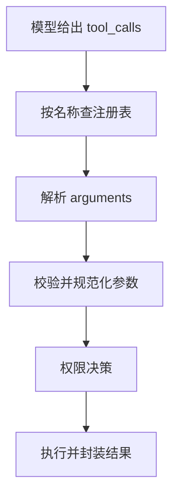
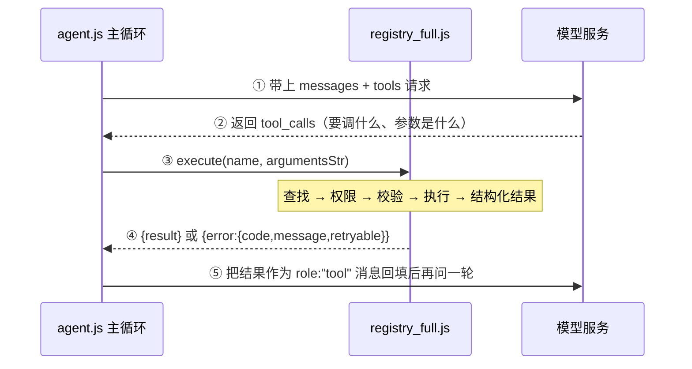

# 第 2 章 · 工具系统：把 call_tool 换成一条拦得住的流水线（Node 版）

## 这一章做什么

第 1 章加一个工具要动两处：往 `TOOLS` 数组里塞一份 JSON Schema（给模型看），再去 `call_tool` 里补一个 `if (name === "xxx")` 分支（给框架用）。三个工具时还行，三十个工具时那个 `call_tool` 会变成谁都改不动的巨型 switch，而且两处代码靠人工同步——schema 和实现对不上时，模型看到的和真正执行的就不是一回事。

这一章把"工具"从一个函数升级成一套平台能力：加工具 = 写一个定义对象 + 一次 `register()`，路由代码零改动；参数在进工具函数之前就被拦下；错误一律变数据回传给模型而不是打穿进程；有副作用的操作先过权限决策；模型陷入死循环时有工具之外的两道防护。

课程全景和章节先后关系见[入门者学习指南](../../docs/beginner-guide.md)。

第一次学习本章，先按本章 README 的“快速开始”运行离线版本，再读本页开头的问题和流程，沿调用关系打开入口文件，最后完成文末练习。逐文件说明和完整测试列表可以留作查阅，不必第一遍从头读完。

学完本章你应该能做到：沿着一轮模型请求找到工具定义和本地实现；默画从名字匹配到结果回填的处理顺序；解释哪些参数可以无损转换、哪些必须拒绝；说清 read/write/danger 的决策树与 fail-closed；解释 `MAX_TURNS` 挡不住哪两类失控。建议先读 [`request-response-walkthrough.md`](request-response-walkthrough.md)，再用本篇查设计细节。

## 十个文件，一条流水线

```
lesson02-tool-system/
├── registry.js       72 行   v1 注册表：定义对象 + register/getSchemas/execute
├── validation.js     89 行   v2 参数校验：schema 驱动 + 类型宽容转换表
├── errors.js         70 行   v3 结构化错误：ErrorCode + ToolError + toResult
├── permissions.js    72 行   v4 权限分级：read/write/danger + 三态确认
├── registry_full.js  86 行   ★ 六步流水线：把 v1~v4 串成一次 execute()
├── agent.js         125 行   v5 主循环：轮数上限 + Loop 检测 + 错误预算
├── tools_demo.js     93 行   4 个演示工具，覆盖三种安全等级
├── llm.js            56 行   模型层：env.json 优先 → 环境变量 → 默认值
├── main.js           44 行   入口：readline 三态确认
└── test.js          25 个离线用例，覆盖成功、拒绝和异常路径
```

阅读顺序按依赖方向：`registry.js`（工具长什么样）→ `validation.js`（参数怎么拦）→ `errors.js`（错误怎么表达）→ `permissions.js`（谁来批）→ `registry_full.js`（总装）→ `agent.js`（装上发动机）→ `tools_demo.js` 和 `main.js`（接上真实场景）→ `test.js`（质检报告，也是最好的用法示例）。

五个零件单独看都是几十行的小文件，值钱的是它们串起来的顺序。

## 一条流水线，六个步骤



一次工具调用从模型提出意图到本地执行，会经过名字匹配、JSON 解析、参数校验、权限决策和执行；最后成功值或错误都封装成结果，交给 Agent 写入 `role:"tool"` 消息。确认时展示的是校验后的参数，因此用户看到的内容和工具实际收到的内容一致。

## 逐个文件看代码

### registry.js：把工具从 if-else 里搬出来

一个工具就是一个对象，四件事装在一起：

```js
r.register({
  name: "get_weather",                     // LLM 调用时用的名字
  description: "查询指定城市的当前天气。",   // LLM 决定要不要调的依据
  params: {                                // JSON Schema 参数协议
    type: "object",
    properties: { city: { type: "string", description: "城市名，如 北京" } },
    required: ["city"],
  },
  fn: async ({ city }) => { ... },         // 真正干活的函数
}, "read");                                // 安全等级，v4 权限层用
```

第 1 章的两处代码（`TOOLS` 说明书、`call_tool` 执行器）在这里合成了一处：`params` 既是协议也是校验依据，`fn` 是唯一的实现。加一个工具只写一个对象、调一次 `register()`，注册表本身一行不动——这就是开闭原则落到代码上的样子。

Node 版必须显式写 schema，因为 JS 没有运行时类型信息，`async ({ city }) => ...` 这个签名在执行期读不出 `city` 是 string。Python 版能靠类型注解自动生成，JS 生态的解法是 Zod 这类库（一个定义同时产出 JSON Schema 和运行时校验器，避免双份维护），本章零依赖，手写。

```js
export function createRegistry() {
  const tools = new Map();          // 闭包私有
  return {
    register(toolDef) { tools.set(toolDef.name, toolDef); return toolDef; },
    getSchemas() {
      return [...tools.values()].map((t) => ({
        type: "function",
        function: { name: t.name, description: t.description, parameters: t.params },
      }));
    },
    async execute(name, argumentsStr) { ... },
  };
}
```

`tools` 被闭包锁住，外部只能走这三个方法。每次 `createRegistry()` 得到一个独立实例，测试里开十个注册表互不污染，不需要"重置全局状态"这种钩子——第 1 章的 `TOOLS` 是模块级常量，有状态的模块必须做成实例。

`execute`（`registry.js`）里已经有三条容错，三条都是"返回错误对象而不是抛异常"：工具名不存在、参数不是合法 JSON、工具执行抛异常。第 1 章看到的工具异常可能直接打断主循环，这里把它们变成回传给模型的错误。这一版的错误还是字符串（`{ error: "未知工具: x" }`），下一站 `errors.js` 才给它加错误码。

### validation.js：参数在进工具之前被拦下

模型给参数是"生成"出来的，不是表单提交，常见三种错：必填没给、类型不对（整数给成 `"3"` 或 `3.0`）、冒出 schema 里没有的字段。这三种错如果放进工具函数里才炸，模型收到的是 `Cannot read property 'weather' of undefined`——一条对它毫无意义的堆栈，它不知道下一步该改什么。

校验函数就三条规则，按顺序跑：

```js
export function validateParams(params, args) {
  const properties = params.properties || {};
  const required = params.required || [];
  const errors = [];

  // 1. 必填检查：明确点名缺了谁、期望什么类型
  for (const name of required) {
    if (!(name in args)) {
      const type = properties[name]?.type || "string";
      errors.push(`缺少必填参数 \`${name}\`（期望类型: ${type}）`);
    }
  }

  // 2 & 3. 类型检查 + 宽容转换；schema 里没有的参数一律拦下
  for (const [name, value] of Object.entries(args)) {
    const schema = properties[name];
    if (!schema) {
      errors.push(`收到未知参数: ${name}，请只使用工具声明的参数`);
      continue;
    }
    ...
  }

  if (errors.length > 0) throw invalidParams(errors.join("; "));
  return args;   // 注意：返回的是转换后的参数
}
```

报错文案是写死的模板（`validation.js:32`、`:40`、`:45`），因为它的读者是模型而不是人：`缺少必填参数 \`city\`（期望类型: string）` 是一句可以直接照做的指令。这条"错误信息的受众是模型"贯穿全章。

宽容转换表是整个文件最值得记的部分：

| 期望类型 | 收到 | 结果 |
|---|---|---|
| integer | `3` / `3.0` | 原样保留为 `3` |
| integer | `"3"` | 转成 `3` |
| integer | `3.7`、`"abc"`、`true` | 拒绝，不做有损截断 |
| number | `"2.5"` | 转成 `2.5` |
| string | `3` | 转成 `"3"` |
| boolean | 非 boolean | 一律拒绝，`"true"` 也不收 |
| array / object | 类型不符 | 拒绝，不做深度转换 |

为什么宽容：模型输出 `"3"` 还是 `3` 是格式差异，可以无损转换，不必多发一轮请求。但宽容有边界：`3.7` 变成 `3` 会改变含义，所以直接拒绝；boolean、数组和对象也不做猜测性转换。转换只修格式，不替模型决定意思。

本次改造顺手改了一处文案：原来未知参数的报错写的是"将忽略"，但代码是 `errors.push` 之后直接抛错（`validation.js:51`），调用根本不会发生，"忽略"是假的，改成"请只使用工具声明的参数"才对得上行为。

### errors.js：错误码给机器，message 给模型

`registry.js` 那版错误是纯字符串，撑不住生产上的三件事：日志分类（"参数错"和"超时"要进不同告警通道）、重试决策（超时值得重试，参数错重试一万次还是错）、监控统计（哪类错误占比最高就是优化方向）。三者共同的前提是机器可读的错误码。

```js
export const ErrorCode = {
  INVALID_PARAMS: "INVALID_PARAMS",       // 参数不合法，模型需修正（不可重试）
  TOOL_NOT_FOUND: "TOOL_NOT_FOUND",       // 模型幻觉了工具名（不可重试）
  EXECUTION_FAILED: "EXECUTION_FAILED",   // 执行失败（可标记 retryable）
  PERMISSION_DENIED: "PERMISSION_DENIED", // 权限拒绝（不可重试）
  LOOP_DETECTED: "LOOP_DETECTED",                 // 死循环检测（框架级）
  ERROR_BUDGET_EXHAUSTED: "ERROR_BUDGET_EXHAUSTED", // 重试预算耗尽（框架级）
};
```

`retryable` 这个布尔值是后面错误预算的燃料：`EXECUTION_FAILED("依赖超时", true)` 会被 Agent 记进预算，累计超阈值强制收手；`INVALID_PARAMS` 不可重试——模型该做的是改参数，不是原样重发。

```js
export class ToolError extends Error {
  constructor(code, message, retryable = false, detail = undefined) { ... }

  /** 转成回传给 LLM 的结构化结果（错误对模型可见，可行动） */
  toResult() {
    return {
      error: { code: this.code, message: this.message, retryable: this.retryable, detail: this.detail },
    };
  }
}
```

`toResult()`（`errors.js:35`）是"异常 → 数据"的边界：文件内部流转用 `throw ToolError`（JS 里异常就是干这个的），跨出去回传模型时统一转成普通对象。异常管内部，结构化结果管对外，两种错误表达法各在自己那侧用。

`message` 不是堆栈，是写给模型的纠正指令：`` 工具 `hack_tool` 不存在。请只使用系统提供的工具。 ``（`errors.js:54` 的工厂函数里）——后半句是行为纠正，不是给人看的错误解释。

本次改造把错误码常量表里 `ERROR_BUDGET: "ERROR_BUDGET_EXHAUSTED"` 这个键值不一致改成了同名（`errors.js:16`），并把 `agent.js` 里两处硬编码的 `"ERROR_BUDGET_EXHAUSTED"`、`"LOOP_DETECTED"` 字符串换成常量引用——错误码的单一事实来源在 `errors.js`，别的地方再抄一遍迟早抄歪。

### permissions.js：read / write / danger 的决策树

第 1 章的工具全是只读 mock，权限问题被掩盖了。这一课的演示工具有写操作（存笔记、删笔记），一旦换成删文件、发工单、改数据库，"模型说了算"就是事故。权限层只回答一个问题：哪些操作可以自动做，哪些必须问人。

分级依据是副作用 × 可逆性：

```js
export const Kind = {
  READ: "read",     // 无副作用 → 自动执行
  WRITE: "write",   // 有副作用可逆 → 用户确认，可"始终允许"
  DANGER: "danger", // 高影响不可逆 → 强制确认，不给"始终允许"
};
```

决策树全在 `check()` 里：

```js
  async check(name, args) {
    const kind = this.kinds.get(name);
    if (!Object.values(Kind).includes(kind)) {
      throw permissionDenied(name, "工具没有声明有效的安全等级，默认拒绝");
    }

    if (kind === Kind.READ) return true;
    if (kind === Kind.WRITE && this.alwaysAllow.has(name)) return true;

    if (!this.confirm) {
      // 无确认通道（后台 Agent / 非交互）→ 安全起见拒绝
      throw permissionDenied(name, "无确认通道，默认拒绝");
    }

    if (kind === Kind.DANGER) {
      console.log(`\n  ⚠️  危险操作确认: ${name}(${JSON.stringify(args)})`);
    }
    const decision = await this.confirm(name, args);
    if (decision === "always") {
      this.alwaysAllow.add(name);
      return true;
    }
    if (decision === true) return true;
    throw permissionDenied(name, "用户拒绝");
  }
```

三态确认对应生产框架里的 ProceedOnce / ProceedAlways / Cancel：`true` 放行本次，`"always"` 放行并记住，`false` 拒绝。别在这里再嵌一层"要始终允许吗"的追问——交互啰嗦，测试里还多一个 EOFError 要处理。

两个容易看漏的细节。第一，`danger` 的 `"always"` 是无效选项：`alwaysAllow` 的快捷放行只对 `WRITE` 生效（`permissions.js:54`），`DANGER` 每次必问。它会把 `delete_note` 记进集合，但那个集合对它永远不生效——不可逆操作不存在"一次信任、永久免审"。第二，没有确认通道时抛的是拒绝而不是放行（`permissions.js:56`），默认值必须选安全的方向，fail-open 的默认放行在无人值守时会变成事故。

`alwaysAllow` 做成实例字段（`permissions.js:36`）而不是模块级单例，理由是授权作用域：用户在会话 A 批准了 `write_note`，不代表会话 B 继承这个授权，全局共享等于把一个会话的授权静默扩大到另一个会话，这是权限提升漏洞。做成实例字段之后测试也天然隔离，不需要 reset 钩子——`test.js:118` 用例守的就是这条。

安全等级必须在注册时显式声明为 `read`、`write` 或 `danger`。漏写或拼错会在注册时直接报错；权限检查本身也会对未知等级默认拒绝，避免配置疏漏变成自动放行。

### registry_full.js：六步流水线，顺序有讲究

四个零件在这里串成一次 `execute()`：

```js
    async execute(name, argumentsStr) {
      // 1. 注册表查找
      const tool = tools.get(name);
      if (!tool) return toolNotFound(name).toResult();

      // 2. 解析参数 JSON
      let args;
      try {
        args = argumentsStr ? JSON.parse(argumentsStr) : {};
      } catch {
        return invalidParams(`参数不是合法 JSON: ${argumentsStr}`).toResult();
      }

      // 3. 参数校验并规范化
      try {
        args = validateParams(tool.params, args);
      } catch (e) {
        if (e instanceof ToolError) return e.toResult();
        throw e;
      }

      // 4. 权限决策：用户确认看到的就是最终执行参数
      try {
        await permissions.check(name, args);
      } catch (e) {
        if (e instanceof ToolError) return e.toResult();
        throw e;
      }

      // 5. 执行（异常隔离：任何异常都变结构化结果，不炸 Agent）
      try {
        const result = await tool.fn(args);
        return { result };
      } catch (e) {
        if (e instanceof ToolError) return e.toResult(); // 工具主动抛的业务错误
        return executionFailed(`${e.constructor.name}: ${e.message}`).toResult();
      }
    }
```

这里先校验再确认：权限确认会把参数展示给用户，确认内容应和工具最后实际收到的参数一致。例如 `"3"` 会先规范化为 `3`，确认后执行的也是 `3`；`3.7` 不会静默变成另一个值。权限确认仍发生在工具函数之前，因此任何写入或删除副作用都要先经过授权。

第 5 步的异常隔离分两个分支：`e instanceof ToolError` 是工具主动抛的业务错误（"查无此城市"），原样 `toResult()`；其他未预期异常（代码 bug）包装成 `EXECUTION_FAILED`。当前示例把异常类型和消息放进返回内容，方便学习时定位问题；真实服务应把细节写入日志，对模型和用户返回泛化说明，避免泄露内部信息。

### agent.js：主循环加两道防失控

主循环本身还是第 1 章那个"想 → 做 → 回填 → 再想"，多了三个常量和两道防护：

```js
export const MAX_TURNS = 10;
export const LOOP_THRESHOLD = 3;  // 同工具+同参数重复 3 次视为死循环
export const ERROR_BUDGET = 4;    // retryable 错误累计 4 次终止

function stableStringify(value) {
  if (Array.isArray(value)) return `[${value.map(stableStringify).join(",")}]`;
  if (value && typeof value === "object") {
    return `{${Object.keys(value).sort().map((key) =>
      `${JSON.stringify(key)}:${stableStringify(value[key])}`
    ).join(",")}}`;
  }
  return JSON.stringify(value);
}

  /** 返回 null=正常；返回字符串=终止原因（LOOP_DETECTED） */
  _checkLoop(guards, name, args) {
    const key = `${name}|${stableStringify(args)}`; // 对象键排序后生成稳定签名
    const count = (guards.callSignatures.get(key) || 0) + 1;
    guards.callSignatures.set(key, count);
    if (count >= LOOP_THRESHOLD) {
      return `检测到死循环: ${name}(${JSON.stringify(args)}) 重复调用 ${LOOP_THRESHOLD} 次`;
    }
    return null;
  }
```

轮数上限（第 1 章的 `MAX_ROUND`）挡不住两种失控：模型反复调同一个工具同一参数（每次都算"有效调用"，轮数根本到不了上限），和模型死磕一个持续报错的工具、每次微调参数重试（签名不同就不算死循环，但 token 一直在烧）。`_checkLoop` 管前者，错误预算管后者：

```js
          const loopReason = loopTripped ? null : this._checkLoop(guards, name, args);

          let result;
          if (loopTripped || loopReason) {
            result = {
              error: {
                code: ErrorCode.LOOP_DETECTED,
                message: loopReason || "本轮已判定死循环，跳过剩余工具调用。",
              },
            };
            loopTripped = true;
          } else {
            result = await this.registry.execute(name, rawArgs);
          }

          // ── 错误预算 ──
          const err = result.error;
          if (err && err.retryable) {
            guards.retryableErrors += 1;
            if (guards.retryableErrors >= ERROR_BUDGET) {
              result.error = {
                code: ErrorCode.ERROR_BUDGET_EXHAUSTED,
                message: "重试预算耗尽，请放弃该方案，换一种方法。",
              };
            }
          }
```

两道防护的处置方式一致：不静默杀进程，而是把终止原因当成工具结果塞回 `messages`（`"检测到死循环"` / `"请放弃该方案，换一种方法"`），给模型一次体面收尾的机会。防护的目的是改变模型行为，不是惩罚模型——它下一轮看到这两句话，会换成向用户解释。

`break` 换成 `loopTripped` 标记是本次改造修掉的一个真 bug。原来判定死循环后直接 `break` 跳出本轮 `for` 循环，剩余的 `tool_call` 就没有对应的 `role:"tool"` 消息了；`assistant(tool_calls)` 与 `role:"tool"` 必须成对，缺一条下一轮请求会被服务端 400 拒绝。现在改成"判定之后仍为每个 `tool_call_id` 回填一条 LOOP_DETECTED 结果，只是不再真的执行"，回归用例在 `test.js:314`：一轮里 4 个同签名调用，第 3 个触发判定，第 4 个仍被回填。

顺带删掉了 `_newGuards` 里的 `errorCounts` 字段：它只写不读，是上一版留下的死代码。

另外两处是第 1 章缺口的下半场。system prompt 有了（`agent.js:55`），行为边界不再全靠模型自觉；模型既没调工具又没吐文本时（被截断或抽风），塞一条 `NUDGE`（`agent.js:19`）给它一次补救机会。

```js
  constructor(registry, { llm = call_llm, verbose = true } = {}) {
    this.registry = registry;
    this.llm = llm;     // 默认真实实现；测试传 fake 函数即可
    this.verbose = verbose;
  }
```

LLM 调用改成构造注入，是这一章测试策略的转折点。第 1 章的 `agent.js` 直接 import `call_llm`，测试只能替换 `globalThis.fetch`；注入之后 `new Agent(registry, { llm: fakeLlm })` 就够，`fakeLlm` 是普通 async 函数，按脚本吐预设的 `tool_calls` 序列，于是"连续 3 次同签名调用 → 注入 LOOP_DETECTED"这种场景能被确定性复现，不用 mock 框架。

### tools_demo.js：四个工具、三种安全等级

工具集是演示用的，但覆盖了三种等级各一个：`get_weather` / `list_notes` 是 read，`write_note` 是 write，`delete_note` 是 danger。

```js
  r.register(
    {
      name: "get_weather",
      description: "查询指定城市的当前天气。",
      params: {
        type: "object",
        properties: { city: { type: "string", description: "城市名，如 北京" } },
        required: ["city"],
      },
      fn: async ({ city }) => {
        const fake = { 北京: "晴 25°C", 上海: "多云 28°C", 深圳: "小雨 30°C" };
        if (!(city in fake)) throw executionFailed(`没有 ${city} 的天气数据`);
        return { city, weather: fake[city] };
      },
    },
    "read",
  );
```

`fn` 里那句 `throw executionFailed(...)` 是业务错误的标准写法：工具自己最清楚"查无此城市"是业务语义而不是 bug，就用带错误码的异常表达它，流水线第 5 步识别出来转成结构化结果（`test.js:292` 钉住：`EXECUTION_FAILED`、`retryable: false`——重试一万次也还是查不到这个城市）。

数据存在 `NOTES` 这个模块级 `Map` 里（`tools_demo.js:16`），真实系统里是文件或数据库。用 Map 是因为它够简单，且测试能直接断言副作用："权限拒绝不落库"那条用例（`test.js:167`）就是拒绝之后检查 `NOTES.size === 0`——权限层的价值不在于"能拦截"，而在于拦截发生在副作用之前。

### main.js：把确认通道接上

```js
/** 三态确认：y=一次 / a=始终允许 / n=拒绝 */
async function cliConfirm(name, args) {
  console.log(`\n  ⚠️  需要确认: ${name}(${JSON.stringify(args)})`);
  const choice = (await rl.question("  批准? (y=一次 / a=始终允许 / n=拒绝): ")).trim().toLowerCase();
  if (choice === "a") return "always";
  return choice === "y";
}

async function main() {
  const registry = buildRegistry(cliConfirm);
  const agent = new Agent(registry, { verbose: true });
  const answer = await agent.run("帮我做三件事：1) 查询北京天气；2) 保存一条笔记，标题'例会'，内容'周三下午三点'；3) 删除一条标题为'临时'的笔记。");
  ...
}
```

权限层只认识一个 `confirm(name, args) → true | "always" | false` 的回调，完全不关心背后是 readline、UI 弹窗还是 IM 审批单。`readline` 出现在入口这一层，`permissions.js` 里没有任何终端相关的代码——生产化时把 `cliConfirm` 换成"发钉钉审批单、等回调"，权限层一行不用改。这个回调接口就是审批系统的扩展点。


一次完整往返：



## 动手练习

按[第 2 章练习](../../docs/beginner-practice.md#chapter-02)完成任务。练习页列出了起始文件、操作目标和自检标准；先用假数据完成，再按本章 README 运行完整示例。

## 下一章

第 3 章解决 `messages` 只增不减的问题。本章的执行流水线保证工具结果"能安全地回来"，但回来之后是原样进上下文：一次返回几万字的长文件或大 JSON，几轮就能把上下文窗口撑满，token 成本随轮数线性上涨。第 3 章给上下文加预算——历史截断、按价值淘汰旧工具结果、超长结果截断或外置存储、必要时把旧历史摘要压缩。

换掉当前实现的触发点很具体：本章的 `get_weather` 只回一句"晴 25°C"，读者自己拿 `list_notes` 换成读一个大文件（或让工具返回一个巨大的 JSON），跑几轮就能看到每轮请求体积翻倍——到那时 `agent.js` 里那个只做回填的 `messages.push` 就必须先过一层上下文管理，这也是第 3 章的第一个文件要接进来的位置。
