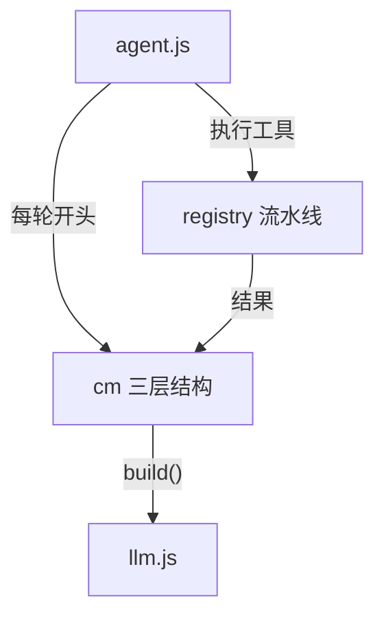
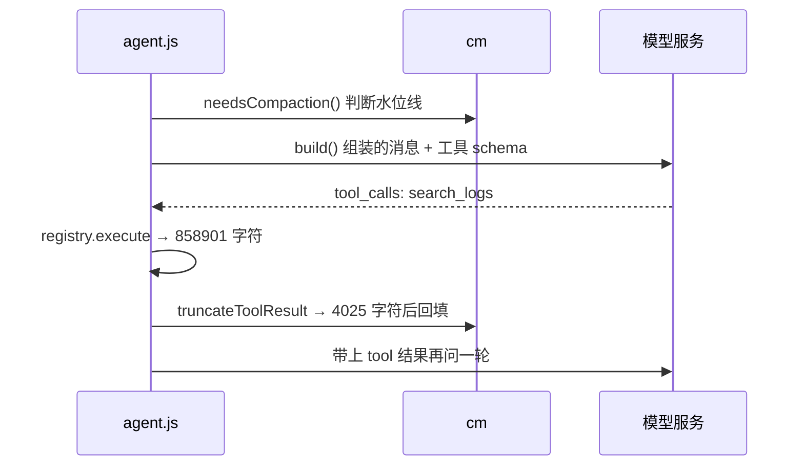

# 第 3 章 · 上下文管理：给只增不减的消息做预算（Node 版）

## 上下文是怎么爆的，这一章要解决什么

命令行里问 Agent 一个复杂点的问题，它会自己决定查几次工具、调几轮模型。代价落在 `messages` 数组上：第 2 章的主循环每轮往里 push 一条 assistant 消息和若干条 tool 结果，而这些内容下一轮要整体重发给模型——LLM 是无状态的，服务端不留对话状态，每轮请求都得带上全部历史。

增长有两个来源，一个温和一个致命。对话本身每轮至少加两条消息，十几轮下来几千 token。工具结果的尖峰则可能一条顶掉整个窗口：本课的 `search_logs` 工具返回 10000 行日志，原始结果 858901 字符（实测），不处理就直接塞进下一轮请求。这是 Agent 和普通聊天机器人的分野——聊天的增长是线性的，Agent 的增长带尖峰。

溢出的后果分两种，后者更麻烦。API 报 400 是看得见的失败，好办；更阴险的是某些实现会悄悄裁掉最早的消息"挤进"窗口，system prompt 和早期决策一起消失，模型行为漂移却没人察觉。所以这一章的原则是提前管理预算，而不是等溢出再补救。

本章在整个项目里的位置：

课程全景和章节先后关系见[入门者学习指南](../../docs/beginner-guide.md)。

第一次学习本章，先按本章 README 的“快速开始”运行离线版本，再读本页开头的问题和流程，沿调用关系打开入口文件，最后完成文末练习。逐文件说明和完整测试列表可以留作查阅，不必第一遍从头读完。

本章没有另起一套系统，它接在第 2 章的工具系统之上：工具系统负责把事做成，上下文管理负责做的过程中别把窗口撑爆。两半缺一不可——只有工具系统，一次大结果就顶爆预算；只有上下文管理而工具是假的，就看不到真实的增长尖峰。

学完本章你应该能做到：说清溢出机制与两种后果；讲透截断和压缩的区别以及生产为什么用组合；背出三层结构与水位线公式；跑通 20 个用例并说清每个在钉什么；认出 `tool` 消息与 `assistant(tool_calls)` 的配对约束（漏一个 id 就是 400）。

## 十四个文件与阅读顺序

```
lesson03-context/
├── 上下文管理（本章新增，六步演进）
│   ├── token_counter.js      57 行   v1  字符近似 token 计数
│   ├── sliding_window.js     44 行   v2  滑动窗口（故意留的失败版本 + 负向探针）
│   ├── context_manager.js    73 行   v3  分层截断：按角色取舍
│   ├── summary_compactor.js  63 行   v4  LLM 摘要压缩：按语义取舍
│   ├── context_manager_v2.js 144 行  v5  三层结构 + 水位线 + 递归压缩 + 结果截断
│   └── agent.js             129 行   v6  集成主循环（三套能力合体）
├── 工具系统（继承第 2 章，本课不改；3 个文件与第 2 章各差一处）
│   ├── registry.js / registry_full.js        注册表 + 完整执行流水线
│   └── validation.js / errors.js / permissions.js
├── 演示与入口
│   ├── tools_demo.js        102 行   5 个工具：4 个小结果 + 1 个大结果
│   ├── llm.js                51 行   fetch 版调用层，配置读 env.json
│   └── main.js               53 行   入口，预算参数都在这配
├── test.js                  202 行   7 个用例：三套能力协同
├── test-context.js          204 行   13 个用例：上下文机制自身的演进
└── package.json                      node --test test.js test-context.js
```

阅读顺序按依赖方向走：`token_counter.js` → `sliding_window.js` → `context_manager.js` → `summary_compactor.js` → `context_manager_v2.js` → `agent.js` → `tools_demo.js` → `main.js` → 两份测试。前五个文件是零件，`agent.js` 是总装。

## 一张图看懂四个角色



四步转一圈：`cm` 组装消息（`build()`）交给 `llm.js` 发出去；模型要工具就交给 `registry` 执行；结果先在 `agent.js` 里截断再回填进 `cm`；下一轮开头先问 `cm` 要不要压缩，然后回到第一步。

三个设计决定，备选方案都试过：

| 备选 | 为什么不用 |
|---|---|
| 等报 400 再处理 | 那时请求已经被拒，没有补救机会，且压缩本身要占一次 LLM 调用 |
| 按消息条数截断 | 一条 3 个字的寒暄和一条 858901 字符的日志在"条数"眼里一样重 |
| 每次压缩都重压全部历史 | 第 N 次压缩要重新读前 N-1 次的所有原文，token 开销是 O(n²) |

选了 token 预算 + 水位线提前触发这条路，代价是得自己数 token，所以第一个文件就是计数器。

## token_counter.js：预算管理先得会数钱

```js
function isCJK(ch) {
  const code = ch.codePointAt(0);
  return (
    (code >= 0x4e00 && code <= 0x9fff) || // CJK 统一表意文字（常见汉字）
    (code >= 0x3400 && code <= 0x4dbf) || // 扩展 A
    (code >= 0x3040 && code <= 0x30ff) || // 日文假名
    (code >= 0xac00 && code <= 0xd7af)    // 韩文谚文
  );
}

export function estimateTokens(text) {
  if (!text) return 0;
  let cjk = 0;
  let other = 0;
  for (const ch of text) {
    if (isCJK(ch)) cjk += 1;
    else other += 1;
  }
  return cjk + Math.ceil(other / 4);   // 中文每字 1 token，其余每 4 字符 1 token
}
```

这两个比例来自 BPE 词表的经验值：高频汉字基本一字一 token；英文常见词和词缀会被合并（"the" 是 1 个 token 而不是 3 个字符），平均一个 token 覆盖约 4 个字符。精确做法是引 tokenizer 逐 token 计数，误差能压到 0。

误差 10~20% 够用的原因是判断的性质变了：预算管理只需要回答"是否接近上限"这个二分类，不需要精确到第几个 token。水位线取可用预算的 80%（`compactRatio = 0.8`），留出来的 20% 缓冲带恰好吸收估算误差——近似值加上缓冲带，触发判断就是可靠的。生产上真需要精确计数的地方是账单对账和逼近硬上限的最后 1%，那是另一件事。

单条消息不等于纯文本：

```js
export function estimateMessageTokens(msg) {
  let tokens = 4;                                     // role 标记等固定开销
  if (typeof msg.content === "string") tokens += estimateTokens(msg.content);
  if (msg.tool_calls) tokens += estimateTokens(JSON.stringify(msg.tool_calls));
  if (msg.tool_call_id) tokens += 8;                  // tool 消息的 id + name 开销
  return tokens;
}
```

序列化给 API 时每条消息都带 role、tool_call_id 这些包装，它们也占额度（OpenAI 官方口径约每条 4 token）。`tool_calls` 的参数本身也进上下文，所以按 JSON 字符串估算。

## sliding_window.js：先写一版错的

```js
export function slidingWindow(messages, maxTokens) {
  const kept = [];
  let total = 0;
  for (let i = messages.length - 1; i >= 0; i--) {   // 从最新往旧走
    const t = estimateMessageTokens(messages[i]);
    if (total + t > maxTokens) break;                // 装不下就停，更旧的全丢
    kept.unshift(messages[i]);
    total += t;
  }
  return kept;
}
```

"从最新往前保留到预算满"这个思路的时间局部性直觉是对的，近期的对话确实比远期重要。它错在只按位置取舍，丢了不该丢的东西：system prompt 塞在一大堆消息最前面，预算一紧张它最先出局，模型随之失去角色定义和行为约束；用户第一轮说的目标、第三轮确认的决策同样是最旧的，也最先被丢，可信息价值恰恰最高。

这个文件的价值在于它是 v3 的对照组。只写正确的实现，讲不出"为什么 system 必须单独保护"；先写一版会丢 system 的，配一个负向探针把缺陷钉住，演进动机就成立了：

```js
export function isSystemPreserved(original, trimmed) {   // sliding_window.js:39
  if (original.length === 0) return true;
  const hasSystem = original[0].role === "system";
  if (!hasSystem) return true;
  return trimmed.length > 0 && trimmed[0].role === "system";
}
```

`test-context.js:56` 断言它在预算只够一条 user 消息时返回 false——这条用例断言的不是正确行为，而是"缺陷确实存在"。面试里讲这段的顺序是：实现滑动窗口 → 用负向测试证伪 → 升级成分层截断，比直接抛出最优解更有说服力。

## context_manager.js：按角色取舍

v2 按位置取舍，v3 换成按角色取舍，规则三条：system 消息永远保留；最后一条 user 消息永远保留；中间历史从新到旧填剩余预算，装不下就丢。

```js
trim(messages) {
  const systemMsgs = messages.filter((m) => m.role === "system");
  const lastUser = messages[messages.length - 1].role === "user"
    ? messages[messages.length - 1]
    : null;
  const middle = messages.filter((m) => m.role !== "system" && m !== lastUser);

  let budget = this.maxTokens;
  const kept = [];
  for (const s of systemMsgs) { kept.push(s); budget -= estimateMessageTokens(s); }   // system 先占
  const tail = [];
  if (lastUser) { tail.unshift(lastUser); budget -= estimateMessageTokens(lastUser); } // 最后 user 再占
  const filled = [];
  for (let i = middle.length - 1; i >= 0; i--) {                                       // 中间从新到旧
    const t = estimateMessageTokens(middle[i]);
    if (budget - t < 0) break;
    filled.unshift(middle[i]);
    budget -= t;
  }
  return [...kept, ...filled, ...tail];
}
```

分配顺序就是优先级：先把 system 和当前指令的坑占好，剩下的才轮到中间历史。这么写等于把"什么最不能丢"编码进了顺序，而不是删完再补。system 之所以单独保护，是因为它承载的约束是全局生效的——"你是助手""只做只读操作""输出 JSON"这些一旦丢掉，模型可能去动手改数据，而且前面几轮的工具调用已经基于这些约束执行过了。

v3 保住了骨架，但中间历史仍是整体丢弃：第 1 轮确认的决策丢了就再也找不回来。要丢得聪明，就进到压缩。

## summary_compactor.js：把旧历史压成摘要

截断按位置取舍，零成本，丢掉的就没有了；压缩按语义取舍，代价是一次 LLM 调用的 token 和延迟，换来关键信息以摘要形式留下，风险是摘要本身可能失真。

```js
const SUMMARIZE_SYSTEM = [
  "你把一段对话历史压缩成摘要，供后续对话继续使用。",
  "必须保留：",
  "  1. 用户的目标、约束、已确认的决策",
  "  2. 关键事实与数据（数字、路径、结论）",
  "  3. 未完成的事项与下一步",
  "  4. 用户的偏好与纠正",
  "必须丢弃：过程性的寒暄、重复表述、已解决且不再相关的细节。",
  "只输出摘要正文，不要任何前缀。",
].join("\n");
```

压缩质量的上限由这份"必须保留清单"决定，它写多细，摘要就保多准。第 4 条容易被忽略：用户说过的"不要再用 pytest"这类纠正，丢了就是重复犯错。

```js
export async function summarize(llm, messages) {
  const resp = await llm(
    [
      { role: "system", content: SUMMARIZE_SYSTEM },
      { role: "user", content: "请压缩以下对话历史：\n\n" + JSON.stringify(messages) },
    ],
    null,   // 不带 tools —— 摘要调用是纯文本任务
  );
  return (resp.content || "").trim();
}
```

`null` 这个参数不只是省 token。摘要和正常推理走同一个 `llm` 函数，靠 `tools` 参数区分两种调用，测试里的脚本化 LLM 也是这么认的（test.js:78）——写成一律返回 `tool_calls`，摘要就变成空字符串，摘要层根本不生成，压缩测试永远过不了。

`compact()` 把消息列表切成两段：旧的压成一条摘要消息，最近 `keepRecent` 条留原文。摘要消息带 `[对话历史摘要]` 前缀，模型看到前缀会知道这是压缩产物、可能丢了细节，引用时谨慎一些，这是防"摘要幻觉"的低成本手段。role 用 `user` 而不是 `assistant`，是为了不让模型把摘要当成"自己说过的话"。

## context_manager_v2.js：三层结构、水位线与切点修复

v3 管截断、v4 管压缩，v5 把它们组装成生产结构：

```
build() 组装出的消息 = [
  system 层    this.system，永不压缩（角色/规则/工具说明）
  summary 层   this.summary，一条 user 消息，旧历史压缩的产物
  recent 层    this.recent，近期原始消息
]
```

```js
build() {
  const parts = [...this.system];
  if (this.summary) parts.push({ role: "user", content: `[对话历史摘要]\n${this.summary}` });
  parts.push(...this.recent);
  return parts;
}
```

`cm` 是消息的唯一持有者：`agent.js` 不再自己拼数组，用户输入、模型回复、工具结果都走 `append()`，发给模型的东西一律经 `build()` 出去。这样压缩、截断、预算统计集中在一处，不会出现"agent 手里一份、管理器手里一份"的分裂状态。

水位线是提前触发的开关：

```js
this.compactThreshold = Math.floor((maxTokens - reserveForOutput) * compactRatio);  // (4096-512)*0.8 = 2867
needsCompaction() { return this.totalTokens() > this.compactThreshold; }
```

三个参数各管一件事。`reserveForOutput` 给模型输出留空间，不预留的话输入把窗口填满，模型没有余量生成回复，轻则被截成半句，重则直接 400——这是最容易被漏的一个参数。`compactRatio` 取 0.8 而不是等 100%，因为压缩要占一次 LLM 调用的时间和额度，而下一轮可能又来一条大结果，等溢出时 API 已经报错，补救机会为零；这 20% 缓冲同时吸收了 token 估算误差。`keepRecent` 保证用户当前指令留在原文层，压缩只碰久远历史。

```js
async compact(llm) {
  if (this.recent.length === 0) return;
  // 若消息虽少但预算仍超限，至少压缩一条；通常保留最近 keepRecent 条。
  let split = Math.max(1, this.recent.length - this.keepRecent);
  while (split > 0 && this.recent[split]?.role === "tool") split -= 1;   // ← 切点修复
  // 切点退到开头时，整段压缩，避免留下不完整的工具调用组。
  if (split === 0) split = this.recent.length;
  const toSummarize = this.recent.slice(0, split);
  const remaining = this.recent.slice(split);

  const newSummary = await summarize(llm, toSummarize);
  if (this.summary) {
    this.summary = await summarize(llm, [                                 // 递归压缩
      { role: "assistant", content: this.summary },
      { role: "assistant", content: newSummary },
    ]);
  } else {
    this.summary = newSummary;
  }
  this.recent = remaining;
}
```

那个 `while` 是本文件最容易考的一行。OpenAI 协议要求 `tool` 消息紧跟对应的 `assistant(tool_calls)`，纯按位置 `slice` 一旦把切点落在 tool 消息上，压缩后的 recent 就以一条孤儿 tool 消息开头，`build()` 出来前面没有 `tool_calls`，请求被 API 拒（400）。切点前移让对应的 `assistant(tool_calls)` 一起留在 recent，就绕过了。这件事的通用认知是：消息序列不是独立条目的集合，`assistant(tool_calls)` 和它的 N 条 tool 结果构成一组，任何裁剪都要以组为单位。

递归压缩解决另一个隐患：摘要本身会随压缩次数增长。再次压缩时把旧摘要和新摘要合并压成一条，summary 层永远只有一条、长度可控。对应 Qwen Code 的 micro-compaction：在上一次摘要的基础上增量合并，而不是每次重读全部原文（那是 O(n²) 的浪费）。

工具结果在进 `cm` 之前先瘦身：

```js
const MAX_TOOL_RESULT_TOKENS = 1000;

export function truncateToolResult(text, maxTokens = MAX_TOOL_RESULT_TOKENS) {
  if (estimateTokens(text) <= maxTokens) return text;
  const half = Math.floor(maxTokens / 2);
  const headChars = half * 4;      // 按 4 字符 ≈ 1 token 折算
  const tailChars = half * 4;
  const head = text.slice(0, headChars);
  const tail = text.slice(-tailChars);
  return `${head}\n...[中间 ${text.length - headChars - tailChars} 字符已截断]...\n${tail}`;
}
```

留头留尾而不是只留头，是因为结构化输出通常头部有格式与上下文、尾部有结论和最新状态，只留头部会丢掉"最后发生了什么"。中间那句省略标记本身也是信息，模型看到它知道这里缺了一截，可以决定换个工具重查。生产上进一步的做法是落盘加路径引用：完整内容写文件，上下文里只放路径和首尾摘要，需要时分段读回来。按 4 字符折算字符数是个已知的精度缺口，纯中文文本会被多留约 4 倍字符，那是"估算 vs 精确"这笔账的一部分。

`budget()` 把账本按层拆开打印：`used.system` / `used.summary` / `used.recent` / `used.total` 加上总预算和预留。排查"为什么压缩了还是超预算"全靠它——通常是 system 太大，或者某条工具结果没截住。预算管理必须可观测，否则水位线就是玄学。

## agent.js：把三套能力装进一个循环

```js
const MAX_TURNS = 10;
const LOOP_THRESHOLD = 3;   // 同工具 + 同参数重复 3 次判死循环
const ERROR_BUDGET = 4;     // retryable 错误累计 4 次终止
const NUDGE = "请直接给出最终回答，不要再调用工具。";

async run(userInput) {
  this.cm.append({ role: "user", content: userInput });
  const guards = this._newGuards();

  for (let turn = 0; turn < MAX_TURNS; turn++) {
    if (this.cm.needsCompaction()) await this.cm.compact(this.llm);   // ① 推理前压缩

    const msg = await this.llm(this.cm.build(), this.registry.getSchemas());  // ② 取组装好的消息
    this.cm.append(msg);

    if (msg.tool_calls?.length) {
      let loopDetected = false;
      for (const tc of msg.tool_calls) {                             // ③ 逐个执行
        ...
        // 判定死循环后，剩下的调用不再执行，但仍逐条回填 role="tool"
        const loopReason = loopDetected
          ? `本轮已判定死循环，跳过执行: ${name}`
          : this._checkLoop(guards, name, args);
        if (loopReason) { loopDetected = true; /* 回填 LOOP_DETECTED */ continue; }

        const result = await this.registry.execute(name, rawArgs);    // 完整流水线
        if (result.error?.retryable) { ... }                          // 错误预算
        const content = truncateToolResult(JSON.stringify(result));    // ④ 先截断
        this.cm.append({ role: "tool", tool_call_id: tc.id, content }); // 再回填
      }
      continue;
    }

    const content = (msg.content || "").trim();
    if (content) return content;                                     // ⑤ 正常出口
    this.cm.append({ role: "user", content: NUDGE });                // 空回复就催一句
  }
  return "【达到最大轮数，任务未完成】";                              // 保险丝
}
```

四处挂载点的位置是刻意的。压缩放在每轮推理之前，保证发出去的 prompt 永远在预算内；放在推理之后，本轮已经带着超限的消息发出去了。截断放在回填之前，水位线统计到的才是真正要发送的量。Loop 检测放在 `execute` 之前拦重复调用，错误预算放在 `execute` 之后按 `retryable` 累加——顺序反过来，要么白花一次工具执行，要么漏掉可重试错误的统计。

`retryable` 这个字段是两块能力的接口。工具流水线返回的结构化错误里带着它，上下文侧不需要理解工具逻辑，只按这个标记决定是否累加预算。第 2 章的 `_newGuards` 里还有一个 `errorCounts` Map，只写不读，本章删掉了（agent.js:35-39）。

**同批 tool_calls 的配对修复**。原来的写法在检测到死循环时只给触发的那一条回填 LOOP_DETECTED 就 `break`，同一批里排在后面的调用没有回复。我构造了一轮里三个 `get_weather` 调用、第二个触发死循环的场景跑了一遍：`cm.recent` 里那条 assistant 消息带 3 个 `tool_calls`，实际只跟了 2 条 tool 消息，孤儿 id `b3`——下一轮请求会被 API 拒（400）。

```js
// 判定死循环后，同一条响应里剩下的 tool_calls 不再执行，
// 但仍逐条回填 role="tool" —— 少回填一条，下一轮 assistant(tool_calls)
// 与 tool 的配对就断了，服务端直接 400（响应里有多个 tool_calls 时才会撞上）
const loopReason = loopDetected
  ? `本轮已判定死循环，跳过执行: ${name}`
  : this._checkLoop(guards, name, args);
if (loopReason) {
  loopDetected = true;
  this.cm.append({
    role: "tool",
    tool_call_id: tc.id,
    content: JSON.stringify({
      error: { code: ErrorCode.LOOP_DETECTED, message: loopReason },
    }),
  });
  continue;
}
```

用 `continue` 而不是 `break`，让整批调用都拿到回填：触发的那条收到"重复调用 3 次"，后面没执行的那条收到"本轮已判定死循环，跳过执行"。修完同一条场景跑出来是 4 条 tool 消息，id 依次 `a1`、`b1`、`b2`、`b3`，没有孤儿——这条边界现在有用例钉住（test.js:124），断言的是"每个 tool_call id 都有配对回复"。

这个 bug 在下游第 4 章已经修过，本章是把它收回上游（第 4 章的 `agent.js` 与本章现在只差头部注释和两处错误码常量，`diff` 验证过），同名用例 `Loop 检测触发时，同一响应里剩余 tool_calls 仍逐条回填` 在 `lesson04-core-tools/test.js:237` 也跑一遍。它和 `compact()` 里那个切点修复是同族问题——`assistant(tool_calls)` 和它的 N 条 tool 结果是一组，**任何让这组不完整的操作都会换来一个 400**，只不过一个发生在切分历史时，一个发生在提前终止时。切点那条用例的归属在 `lesson04-core-tools/test.js:207`（实测单跑 1/1 通过）。

顺手统一了错误码：`agent.js:93` 与 `agent.js:107` 两处原本硬编码的字符串改为引用 `errors.js` 里的 `ErrorCode` 常量。本课这份 `errors.js` 的键名还是 `ERROR_BUDGET`（值同样是 `ERROR_BUDGET_EXHAUSTED`），第 2 章后来把键名改成了与值同名的 `ERROR_BUDGET_EXHAUSTED`，这个改名没有回补到本课。

## 继承来的工具系统，以及五个演示工具

`registry.js`、`registry_full.js`、`validation.js`、`errors.js`、`permissions.js` 五个文件继承自第 2 章，本课没有改动：`registry.js` 与 `permissions.js` 逐字节相同（`diff` 验证过），另外三个各差一处——`registry_full.js:61` 只差缩进，`validation.js:40` 的未知参数文案与 `errors.js:16` 的错误码键名停在第 2 章改之前。流水线是：

```
execute(name, argsJson)
  → 注册表查找（没有 → TOOL_NOT_FOUND）
  → 解析参数 JSON（坏 JSON → INVALID_PARAMS）
  → 权限决策（read 直放 / write 与 danger 走 confirm → PERMISSION_DENIED）
  → 参数校验（缺参、类型错 → INVALID_PARAMS，带宽容转换）
  → 执行（异常全隔离 → EXECUTION_FAILED，附 retryable）
  → 返回结果或结构化错误
```

这条流水线的产出正好是上下文管理的输入：`retryable` 决定错误预算是否累加，结果长度决定要不要截断。`permissions.js:51` 有个诚实的缺口——未知工具默认按 `read` 放行，注释里留了一条待办（第 6 章再改），但第 4~13 章还是同一份文件，尚未修。

`tools_demo.js` 的五个工具刻意分成两类。`get_weather` / `list_notes` 是小结果，`read` 级直放；`write_note` / `delete_note` 演示审批流（后者是 danger，不给"始终允许"）；`search_logs` 返回 10000 行日志、858901 字符，专门用来演示截断。一次 `search_logs` 就能让 recent 层暴涨到触发水位线，这是"增长尖峰来自工具结果"的最小复现。

`main.js` 是全部旋钮所在：预算参数（main.js:29-34）、system prompt（main.js:35-37）、以及终端里的三态确认 `cliConfirm`（main.js:19-24，`y` 一次 / `a` 始终允许 / `n` 拒绝）。跑完打印 `[agent]` 结果、`[notes]` 落库、`[budget]` 账本。


一次完整往返：



## 动手练习

按[第 3 章练习](../../docs/beginner-practice.md#chapter-03)完成任务。练习页列出了起始文件、操作目标和自检标准；先用假数据完成，再按本章 README 运行完整示例。

## 下一章

第 4 章给 Agent 真实的行动力：`run_shell`、读文件、`fetch_url`、搜索这些高杠杆工具，替换本章 `tools_demo.js` 里那批假数据工具（天气是写死的表，日志是本地生成的字符串）。

触发换实现的场景很具体：本章的工具没有一处碰真实世界，所以"工具返回几 MB"只能用 `search_logs` 模拟。等你真的去读一个 200KB 的日志文件、跑一条 `cat /dev/zero`，问题就变成另一批——子进程 stdout 会被 `maxBuffer` 打爆、网络响应要限流、截断掉的内容得落盘再给模型一条"你该分页读"的提示。第 4 章把这些收在工具内部做第一道截断，本章的 `truncateToolResult` 作为第二道继续兜住上下文预算。
