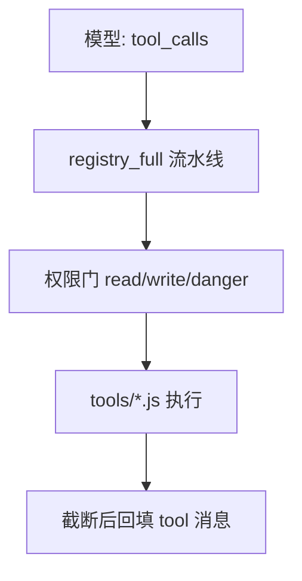
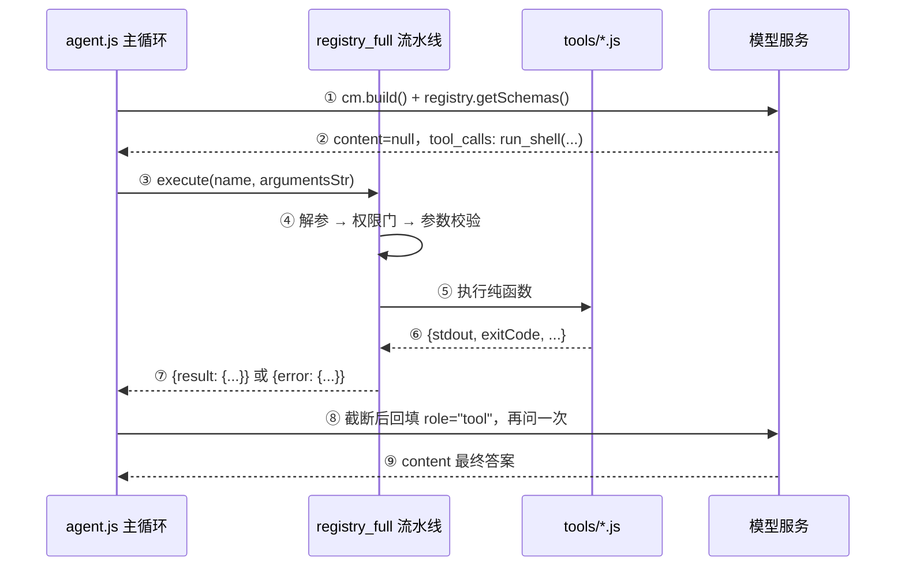

# 第 4 章 · 高杠杆核心工具（Node 版）

## 这一章做什么：给骨架装上真的手

前 3 章攒出来一副完整的骨架：主循环会自己决定调哪个工具，注册表管注册/校验/权限/错误分层，上下文管理器管 token 预算和压缩。但骨架上的工具是假的——`get_weather` 返回写死的"晴 25°C"，`search_logs` 返回随机 trace_id 拼的假日志，`write_note` 往一个进程内 Map 里塞东西。

假工具的问题不是不能跑，是不成立。真实任务里没有"查天气"这么单一的能力：让 Agent 分析代码库，它得能列目录、读文件、按关键词搜内容、跑命令统计、必要时联网查文档。你不可能为每一种操作预制一个工具，用户的第一句话就能超出你预制的那几十个。

这一章做两件事。把工具换成真的（读文件、写文件、列目录、搜内容、联网、跑命令），并且把"危险动作要人点头"这条线从注册表一路接到终端上，让人真的能点头。

这一章的定位不在"再加一层能力"，而在"验证前 3 章的架构撑不撑得住"。第 2 章把工具做成了数据（注册表 + schema + 权限等级），第 3 章把上下文做成了独立依赖。这一章换了 100% 的工具、改了运行形态，11 个框架文件一个字节没动——这就是那两章的价值兑现。

课程全景和章节先后关系见[入门者学习指南](../../docs/beginner-guide.md)。

第一次学习本章，先按本章 README 的“快速开始”运行离线版本，再读本页开头的问题和流程，沿调用关系打开入口文件，最后完成文末练习。逐文件说明和完整测试列表可以留作查阅，不必第一遍从头读完。

学完这一章你应该能做到：说清"高杠杆工具"为什么比"工具多"重要；讲透 `run_shell` 的五层锁并主动交代黑名单的边界；解释 `fetch_url` 这个 GET 工具为什么算 write 级；背出一次工具调用过的六道门；跑通 19 个用例并说清那两条"配对完整性"用例钉的是什么。

## 六个文件，两份遗产

```
lesson04-core-tools/
├── core_tools.js       128 行  ★ 翻译层：6 个工具 → schema + 权限等级
├── tools/               262 行  ← 本章新增的全部实现
│   ├── shell.js         68 行    run_shell：黑名单 + 超时 + 输出上限
│   ├── filesystem.js    66 行    read_file / write_file / list_files
│   ├── search.js        93 行    search_files：grep + glob 合一
│   └── fetch.js         35 行    fetch_url：GET + 超时 + 截断
├── agent.js            126 行  ★ 主循环（继承第 3 章，本章改了一处）
├── main.js             112 行  ★ 交互式 REPL + 终端三态确认
├── test.js             276 行    19 个用例
├── demo/                        三个含 TODO 标记的示例文件
├── registry_full.js     86 行    完整执行流水线        ← 继承第 2 章
├── registry.js          72 行    v1 注册表，对照件     ← 继承
├── permissions.js       72 行    权限三档 + 三态确认   ← 继承
├── validation.js        89 行    参数校验              ← 继承
├── errors.js            70 行    错误码 + ToolError    ← 继承
├── context_manager_v2.js 144 行  三层上下文 + 水位线   ← 继承第 3 章
├── summary_compactor.js 63 行    摘要压缩              ← 继承
├── context_manager.js   73 行    分层截断，对照件      ← 继承
├── sliding_window.js    44 行    滑动窗口，负面对照件  ← 继承
├── token_counter.js     57 行    token 估算            ← 继承
├── llm.js               51 行    env.json + fetch 直连 ← 继承
├── report.md             6 行    一次真实运行留下的产物
└── env.json                     API 配置（不进 git）
```

阅读顺序：`core_tools.js` 先看"给了模型哪 6 个工具、各自什么等级"，再顺着 `tools/` 四个实现往下读（都很短），然后 `agent.js` 看工具怎么被调用，`main.js` 看怎么装配和怎么问用户，最后 `test.js`。

标着"继承"的 11 个文件与第 3 章逐字节相同，本章一个字没动。它们的作用是当"真话的证据"：换工具不碰框架，这件事不是在文档里声称的，是 `diff` 出空结果。对照件（`registry.js` 的 v1 版、`context_manager.js` 的分层截断、`sliding_window.js` 的滑动窗口）不是死代码，是留着做演进对照的教材，第 2、3 课讲过它们。

## 一次工具调用要过的六道门



这张图是这一章的骨架，对着讲三句。

**模型只负责说，不负责做。** 它返回的是一串调用意图（工具名 + JSON 字符串参数），落到我们手里就是 `registry_full.js` 第 46 行 `execute(name, argumentsStr)` 的两个入参。执行权一直在框架这边，这是权限审批能存在的前提。

**工具实现和协议是两层。** `tools/shell.js` 里的 `runShell()` 是个纯函数，它不知道 Function Calling 的报文长什么样，也不知道自己会被标成 danger 级。`core_tools.js` 负责翻译：把纯函数包成 `{name, description, params, fn}`，同时声明安全等级。所以同一个 `runShell` 换个宿主就能换等级——CI 里自动放行，生产里强制人工确认。

**回填的内容要先瘦身。** 工具返回的东西进上下文之前会过 `truncateToolResult`（`context_manager_v2.js` 第 28 行，1000 token 上限，保留头尾）。`run_shell` 的 `cat` 能吐几十 MB，`read_file` 能读一个 200KB 的日志，这些数据直接塞进窗口，一次就吃掉整个预算。

## 逐个文件看代码

### core_tools.js：把纯函数翻译成工具

这个文件 128 行，全文就是六段 `r.register(...)`，没有一行业务逻辑。它存在的理由在第 20 行那句注释里：`confirm 由调用方注入`。

```js
export function buildCoreTools(confirm = null) {
  const r = createFullRegistry(confirm);

  r.register(
    {
      name: "read_file",
      description: "读取文本文件内容。文件过大时会提示分页读取。",
      params: {
        type: "object",
        properties: {
          file_path: { type: "string", description: "绝对或相对路径" },
        },
        required: ["file_path"],
      },
      fn: async ({ file_path }) => readFile_(file_path),   // 纯函数，只管干
    },
    "read",                                                // ← 等级在这里声明
  );
```

六个工具的能力和等级，一张表看完（行号是各自 `register` 的起点）：

| 工具 | 干什么 | 等级 | 行 | 为什么是这个等级 |
|---|---|---|---|---|
| `read_file` | 读文本文件，超 50KB 只回头部 | read | 24 | 只读本地，不改世界 |
| `list_files` | 列目录（不递归） | read | 40 | 同上，输出还有上限 |
| `search_files` | 递归搜内容，支持文件名通配 | read | 56 | 同上 |
| `write_file` | 写文件，自动建父目录 | write | 76 | 改了文件系统，可回滚 |
| `fetch_url` | GET 一个 URL | write | 93 | 语义是读，风险偏高（下一节讲） |
| `run_shell` | 跑 shell 命令 | danger | 109 | 万能，破坏不可逆 |

`description` 是给模型看的，它决定模型在多选时挑谁。"读取文本文件内容"和"根据路径读取文本文件，文件过大时提示分页"对模型的引导力不一样，这是提示工程落在工具层的那一半。`params` 用 JSON Schema 描述参数形状，`required` 里的字段缺失会被 `validation.js` 拦下并回灌错误。

翻译层隔开的两个世界：`tools/*.js` 那边是纯函数，可以脱离 Agent 单独测（`test.js` 前 12 个用例就是直接调它们（`test.js:21` 到 `test.js:106`），没起过 LLM）；这边是协议层，名字、描述、参数形状、安全等级都集中在这 128 行里。哪天要把 Function Calling 换成 MCP 的工具描述，改的是这个文件，四个实现一个都不用动。

顺手修的一处：`list_files` 的参数描述写着"默认当前目录"，但 schema 里 `dir_path` 原本是 `required`，模型照着描述省略参数会被判 `INVALID_PARAMS`。现在 `required` 为空、`fn` 里 `dir_path = "."`（第 40-54 行），描述和行为一致了。

### tools/shell.js：run_shell 与它的五层锁

一个 shell 等于无限个工具。`grep | sort | uniq -c` 这种链式统计，你没法用专用工具预先覆盖，模型现场拼命令就行。它的代价是它是这一章里唯一能造成不可逆破坏的东西，所以锁也最多。

```js
const FORBIDDEN_PATTERNS = [
  /\brm\s+-rf\b/,             // 递归删除
  /\bshutdown\b/,             // 关机
  /\breboot\b/,               // 重启
  /\bmkfs\b/,                 // 格式化磁盘
  /\bdd\s+if=/,               // 写磁盘镜像
  /:\(\)\s*\{\s*:\s*;\s*\}/,  // fork bomb（递归 fork 的函数）
];

export function runShell(command, { timeout = 10000, cwd = process.cwd() } = {}) {
  for (const pattern of FORBIDDEN_PATTERNS) {          // ① 黑名单
    if (pattern.test(command)) {
      return Promise.resolve({
        error: `命令包含危险操作，已拦截：${command}`,
        blocked: true,
      });
    }
  }
  return new Promise((resolve) => {
    exec(
      command,
      { timeout, cwd, maxBuffer: 1024 * 1024 },        // ② 超时 ③ 输出上限 1MB
      (err, stdout, stderr) => { ... },
    );
  });
}
```

五层里有两层不在这段代码里：权限分级（danger + 人工确认）声明在 `core_tools.js` 第 109-124 行，框架层截断（`truncateToolResult`）在 `agent.js` 第 111 行。剩下第五层是沙箱，文件头第 13-14 行只用注释写明了边界，没实现——`child_process` 不是隔离容器，命令能逃逸，生产要靠 Docker/gVisor 这类 OS 级隔离。这层缺席是刻意的，填它需要的不是几十行代码，是一整套部署形态。

黑名单能拦什么，得说清楚。它拦的是"模型犯蠢"：模型确实会幻觉出 `rm -rf /` 这种命令，拦下来省掉一次事故。它拦不住攻击者，`rm -fr`、`find . -delete`、`python3 -c 'import shutil...'` 都能绕过去。定位是防呆，不是防线。

`runShell` 从不抛异常，四种结果都是对象（实测返回）：

```
正常   {"result":{"stdout":"hi\n","stderr":"","exitCode":0}}
拦截   {"error":"命令包含危险操作，已拦截：rm -rf /","blocked":true}
超时   {"stdout":"","stderr":"","exitCode":null,"timeout":true,"error":"Command failed: sleep 2\n"}
```

`timeout: true` 这个标记值钱：模型看到它就知道"不是命令写错了，是跑太久"，下一步换方案而不是改参数重试。而 `exitCode !== 0` 加 stderr 是给模型的病历，它可能自己修好——脚本死了就死了，Agent 会看一眼错误再决定，这是它俩的本质区别。

### tools/filesystem.js：读、写、列目录

三个函数加一个共同点：出错返回 `{error}`，不抛。

```js
export async function readFile_(filePath) {
  try {
    const content = await readFile(filePath, "utf8");
    if (content.length > 50000) {                        // 50KB 软阈值
      return {
        filePath,
        truncated: true,
        size: content.length,
        head: content.slice(0, 2000),
        hint: "文件过大，请使用 run_shell 的 head/sed 分页读取",
      };
    }
    return { filePath, content };
  } catch (e) {
    return { filePath, error: e.message };
  }
}
```

`hint` 不是错误，是给模型的行动建议。它下一轮会自己改调 `run_shell("head -100 big.log")` 分段读——工具顺手告诉模型"你该怎么做"，比硬截断后让它猜要好。

`writeFile_` 里 `mkdir(dirname(filePath), { recursive: true })` 让 `a/b/c/d.txt` 这种路径不用预先建目录；返回 `bytes` 是给模型的回执，它据此判断写成功没有。

`listFiles` 故意不递归。递归遍历一个仓库会吐几千行，瞬间打爆上下文；列一层、看清了再往下走，和人在终端里 `ls` → `cd` → `ls` 的探索方式一样。这个函数的参数现在是非必填的（默认 `.`），原因在 `core_tools.js` 那节说过。

### tools/search.js：grep 和 glob 合成一个工具

"在 js 文件里搜 TODO"是探索代码库最常出现的动作。拆成两个工具（一个按文件名找、一个搜内容）意味着模型要先 glob 再 grep，多一轮推理、多一份 schema；合成一个 `search_files(pattern, {dir, fileGlob})` 一步到位。

```js
export async function searchFiles(pattern, { dir = ".", fileGlob = "*", limit = 50, regex = false } = {}) {
  const globRe = new RegExp("^" + globToRe(fileGlob) + "$");

  // 默认按普通文本查找；只有 regex: true 才把 pattern 当正则
  const contentRe = regex ? new RegExp(pattern) : new RegExp(escapeRe(pattern));

  async function walk(dirPath) {
    ...
      if (matches.length >= limit) return;               // 条数上限
      ...
        if (name === "node_modules" || name === ".git") continue;   // 跳过噪音
```

三处工程细节都在这几十行里。`limit` 默认 50，否则搜个单字母会把几万行灌进上下文；`node_modules` 和 `.git` 直接跳过，它们通常是文件数最多、价值最低的两棵树；默认搜索会把 `pattern` 当普通文本，所以 `foo(bar)` 不会被括号误解。需要正则时再显式传 `regex: true`，例如搜索 `function\\s+\\w+`。非法正则会明确报错，避免静默改成另一种搜索含义。

这个 glob 转换函数是这一章唯一一个真被写出 bug 的地方，值得展开：

```js
function escapeRe(s) {
  return s.replace(/[.*+?^${}()|[\]\\]/g, "\\$&");
}

function globToRe(glob) {
  return glob
    .split("*")
    .map((part) => part.split("?").map(escapeRe).join("."))
    .join(".*");
}
```

原先的写法是先把每段转义、再对整串做 `.replace(/\?/g, ".")`。转义已经把 `?` 变成 `\?`，再替换就得到 `\.`——`fileGlob: "app.j?"` 变成"匹配 app.j."，永远命不中 `app.js`。实测 `searchFiles("init", {dir:"demo", fileGlob:"app.j?"})` 返回 `{"count":0,...}`。修法是先切分再逐块转义：按 `*` 切段、段内按 `?` 切开、每块转义后用 `.` 连起来。现在这条命令命中 `demo/app.js`（`test.js:98` 的用例钉住它）。

文件名 glob 的边界用例可以从 `test.js` 查到；下面的示例展示它怎样影响搜索结果。

### tools/fetch.js：联网取数，以及它为什么是 write 级

```js
export async function fetchUrl(url, { timeout = 15000 } = {}) {
  try {
    const resp = await fetch(url, {
      signal: AbortSignal.timeout(timeout),
      headers: { "User-Agent": "lesson04-agent/1.0" },
    });
    // 逐块读取，达到 2 MB 就停止，避免先把整份响应读进内存
    const reader = resp.body.getReader();
    let text = "";
    let byteCount = 0;
    let truncatedByBytes = false;
    const decoder = new TextDecoder();
    while (true) {
      const { done, value } = await reader.read();
      if (done) break;
      const remaining = 2_000_000 - byteCount;
      const chunk = value.subarray(0, remaining);
      text += decoder.decode(chunk, { stream: true });
      byteCount += chunk.byteLength;
      if (chunk.byteLength < value.byteLength) {
        truncatedByBytes = true;
        await reader.cancel();
        break;
      }
    }
    text += decoder.decode();
    const truncated = truncatedByBytes || text.length > 10_000;
    return {
      url,
      status: resp.status,
      contentType: resp.headers.get("content-type") || "",
      truncated,
      body: text.slice(0, 10_000),
      hint: truncated ? "响应内容已截断，仅返回前 10000 个字符" : undefined,
    };
  } catch (e) {
    return { url, error: e.message };
  }
}
```

实测两次真实请求：`https://example.com` 返回 `{"status":200,"contentType":"text/html","truncated":false,...}`，坏域名返回 `{"url":"https://no-such-host-xyz.invalid/","error":"fetch failed"}`。`AbortSignal.timeout` 是零依赖做超时的干净写法，不设它的话，一个不响应的服务能把整轮对话挂死。

这个工具在 `core_tools.js` 第 93-107 行注册成 write 级，是本课最容易被追问的一个决定。GET 语义上是"读"，凭什么要用户确认？因为权限分级看的是风险，不是语义。GET 请求也可能触发后端的业务逻辑（计数器、爬虫告警），可能消耗第三方付费配额，更要紧的是 SSRF——提示注入可以诱导 Agent 去请求 `http://169.254.169.254/latest/meta-data/`（云厂商元数据端点，能换到临时凭证）或者内网服务地址。一个"读网页"的工具，能读到内网里本不该被 Agent 看见的东西。

读取器会在读到 2 MB 时停止，并且最终只把前 10000 个字符交给 Agent。前一个限制控制读取量，后一个限制控制进入上下文的文本量；`agent.js` 还会再按 token 预算截断工具结果。这样不会为了裁剪输出而先把任意大的响应完整读进内存。代码没有限制目标主机，因此真实部署仍需加域名/IP 规则，防止请求内网地址或云元数据服务。

### agent.js：这一章只动了一处，非动不可

主循环整体是第 3 章那份，本章改的是 Loop 检测分支，改的原因是一类只在特定形状下出现的线上 400。

```js
let loopDetected = false;
for (const tc of toolCalls) {
  ...
  const loopReason = loopDetected
    ? `本轮已判定死循环，跳过执行: ${name}`
    : this._checkLoop(guards, name, args);
  if (loopReason) {
    loopDetected = true;
    this.cm.append({
      role: "tool",
      tool_call_id: tc.id,
      content: JSON.stringify({ error: { code: "LOOP_DETECTED", message: loopReason } }),
    });
    continue;                       // 原来是 break
  }
```

原来的写法是判定死循环后 `break`，跳出这一轮剩下的 `tool_calls`。麻烦在于循环退出只影响我们自己：上面第 65 行已经把那条 `assistant` 消息（带 N 个 `tool_calls`）原样 append 进上下文了，服务端校验的是配对关系——`tool_calls` 里有几个 id，后面就必须有同样多的 `role: "tool"` 消息回复它们。N 大于 1 的时候，被判死循环的那条之后剩下的调用再也拿不到回填，下一轮请求带着孤儿 `tool_calls` 发出去，直接 400（`Messages with role 'tool' must be a response to a preceding message with 'tool_calls'` 是同一类报错的兄弟）。

改成 `continue` 之后，剩下的调用不再执行、但仍然逐条回填一条 `LOOP_DETECTED` 错误，配对数量对得上，模型也能从错误里读出"这轮已经被判定为重复调用了"。`test.js` 第 237 行的用例构造了"一轮两条相同调用、第二条触发阈值"的形状，逐个检查每条 `tool_call` 都有配对的 `tool` 消息。

同一个坑还有第二种形状，在第 3 章：压缩的切点如果恰好落在 `tool` 消息上，被压进摘要的 `assistant(tool_calls)` 和留在 `recent` 的 `tool` 结果就会分家。那边靠切点前移（`context_manager_v2.js` 第 106-108 行）解决，本章 `test.js` 第 207 行把它作为跨章回归继续跑着。写 Agent 框架，配对完整性要当成不变式守，它摔出来的错永远是 400。

循环还有两个出口和两个防失控设施，都是继承来的：`MAX_TURNS = 10` 兜住不收敛的模型，retryable 错误累计到 4 次就把错误改写成 `ERROR_BUDGET_EXHAUSTED` 让模型换方案（第 100-108 行），此外模型只回空内容时会塞一句 `NUDGE`（第 18 行）催它收尾。

### main.js：从跑完一个任务，到一次会话

第 3 章的入口是"跑一个写死的任务、打印结果、退出"。工具换真之后这么干不合适了——分析代码库是来回好几轮的事，而且危险命令得当场问人。这一章把它改成 REPL。

```js
async function repl() {
  const registry = buildCoreTools(cliConfirm);   // 三态确认接进 readline
  let cm = newContext();
  const agent = new Agent({ registry, cm, llm: call_llm, verbose: true });

  while (true) {
    const raw = await rl.question("\n你> ");
    ...
    if (line === "/reset") {
      cm = newContext();
      agent.cm = cm;        // 换掉引用就"失忆重开"，Agent 一行不用改
      continue;
    }
    const answer = await agent.run(line);
    console.log(`\nagent> ${answer}`);
  }
}
```

跨轮活下来的只有两个东西：同一个 `cm`（每轮 `agent.run` 往它里面 append，下一轮 `build()` 出来就带上全部历史，多轮记忆没有别的机制）和同一个 `registry`（工具注册一次全程复用）。`/reset` 之所以能一键清空，是因为 Agent 对 `cm` 是引用依赖，换引用即重置——这是第 2 章选择依赖注入而不是模块级单例的兑现。`/budget` 打印 `cm.budget()` 的账本，`/help`、`/exit` 是纯 UI。

`cliConfirm` 把第 2 章的三态确认接到终端：

```js
async function cliConfirm(name, args) {
  console.log(`\n  ⚠️  需要确认: ${name}(${JSON.stringify(args)})`);
  const choice = (await rl.question("  批准? (y=一次 / a=始终允许 / n=拒绝): ")).trim().toLowerCase();
  if (choice === "a") return "always";
  return choice === "y";
}
```

三个返回值对应三种语义：`true` 放行这一次，`"always"` 放行并记进会话内的 allowlist（后面同类工具不再问），`false`（含其他任何输入）拒绝并把 `PERMISSION_DENIED` 回灌给模型。danger 级在 `permissions.js` 第 61-63 行还会额外打印一行"危险操作确认"，所以危险命令会看到两行提示——一行来自权限层，一行来自这个确认函数，读的时候不必困惑。

框架和 UI 的分界线在这里：`Agent.run()` 是"一次交互的完整单元"，`repl()` 里的 while 循环是会话管理。交互式支持是加在这层上的，`agent.js` 没为它改过一行。


一次完整往返：



## 动手练习

按[第 4 章练习](../../docs/beginner-practice.md#chapter-04)完成任务。练习页列出了起始文件、操作目标和自检标准；先用假数据完成，再按本章 README 运行完整示例。

## 下一章

第 5 章做 RAG 记忆：把知识放到上下文之外，按需检索注入。手是有了，但 Agent 的"知识"还锁在窗口里——关掉终端再打开，上一次会话里说过的偏好、约定、踩过的坑全没了，而"把历史都塞进窗口"这条路第 3 章已经证明它走不远。

触发换实现的具体场景很直白：用户第二次说"还是按上次的规矩来"，Agent 一脸茫然。当前实现里 `cm` 是进程内的，`/reset` 之后连本轮都归零，跨会话更是彻底没有；`read_file` 能读文件，但读什么得靠模型当场猜，没有一处存着"这个项目约定用连字符命名测试文件"这类结论。第 5 章的提取与召回就是替掉这种"每轮从零猜"的做法。
