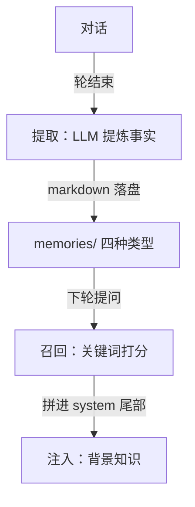
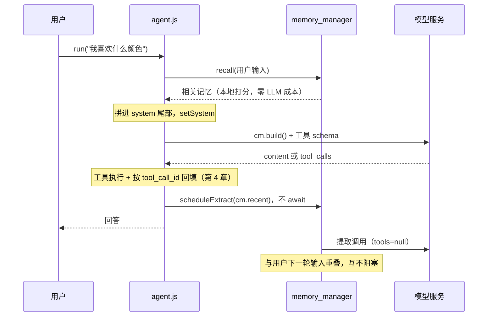

# 第 5 章 · 跨会话记忆：把知识放到上下文窗口外面（Node 版）

## 这一章做什么

前四章的 Agent 是条金鱼。第 3 章花了整整一章解决"这次会话太长怎么办"——切分、压缩、三层上下文，但那些历史全在内存里，进程一停就没了。本章要解决的是另一件事：**你说过一次"我写代码用 4 空格缩进"，关掉终端重开，Agent 还记得。**

这两件事的区别值得先分清楚，因为面试第一问就在这里。压缩是"塞"：把旧历史压缩后继续放在上下文窗口里，服务于本次会话的预算。记忆是"取"：把值得长期保留的事实写成磁盘上的文件，窗口里只放和当前问题相关的那几条。塞得再好也只管这一局，取才能跨局。

还有个更实际的动机。你在会话 1 里告诉 Agent"这个仓库用 pnpm 不是 npm"，会话 2 它又默认敲 `npm install`。把全部历史回放给它是最笨的解法：token 费用随轮数线性涨，注意力还会被无关历史稀释。真正该留下的是一句"用户要求用 pnpm"，而不是当初讨论包管理器的那 20 轮对话。**记忆的价值在提炼，不在存储。**

本章在整个项目里的位置：

课程全景和章节先后关系见[入门者学习指南](../../docs/beginner-guide.md)。

第一次学习本章，先按本章 README 的“快速开始”运行离线版本，再读本页开头的问题和流程，沿调用关系打开入口文件，最后完成文末练习。逐文件说明和完整测试列表可以留作查阅，不必第一遍从头读完。

学完本章你应该能做到：说清记忆和压缩的分工；画出提取→存储→召回→注入这条流水线并指出每段落在哪个文件；解释异步提取怎样按会话记录进度；指出关键词召回的局限在哪。

## 文件长什么样

```
lesson05-memory/
├── memory_store.js      168 行   存哪：目录结构、frontmatter 序列化/解析、MEMORY.md 索引
├── memory_entries.js     83 行   写入语义：CRUD、按 name 去重、索引重建
├── extract.js            84 行   记什么：提取规则 prompt + LLM 输出的容错解析
├── recall.js            111 行   怎么取：中英分词、加权打分、可选 LLM 精排
├── memory_manager.js    123 行   调度：统一入口 + 异步提取的并发控制
├── agent.js             164 行   ★ 装配：第 4 章主循环 + 开头注入 + 结束提取
├── main.js              105 行   入口：REPL 与 /memories /forget /reset /budget
├── test.js              422 行   20 个用例（mock LLM，无需 key）
├── memories/                    演示记忆库：一个用户的颜色偏好来回改的 4 条记录
└── 以下文件从第 4 章原样复制（12 个逐字节相同；`core_tools.js`、`tools/search.js` 有差异，见 README）：
    core_tools.js / registry.js / registry_full.js / validation.js / errors.js /
    permissions.js / tools/{shell,search,filesystem,fetch}.js /
    context_manager_v2.js / summary_compactor.js / token_counter.js / llm.js
```

阅读顺序按数据流走：`memory_store.js`（记忆长什么样）→ `memory_entries.js`（怎么写才不重复）→ `extract.js`（谁决定记什么）→ `recall.js`（怎么找回来）→ `memory_manager.js`（怎么不阻塞对话）→ `agent.js`（怎么接进主循环）。前四个是零件，manager 是调度中枢，agent 是装配件。

## 记忆是怎么转起来的



四个环节各自独立，可以单独替换。存储换成向量库，只动 `memory_store.js`；召回换成 embedding，只动 `recall.js`；提取的 prompt 想调，只动 `extract.js`。这个切法是本章最值钱的东西——它让"生产环境要换向量检索"从一句口号变成一次局部替换。

## memory_store.js：记忆就是一堆 markdown 文件

存储层只干三件事：把一条记忆写成文件、把文件读回对象、维护一份人类可读的索引。它不管"该不该存"，那是提取层的判断。

目录即分类，四个目录对应四类记忆（`memory_store.js:35` 的 `MEMORY_TYPES`）：`user` 用户偏好、`feedback` 用户的纠正与规则、`project` 项目知识、`reference` 外部资源引用。每条记忆是一个 `.md` 文件，路径由类型和标题算出来：

```js
/** 标题 → 文件名 slug（去特殊字符，限长） */
export function toSlug(title) {
  return title
    .replace(/[^\w\u4e00-\u9fff-]+/g, "-")   // 中文和连字符保留，其余（含空格）变 -
    .replace(/^-+|-+$/g, "")                 // 去掉首尾连字符
    .slice(0, 50);                           // 限长，防文件名过长
}
```

用标题算文件名而不是用 UUID，是为了让"按 name 去重"有物理基础——同一个标题必然落到同一个文件上，覆盖就是覆盖，不会出现两条同义记忆。代价是标题带特殊字符时要清洗，`toSlug` 把空格和标点都折成连字符。

文件格式是 frontmatter（用 `---` 包起来的键值对头，静态站点生成器常用，这里用来存元数据）加正文：

```markdown
---
name: 缩进偏好
description: 用户喜欢 4 空格缩进
type: user
---
写代码用 4 空格缩进
Why: 可读性好
How to apply: 生成代码时
```

`description` 单独占一行是有用途的，不是冗余：召回时它承担相关性判断，命中它权重最高。`body` 是完整事实，`Why:` 和 `How to apply:` 是给模型判断边界用的可选行。

解析用一条正则拆开两段：

```js
export function parseMemory(content) {
  // 分隔符后的换行符允许 1 个或多个：serializeMemory 写的是 "---\n\n"，但人手工写
  // 记忆文件时常常不空行（"---\n正文"），严格匹配 \n\n 会把这类文件静默判为损坏。
  const m = content.match(/^---\n([\s\S]*?)\n---\n+([\s\S]*)$/);
  if (!m) return null;
```

这里踩过一个坑，值得单独说。`serializeMemory` 写出来的分隔符后面跟一个空行，所以最初的正则写的是 `\n\n`。后来发现课程自带的演示记忆库里那条 `用户喜欢的颜色是白色.md` 一直读不出来——只有 3 条记忆被加载，实际文件有 4 个。根因就是那个文件是人手工写的，`---` 后面紧跟正文、没有空行，正则匹配失败返回 `null`，而调用方读到 `null` 只是跳过，没有任何提示。**静默丢数据比报错难查得多**：没有异常、没有日志，只是记忆库少了一条。改成 `\n+` 之后 4 条都读得出来，`test.js:72` 那个用例把这个场景钉死了。

再记一条相关的教训：`parseMemory` 遇到坏文件返回 `null` 而不是抛异常，这个方向是对的（用户会手改这些文件，单条坏了不能炸整个库），但"返回 null"必须配一个测试去覆盖"什么样的文件会走到 null"——否则容错代码会把真正的解析 bug 一起吃掉。

索引文件 `MEMORY.md` 是可选的便利设施（`memory_store.js:158` 的 `updateIndex`）。它每次写入后整体重建，不做增量更新：条目少的时候全量重写更简单也更不容易错，而记忆库撑不到让 O(n) 重建变成瓶颈的规模。

## memory_entries.js：写入侧的第一道闸是去重

`memory_store.js` 管文件读写，`memory_entries.js` 往上加业务语义。保存一条记忆的完整逻辑不长，但每行都在防一件事：

```js
export async function saveMemory(entry) {
  const normalized = normalizeEntry(entry);              // 规范化 + 类型兜底
  const all = await readAllMemories();
  const existing = all.find((m) => m.name === normalized.name);
  if (existing) {
    // 内容一致 → 无变化，跳过（避免重复写 + 避免索引抖动）
    if (existing.body === normalized.body && ...) {
      return { entry: existing, created: false, deduped: true };
    }
  }
  await writeMemory(normalized);
  // 类型变了：旧类型目录下的同名文件必须删掉……
  if (existing && existing.type !== normalized.type) {
    await deleteMemoryFile(existing.type, existing.name);
  }
  await updateIndex(await readAllMemories());
  return { entry: normalized, created: !existing, deduped: false };
}
```

按 name 去重放在写入侧而不是读取侧，因为读取侧没法判断哪条该赢。提取是 LLM 做的，"用户喜欢 4 空格"这种事实会在多次对话里被反复提炼，不去重的话记忆库会被同一件事刷屏，召回时注入一堆重复内容，既烧 token 又干扰模型。

类型变了要删旧目录文件这一条也是补上的（`memory_entries.js:56`）。旧实现只在名称和内容上判断，一条记忆从 `user` 改成 `project` 后，新文件写进 `project/`，旧文件还躺在 `user/`，`readAllMemories` 一读就返回两条同名的——召回时同一件事注入两份。回归用例在 `test.js:113`。

`normalizeEntry`（`memory_entries.js:22`）做两件兜底：`type` 不在四类里就归 `user`，`name` 为空直接抛错。名称必须有的理由是它同时是去重键和 `/forget` 的入参。

## extract.js：记什么由 prompt 决定，不由代码决定

提取这一步是整个系统里最难保证质量的环节，因为它没有确定性答案。"用户说‘今天好热’"该不该记？"用户说‘这个仓库用 pnpm’"呢？判断标准是"未来对话还需要吗"，这个判断只能交给模型。代码能做的只有两件事：把判断标准写清楚，以及不信任模型的输出格式。

判断标准写在系统提示词里（`extract.js:15` 的 `EXTRACT_SYSTEM_PROMPT`），三个部分缺一不可：

```js
"必须提取：",
"  1. 用户的偏好、习惯、工作方式（type: user）",
"  2. 用户给出的纠正、确认的规则（type: feedback）",
"  3. 项目相关的背景、决策、约定（type: project）",
"  4. 外部资源的引用（type: reference）",
"",
"不要提取：临时性问题、寒暄、过程性细节、对话中已解决且不再相关的内容。",
"如果没有值得保存的，返回空数组 []。",
```

白名单（四类该记的）、黑名单（不该记的）、空输出兜底，缺哪个都会出事。少了黑名单，记忆库里会塞满"今天天气不错"；少了"没有就返回 []"这一句，模型会为了完成任务硬编一条记忆出来。这三件事只能在 prompt 里做，代码没法在事后判断"这条记忆值不值得存"。

模型把 JSON 包进 ```json 代码块是常态，前后还会加"好的，以下是提取结果："之类的废话，所以解析链有三层（`extract.js:33` 的 `parseExtractOutput`）：先剥代码块，再 `JSON.parse`，失败就正则抠第一个 `[...]` 片段，全都失败返回空数组。原则是**提取失败等价于本轮没提取到记忆**，绝不能让解析异常打穿主对话。

调用 LLM 那一行有个细节（`extract.js:75`）：

```js
const resp = await llm(
  [
    { role: "system", content: EXTRACT_SYSTEM_PROMPT },
    { role: "user", content: userPrompt },
  ],
  null, // 提取是纯文本任务，不带工具
);
```

第二个参数是工具 schema，这里明确传 `null`。提取是纯文本任务，给它工具定义既浪费 token，又可能让模型在提取途中试图调工具。这个 `null` 后来成了测试里区分两种调用的标志：正常推理一定带 schema 数组，提取调用一定带 `null`，mock 的 LLM 靠它判断自己现在扮演哪个角色（`test.js:266` 起的用例都这么写）。

## recall.js：怎么把相关的记忆找回来

召回要做的是"从 N 条记忆里挑出和当前问题相关的那几条"。生产环境的答案是 embedding 向量检索，本章用零依赖的关键词评分，因为关键词版本能跑、能测、能讲清楚，而且接口只占一个函数的位置。

分词是最先撞上的问题：中文没有空格，`String.split(" ")` 切不出词。教学版用 2-gram（把任意相邻两字当作一个词）近似，`tokenize`（`recall.js:17`）里英文按 `[a-z0-9]{2,}` 取词、中文按相邻两字切：

```js
// 中文：2-gram（"缩进偏好" → 缩进 / 进偏 / 偏好）
const cjk = str.match(/[\u4e00-\u9fff]+/g) || [];
for (const chunk of cjk) {
  for (let i = 0; i < chunk.length - 1; i++) {
    tokens.add(chunk.slice(i, i + 2));
  }
}
```

英文词限定 ≥2 字符是刻意的过滤，防的是"a""i"这类噪音词，顺带把单个数字也过滤掉了——所以 `tokenize("我用 4 空格缩进")` 的结果里没有 `"4"`，这个反直觉的行为被 `test.js:157` 钉在测试里。

打分按字段加权（`recall.js:43`）：

```js
if (desc.includes(token)) score += 3;
if (name.includes(token)) score += 2;
if (body.includes(token)) score += 1;
```

权重倒过来记会出问题。`description` 是提取时专门为"未来判断相关性"写的一行摘要，信息密度最高；`body` 里可能出现偶然提到的词，权重最低。这跟 Elasticsearch 的字段加权（field boost）是同一个思路。打分之后砍两刀：`score` 为 0 的直接过滤，再取 Top 5（`recall.js:14` 的 `RECALL_LIMIT`）。宁缺毋滥——注入一条不相关的记忆比不注入更糟，模型会把它当成事实。

第二阶段的 LLM 精排（`recall.js:76`）是可选的，只在候选多于一条时才值得花这次调用。它的位置也说明了两阶段检索的通用结构：便宜的方法把候选集缩小，贵的方法在小的候选集上做判断。解析失败时保守返回全部候选，宁可多注入也不全丢。

关键词版本的局限必须说清楚：它只有字面交集，撞不上"说的是一回事、用词完全不同"的记忆。拿刚才的 query 对两条语义相同的记忆实测一下：

```text
query tokens: 我用 / 用什 / 什么 / 么编 / 编辑 / 辑器
记忆含"编辑器"三字 → 召回 1 条
记忆不含"编辑"二字（Vim 打开文件）→ 召回 0 条
后者 tokens: vim / 文件 / 件默 / 默认 / 认用 / 打开 / 不用 / 用别 / 别的
```

两条记忆都在说"用户用 Vim"，区别只在措辞。一条恰好复用了"编辑器"这三个字，2-gram 切出"编辑""辑器"正好命中；另一条写的是"文件默认用 Vim 打开"，和 query 没有一个共同 token，直接出局。用户不会按记忆库的措辞提问，这就是生产环境要换 embedding 向量检索的原因——向量比的是语义距离，不是字符串有没有共享片段。分层的好处在这里兑现：换检索方式只需重写 `recallByKeywords` 这一个函数（`recall.js:57`），存储层、提取层、注入层都不动。

演示库里那 4 条颜色偏好撞的是同一堵墙，只不过方向相反：它们和"我用什么编辑器"没有共同 token，所以召回 0 条。

## memory_manager.js：提取不能挡住对话

提取需要再调用一次 LLM，所以本章让它在后台运行，不阻塞用户等待回复。`scheduleExtract` 先复制消息数组，再判断距离上次提取是否至少多了两条消息；太少就跳过，以免每轮都多花一次模型调用。

进度按 `memoryScope`（会话标识）分开保存。每个会话有自己的游标和“上次处理到的消息”锚点；如果用户重置上下文、切换会话或恢复后的历史发生变化，锚点对不上，提取器会从当前消息重新检查。这样不会把 A 会话的游标拿去切 B 会话的数组。后台任务也按 scope 分开排队，旧会话的积压消息不会混进新会话。

同一会话同时只跑一个提取任务。提取期间有新消息时只保留最新快照；当前任务结束后再从该会话的游标继续。失败会写日志，不会让主对话失败。完整实现见 `memory_manager.js` 的 `scheduleExtract()` 和 `_runExtract()`。

## agent.js：主循环只多了两处

第 4 章的 `agent.js` 已经是一个完整的主循环：压缩检查、带工具 schema 推理、Loop 检测、权限/校验/执行流水线、retryable 错误预算、工具结果截断回填。本章对它的改动只有两处，都在 `run()` 的首尾：

```js
async run(userInput, { memoryScope = "default" } = {}) {
  // ① 记忆注入：每轮动态 recall，结果拼进 system prompt
  const recalled = await this.memory.recall(userInput);
  const recallText = this.memory.formatRecall(recalled);
  this.cm.setSystem([
    { role: "system", content: this.systemPrompt + recallText },
  ]);
  // ... 中间是推理循环，与第 4 章逐行相同 ...
  // ③ 异步提取：fire-and-forget（游标/频率/串行队列在 manager 内）
  this.memory.scheduleExtract(this.llm, this.cm.recent, memoryScope);
  const lastAssistant = [...this.cm.recent].reverse().find((m) => m.role === "assistant");
  return (lastAssistant?.content || "").trim() || "【未得到回答】";
}
```

注入位置选在 system prompt 尾部而不是对话开头，有两个理由。system 层不参与对话逻辑流，每轮由 `cm.setSystem` 重建，模型把它当背景知识；放进 user 消息序列则会污染对话，让模型以为这是用户刚说的话。注入文本还带了一句"（来自历史会话，仅相关时使用）"（`memory_manager.js:61` 的 `formatRecall`，那句标注在 `64`），提醒模型记忆可能已经过时，别当成绝对事实。召回用本轮的用户输入做 query 而不是整段历史，因为用户这轮问什么就该召回什么，用整段历史会被无关词稀释。

提取放在 `run()` 末尾也有理由：本轮对话产生的新信息要到本轮结束才完整，提前提取会漏掉 assistant 回复里的新事实。这一行是 `void` 语义的 fire-and-forget，不 await——用户看到回答的那一刻，提取还在后台跑。

构造函数改成依赖注入（`agent.js:32`），`memory` 和 `systemPrompt` 从外面传进来。这是本章唯一的结构性改动，好处是 `Agent` 完全不知道记忆存在哪里、怎么召回——它只调 `recall` 和 `scheduleExtract` 两个方法。测试里换成 mock 的 memory 或直接注入 `MemoryManager` 都很自然。

顺带两处小改动：`MAX_TURNS` 从第 4 章的 10 提到 30（记忆场景的会话更长），撞上限的处理也从"直接返回 `【达到最大轮数，任务未完成】`"改成跳出循环取最后一条 assistant 文本（`agent.js:158-162`），有内容就给用户，没有才回 `【未得到回答】`。`_newContext()` 和 `reset()` 也收进了 `Agent`（`agent.js:41`），`main.js` 的 `/reset` 因此只需调 `agent.reset()`。

## main.js：REPL 与它的元命令

入口的变化就是换了个装配方式，多接一个 `MemoryManager`，并加两条管理记忆的元命令：

```js
const registry = buildCoreTools(cliConfirm);
const memory = new MemoryManager();
const agent = new Agent({ llm: call_llm, memory, registry, systemPrompt: SYSTEM_PROMPT, verbose: true });
```

元命令里 `/reset` 的语义最值得记：它调 `agent.reset()`（`main.js:84`），只换掉上下文管理器，`memory` 对象不动。"这次会话说了什么"和"跨会话的事实"生命周期不同，前者随时可以丢，后者不该被一次 reset 清空。`/forget <名称>`（`main.js:74`）才是真的删记忆，走 `memory.forget(name)`，删完记忆库文件和索引一起更新。

`cliConfirm`（`main.js:30`）是第 2 章那套三态确认（y 一次 / a 始终允许 / n 拒绝）接到 readline，`run_shell` 这种 danger 级工具触发时会弹出来。本章的 `main.js` 把它一路传给了 `buildCoreTools`。


一次完整往返：



## 动手练习

按[第 5 章练习](../../docs/beginner-practice.md#chapter-05)完成任务。练习页列出了起始文件、操作目标和自检标准；先用假数据完成，再按本章 README 运行完整示例。

## 下一章

第 6 章做多 Agent 协作：把一个大任务拆给子 Agent，父 Agent 只做规划与汇总。要处理的具体问题是上下文隔离（子 Agent 拿到什么、不拿到什么）、防递归（子 Agent 不能再无限制地生孙子）、以及并行委派时结果怎么按原顺序汇聚。本章的记忆系统在这一章会有个新用法——子 Agent 的记忆只在本分支内有效，不能污染父会话。

换掉本章实现的触发点很具体：记忆库超过几百条、或者用户开始抱怨"它明明知道却想不起来"。这时候关键词打分的召回率会明显掉下来（本章已经量过：措辞不同就 0 条），需要把 `recallByKeywords` 换成 embedding 向量检索，把 `memory_store.js` 换成向量库；如果再进一步遇到"两条记忆互相矛盾、模型自己猜错的概率变高"，就该给记忆条目加时间戳与失效标记，那是第 13 章生产治理的内容。
