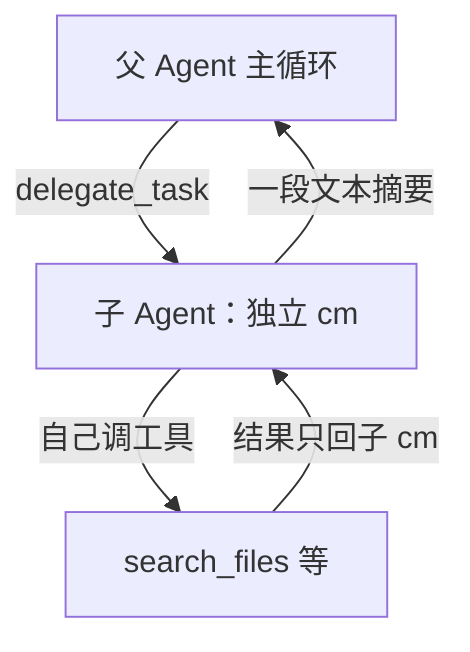
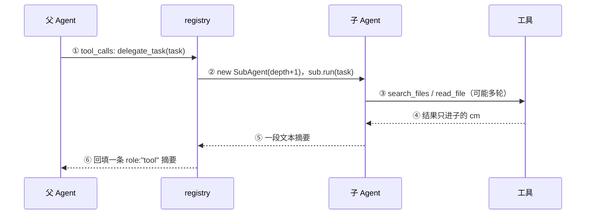

# 第 6 章 · 多 Agent 委派（Node 版）

## 这一章要解决的事

上一章的 Agent 已经能记住你上次说过的话，但它有个上限：一次对话里所有脏活累活都挤在同一个上下文窗口。让它"分析 demo 目录的代码质量"，它会连着调十几次 `search_files`、`read_file`，几十条工具结果灌进 `messages`，然后在这个背景下回答你真正想问的东西——注意力被前面那些过程数据稀释了。

这一章加的能力叫委派。父 Agent 把一件独立的子任务交给一个新造出来的子 Agent，子 Agent 有自己的上下文管理器（下称 cm，负责攒发给模型的消息列表、盯 token 预算），跑完只回传一段文本摘要。父的 `messages` 里因此只多一条 `role:"tool"` 的消息，就是那段摘要；子 Agent 中间翻了多少文件、调了几次工具，父看不到。

```text
你> 分析 demo 目录的代码质量
父 Agent : 得先摸清 TODO/FIXME 的分布 → 调 delegate_task("搜索 demo 目录的 TODO")
   子 Agent : search_files → 读文件 → 再搜 → 汇成一段话（全在它自己的 cm 里）
父 Agent : 拿到那段话，接着回答你
```

为什么"让父 Agent 自己干 + 事后压缩"替代不了这件事？压缩是事后的、有损的，隔离是事前的：子任务的过程数据从一开始就不进父的窗口，父每一轮请求都更短更聚焦。一次会话里父可能委派五六件子任务，每次各自几十次工具调用，这些都不叠到它头上。

本章在整个项目里的位置：

课程全景和章节先后关系见[入门者学习指南](../../docs/beginner-guide.md)。

第一次学习本章，先按本章 README 的“快速开始”运行离线版本，再读本页开头的问题和流程，沿调用关系打开入口文件，最后完成文末练习。逐文件说明和完整测试列表可以留作查阅，不必第一遍从头读完。

学完本章你应该能做到：说清隔离为什么是委派的核心价值而不是"人多力量大"；讲明白 `depth` 怎么沿闭包逐层传递；说出防递归的两个门限以及它们在什么情况下会打架；算得出并行委派省的是哪种时间；指出委派链路上错误隔离的边界在哪。

## 文件分工

```
lesson06-multi-agent/
├── depth_guard.js        32 行   两道深度门限：canDelegate（执行时）/ shouldExposeDelegateTool（列工具时）
├── subagent.js          161 行   子 Agent：独立 cm（2048 token 预算）+ 精简主循环 + Loop 检测
├── agent_tool.js         99 行   delegate_task 的工具定义：工厂函数、闭包带 depth、mode=fork 分支
├── context_select.js     33 行   要不要把父的近期上下文带给子 Agent（默认不带）
├── parallel.js           71 行   并发池批量派发 + 结果按任务顺序汇聚
├── agent.js             172 行   主 Agent：构造函数末尾注册 delegate_task，其余继承第 5 章
├── main.js              129 行   REPL 入口、/demo 演示、记忆与预算的元命令
├── test.js              512 行   19 个用例（含 1 个负向测试）
├── demo/                         演示靶子：app.js（2 TODO + 1 FIXME）、utils.js（1 TODO）、styles.css（1 FIXME）
│
├── 以下 17 个文件与第 5 章逐字节相同；`memory_store.js`、`memory_entries.js` 是例外（第 5 章修复前的版本）
│   ├── core_tools.js / registry.js / registry_full.js / permissions.js / validation.js / errors.js
│   ├── context_manager_v2.js / token_counter.js / summary_compactor.js
│   ├── memory_store.js ★ / memory_entries.js ★（与第 5 章有差异）/ extract.js / recall.js / memory_manager.js
│   ├── llm.js
│   └── tools/  （shell.js / filesystem.js / search.js / fetch.js）
└── docs/                         本教程与面试题
```

阅读顺序按依赖方向：`depth_guard.js`（护栏）→ `subagent.js`（工人）→ `agent_tool.js`（任务单）→ `context_select.js`（带不带背景去）→ `parallel.js`（一次派出去多个）→ `agent.js`（包工头怎么装配）→ `main.js`（怎么入口）→ `test.js`（怎么验证）。

## 委派一次长什么样



这张图里只有最后一条边跨过了隔离墙：子 Agent 调了多少轮工具、每次拿到多大的结果，全都停在它自己的 cm 里，回给父的是一段人话摘要。前面三条边都在墙内。

## 逐个文件看代码

### depth_guard.js：两道护栏

```js
// depth_guard.js 全文就三个函数
export function canDelegate(depth, maxDepth) {
  return depth < maxDepth;              // 第 14 行：执行时兜底
}

export function shouldExposeDelegateTool(depth, maxDepth) {
  return depth + 1 < maxDepth;          // 第 22 行：这个 Agent 的工具列表里要不要出现 delegate_task
}

export function depthLimitMessage(maxDepth) {   // 第 27 行
  return `委派深度限制：最多 ${maxDepth} 层（当前已到边界）。` +
    "请使用你自己的工具直接完成任务，不要再调用 delegate_task。";
}
```

不限制深度会指数爆炸：每个子 Agent 都能再派两个孙子，一层层翻下去。两道护栏分工不同，`depth` 是"当前这个 Agent 在第几层"，父是 0，它的子 Agent 是 1。

第一道是**物理隔离**，发生在拼工具列表的时候：`subagent.js` 第 69 行拿 `shouldExposeDelegateTool` 决定要不要把 `delegate_task` 从 schema 里摘掉。模型看不到这个工具，就不会浪费一轮推理去调一个注定被拒的东西，也不会幻觉出更深的委派。第二道是**运行时兜底**，发生在 `fn` 执行的那一行（`agent_tool.js` 第 70 行）：工具真被调用时再查一次深度，越界就返回错误文本。这道防的是绕过工具列表的路径——手动构造工具、配置写错、以后有人改了过滤逻辑。

这里有一处不一致：两个门限的边界差了一层。`depth=1` 时 `canDelegate(1, 2)` 是 `true`，但 `shouldExposeDelegateTool(1, 2)` 是 `false`——子 Agent 根本拿不到这个工具。也就是说，子 Agent 这条路径上运行时兜底永远触发不到，只有 `parallel.js` 那种把 `depth` 从外面传进来的入口才会用到它。把 `shouldExposeDelegateTool` 改成和 `canDelegate` 一样，等于放开"父→子→孙"三层，那是产品决策不是笔误修正，所以本章按现状描述，缺口挂在 README 的缺口表里。`test.js` 第 110 行的用例把两个值都钉住了，改哪边都会被发现。

### subagent.js：子 Agent 是一台小号的 Agent

```js
export class SubAgent {
  constructor({ llm, registry, systemPrompt = DEFAULT_SUBAGENT_PROMPT, depth = 0, maxDepth = 2, verbose = false }) {   // 第 37 行
    this.cm = new TieredContextManager({
      maxTokens: 2048,        // 第 52 行：父 Agent 是 4096，这里只要一半
      reserveForOutput: 256,
      compactRatio: 0.8,
      keepRecent: 4,
    });
  }

  _schemas(tools) {           // 第 60 行
    let schemas = this.registry.getSchemas();
    if (Array.isArray(tools)) {
      schemas = schemas.filter((s) => tools.includes(s.function.name));    // 白名单
    }
    if (!shouldExposeDelegateTool(this.depth, this.maxDepth)) {
      schemas = schemas.filter((s) => s.function.name !== "delegate_task"); // 第 69 行：物理隔离
    }
    return schemas;
  }
}
```

**独立 cm 是隔离的物理基础。** 构造子 Agent 时 `new` 的是一个新的 `TieredContextManager`，与父的那个是两个对象，谁也不共享 `recent` 数组。预算给 2048 而不是父的 4096，理由是它只做一个子任务、不需要大视野；小预算还会更早触发压缩（`context_manager_v2.js` 第 90 行），资源不容易失控。

**工具表是共享的，过滤发生在取 schema 之后。** 子 Agent 拿到的 `registry` 就是父那一个对象——工具实现、权限规则、错误分层全都复用。隔离只做在"给模型看什么"这一层，也就是"共享手、不共享脑"。`_schemas` 里 `Array.isArray(tools)` 这层守卫是给模型留的容错：参数该给数组，模型偶尔给个字符串，这时退化成"不筛白名单"，而不是抛异常。

`run()`（第 94 行）的循环骨架与父 Agent 几乎一样：压缩 → 问模型 → 有 `tool_calls` 就逐个执行并回填 → 没有就收尾。差异有三处。它没有记忆注入和错误预算（那是父的活）；fork 模式下会在 task 前面插一条 `[继承的父对话上下文，仅作背景参考]`（第 102 行）；它有 `_checkLoop`（第 76 行），同工具同参数重复 3 次就注入 `LOOP_DETECTED`。

Loop 检测是 code review 补上的。最初子 Agent 只有 `MAX_TURNS = 8` 兜底，模型死磕同一个工具时会白转到第 8 轮才停，token 照烧。补上之后它与父 Agent 的能力清单才对得上——子 Agent 不是低配版就可以省掉护栏，它一样会卡死。

### agent_tool.js 与 context_select.js：把委派做成一个工具

```js
export function createDelegateTool({ llm, registry, depth, maxDepth, subagentPrompt, getParentContext, verbose = false }) {   // 第 33 行
  return {
    name: "delegate_task",                                                     // 第 43 行
    params: { /* task（必填）/ tools（白名单）/ mode（independent|fork） */ },   // 第 48-67 行
    fn: async ({ task, tools, mode }) => {
      if (!canDelegate(depth, maxDepth)) {
        return { error: depthLimitMessage(maxDepth) };                          // 第 70 行：运行时兜底
      }
      let parentContext = null;
      if (mode === "fork" && typeof getParentContext === "function") {
        parentContext = buildInheritedContext(CONTEXT_MODE.FORK, getParentContext());   // 第 81 行
      }
      const sub = new SubAgent({ llm, registry, depth: depth + 1, maxDepth, systemPrompt: subagentPrompt, verbose });   // 第 87 行
      const result = await sub.run(task, { tools, parentContext });
      return { result, fromSubagent: true };                                     // 第 96 行
    },
  };
}
```

**为什么是工厂函数而不是一个常量工具对象。** `depth` 必须每个 Agent 一份，而工具定义对象是死的——工厂每次调用把当前的 `depth` 关进闭包里，于是每一层 Agent 都能生成一个"装着自己是第几层"的工具实例。父创建的那个捕获 `depth=0`，如果子将来也创建，它捕获的是 `depth=1`。不用全局变量，也不用在消息里传递层级，纯粹靠闭包。

现在子 Agent 可以在深度允许时继续委派。创建子 Agent 时，`agent_tool.js` 会传入 `delegateFactory`；子 Agent 构造时用自己的 `depth` 决定是否创建下一层的 `delegate_task`。因此每层工具都绑定当前层级，不会误用根 Agent 捕获的 `depth=0`。以 `maxDepth=3` 为例，根 Agent 可创建深度 1 的子 Agent；深度 1 的子 Agent还会看到委派工具；深度 2 的子 Agent 看不到该工具。运行时的 `canDelegate()` 仍保留作兜底检查。

`mode` 决定子 Agent 要不要带背景。默认 `independent`，子 Agent 只看到 task 描述；传 `mode="fork"` 时通过 `getParentContext` 回调拿到父的近期消息——`agent.js` 第 50 行注入的回调是 `() => this.cm.recent`。

```js
// context_select.js（33 行，整个文件）
export const CONTEXT_MODE = { INDEPENDENT: "independent", FORK: "fork" };   // 第 16 行

export function buildInheritedContext(mode, parentRecent, maxInherit = 4) {  // 第 28 行
  if (mode !== CONTEXT_MODE.FORK) return null;
  if (!parentRecent || parentRecent.length === 0) return null;
  return parentRecent.slice(-maxInherit).map((m) => ({ ...m }));            // 第 32 行
}
```

**默认独立有三个理由。** 防污染（子任务的探索过程不回流到父）、防串扰（子任务 A 的历史不该影响子任务 B 的判断）、最小权限（子 Agent 只看到"该看的"，不知道父的无关细节）。fork 是显式 opt-in，而且只带最近 4 条、不做全量继承——token 开销得有上限。第 32 行那个 `.map((m) => ({ ...m }))` 是复制：不复制的话，父子两边会引用同一批消息对象，谁后改谁打脸。

### parallel.js：一次派出去多个

```js
export async function delegateParallel({ llm, registry, tasks, maxConcurrent = 3, depth = 0, maxDepth = 2, verbose = false }) {   // 第 28 行
  if (!canDelegate(depth, maxDepth)) {
    return tasks.map(() => `【委派被拒绝】${depthLimitMessage(maxDepth)}`);      // 第 38-40 行
  }
  const results = new Array(tasks.length);
  let next = 0;

  async function worker() {                    // 第 46 行
    while (next < tasks.length) {
      const i = next++;
      const sub = new SubAgent({ llm, registry, depth: depth + 1, maxDepth, verbose });
      results[i] = await sub.run(task, { tools });      // 第 57 行：按下标回填
    }
  }

  const workerCount = Math.min(maxConcurrent, tasks.length);          // 第 61 行
  await Promise.all(Array.from({ length: workerCount }, worker));      // 第 62 行
  return results;
}
```

**为什么是并发池而不是 `Promise.all(tasks.map(...))`。** 后者会把所有子 Agent 一次性点火，4 个任务就是 4 份同时开跑的开销，任务多的时候成本不可控。并发池把同时开跑的数量钉在上限，多出来的任务排队等 worker 空出来。`next++` 这个共享游标不需要加锁——Node 单线程，`const i = next++` 中间插不进别的 worker。

`results[i]` 按下标回填，所以结果顺序和任务顺序永远一致，跟谁先跑完无关；父拿到数组就能和 `tasks` 一一对齐。`mergeResults`（第 67 行）负责把任务和结果拼成给模型读的文本。

**并行省的是墙钟时间，不是钱。** 4 个任务并发 2，总耗时接近"最慢的那 2 个"而不是 4 个相加；但总 token 不变，N 个子任务就是 N 份开销。任务之间有依赖（B 要 A 的结果）、或者几个子 Agent 要写同一个文件时，就不该并行。

### agent.js：主 Agent 只多了一次注册

```js
this.registry.register(
  createDelegateTool({
    llm,
    registry,
    depth: 0,
    maxDepth,
    getParentContext: () => this.cm.recent,   // 第 50 行
    verbose,
  }),
  "write",     // 第 53 行：委派会拉起子 Agent 消耗资源，按 write 级走确认
);
```

主循环（`agent.js:98-162`）一个字都没改。对主循环来说 `delegate_task` 就是个普通工具：模型决定调不调、传什么参数，registry 统一执行，结果以 `role:"tool"` 回填，下一轮继续。这就是"工具是数据、框架是骨架"的具体样子——加一层新能力，动的是注册那一处。

第二个参数 `"write"` 是安全等级，走的是 `registry_full.js` 第 33 行的 `register(toolDef, kind)`。给 write 而不是 read，理由是委派会拉起真实的子 Agent 消耗资源，按有副作用的工具处理、让用户确认一次。六个核心工具的分级在 `core_tools.js` 第 21-128 行。

构造函数上方那段注释（第 40-43 行）记着一个已知的坑：registry 是共享对象，每个 Agent 实例都会注册自己的 delegate 工具，后注册的覆盖先注册的；如果多个 Agent 实例共用一个 registry，只有最后 `new` 的那个 `depth` 生效。本章靠子 Agent 的物理隔离兜住这个风险，所以"可接受"。

### main.js：/demo 与 REPL

```js
async function demoParallelDelegation() {                     // 第 37 行
  const registry = buildCoreTools(cliConfirm);
  const tasks = [
    { task: "在 demo 目录下搜索所有含 TODO: 标记的文件，列出文件路径和每处 TODO 内容。",
      tools: ["search_files", "read_file"] },
    { task: "在 demo 目录下搜索所有含 FIXME: 标记的文件，列出文件路径和每处 FIXME 内容。",
      tools: ["search_files", "read_file"] },
  ];
  const results = await delegateParallel({
    llm: call_llm, registry, tasks, maxConcurrent: 2, depth: 0, maxDepth: 2, verbose: true,   // 第 54 行
  });
  console.log(`\n[demo] 汇聚结果：\n${mergeResults(tasks, results)}`);   // 第 64 行
}
```

加这条命令的理由很实在：委派该不该发生由模型自己判断，第一次跑的人很可能看不到它发生。`/demo` 把两个独立子任务写死在代码里，一次演示"派发 → 隔离 → 汇聚"三步，顺带演示工具白名单——两个子任务都只给了 `search_files` 和 `read_file`，拿不到 `run_shell`。

REPL 主体在第 67 行起：`/demo` 在第 90 行，`/memories`、`/forget`、`/budget`、`/reset` 沿用第 5 章，主对话在第 115 行 `await agent.run(line)`。第 117 行的 `catch` 只包住了 `agent.run` 这一句，`/demo` 那次调用不在 try 块里——子 Agent 失败会顺着 `delegateParallel` 抛出来，一路冒到第 126 行的 `repl().catch(...)`，进程退出。这条缺口挂在 README 缺口表里，第 13 章补错误兜底。


一次完整往返：



## 动手练习

按[第 6 章练习](../../docs/beginner-practice.md#chapter-06)完成任务。练习页列出了起始文件、操作目标和自检标准；先用假数据完成，再按本章 README 运行完整示例。

## 下一章

第 7 章做 Skill 系统：把"怎么用这些工具干活"的知识从 system prompt 里搬出来，写成一个个 `SKILL.md`（带 frontmatter 的知识文件），Agent 按需把相关的那一份注入上下文。它和第 6 章的委派正好互补——委派解决"谁去干"，Skill 解决"照着什么章法干"。

换掉当前实现的触发点很具体。现在要给子 Agent 换一套行为，只能通过 `subagentPrompt` 把整段提示词塞给它（`agent_tool.js` 第 92 行），而子任务的类型一多，父的 system prompt 和每个子任务的提示词都会长到没人维护得动；另一种情形是委派从"父派几个独立子任务"变成"一串有先后依赖的流程"——那时的瓶颈不在隔离和并行，而在编排（DAG、条件分支、Agent 间通信），那要等第 10 章之后的路线图。
