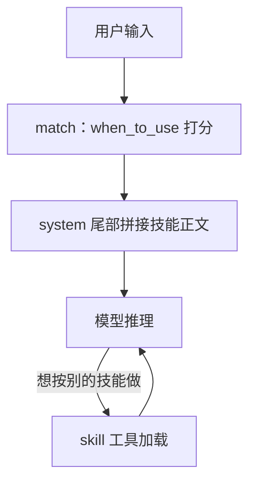
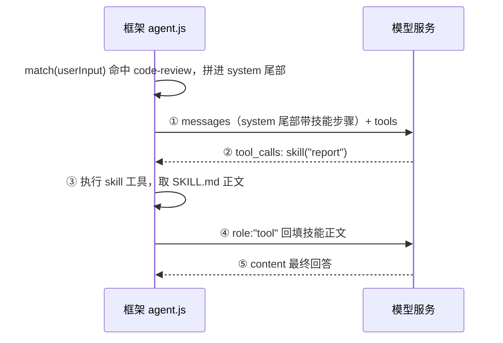

# 第 7 章 · Skill 系统：把领域经验喂给 Agent

## 这一章要解决的事

前六章结束时，这个 Agent 已经能调 `run_shell`、`read_file`、`search_files`，也有长期记忆和委派子任务的能力。但把"帮我 review 一下最近的改动"交给它，它多半会挑几个文件读起来就开口评论——先跑 `git diff` 把范围缩到变更行，再决定读哪些文件，这条经验不在代码里，也不在模型参数里。工具描述只交代"这个工具能干什么"，不交代"这类任务按什么顺序、抓哪些重点"。

补这层经验有两条路。一条是把"做 review 要先看 diff"写进 system prompt 的源码字符串，代价是每次请求都占 token，加一类任务要改一次代码。另一条是把经验做成独立文件（`SKILL.md`），命中场景时才注入。本章走第二条：技能是数据，加技能不改一行源码。

放在 13 章项目里的位置，它属于"让它像产品"这一段的中段——Agent 的手和脑都有了，现在给它装经验。

课程全景和章节先后关系见[入门者学习指南](../../docs/beginner-guide.md)。

第一次学习本章，先按本章 README 的“快速开始”运行离线版本，再读本页开头的问题和流程，沿调用关系打开入口文件，最后完成文末练习。逐文件说明和完整测试列表可以留作查阅，不必第一遍从头读完。

学完本章你应该能做到：写一个带 frontmatter 的 `SKILL.md`；说清模型的显式加载和框架的自动触发这两条通道各自的可靠性来源；解释为什么自动注入只取一个技能；指着代码讲清三段注入文本在 system prompt 尾部的拼接顺序。

三个扩展机制经常被混着说，先把它们分开（第 8 章还会回到这张表）：

| 机制 | 本质 | 谁写 | 加载时机 |
|---|---|---|---|
| MCP | 协议（JSON-RPC） | 工具提供方 | 连接时发现 |
| Plugin | 代码（钩子/工具） | 开发者 | 启动时注入 |
| Skill | 知识（提示词 + 步骤） | 领域专家 / 用户 | 按需加载、自动触发 |

本章只做最后一行。MCP 和 Plugin 提供"手"，技能提供"手巧"——用已有的手把活干对。

## 文件都在哪

```
lesson07-skill/
├── skill_store.js         95 行   SKILL.md → 对象：frontmatter 解析、tools 转数组、遍历 skills/ 目录
├── skill_registry.js      64 行   索引：load/list/get/match（打分排序）
├── skill_tool.js          61 行   显式通道：skill 工具 + 可用技能清单文本
├── skill_trigger.js       46 行   自动通道：Top 1 选择 + 注入文本格式化
├── agent.js              198 行   集成：注册工具、懒加载、三段注入（本章改 +26 行）
├── skills/
│   ├── code-review/SKILL.md  24 行
│   ├── bug-hunt/SKILL.md     21 行
│   └── report/SKILL.md       25 行
├── main.js               101 行   REPL + /skills 元命令
├── test.js               341 行   17 个用例
└── docs/course.md                当前文件
```

除上面这些，其余 23 个源文件（工具、注册表、权限、上下文、记忆、委派）从第 6 章原样带过来，一行没动。`subagent.js` 是唯一的例外：构造函数多了一个 `delegateFactory` 注入点（161 → 164 行）。阅读顺序按依赖走：先看一个真实的 `SKILL.md`（数据长什么样），再 `skill_store.js`（怎么解析）→ `skill_registry.js`（怎么打分）→ `skill_tool.js`（显式通道）→ `skill_trigger.js`（自动通道）→ `agent.js`（怎么拼进 system）→ `main.js`、`test.js`。

## 一次技能从文件走到 system 尾部



两条箭头就是两条通道。用户输入进 `match`，命中的技能正文被拼进 system prompt 尾部，模型带着这份步骤开始推理；推理中如果发现当前任务更贴合另一个技能，它自己调 `skill` 工具把那份正文拉进上下文。前者的可靠性来自框架（不用模型判断），后者的灵活性来自模型（它知道自己在做什么任务），两条都留着。

注入文本一共三段，按顺序拼在基础 system prompt 后面（`agent.js:107-118`）：

| 顺序 | 来源 | 内容 | 少了会怎样 |
|---|---|---|---|
| 一 | `memory.formatRecall` | 相关记忆（第 5 章） | 用户偏好和项目事实丢失 |
| 二 | `buildSkillInjection` | 命中的技能正文（本章） | 模型只能自己摸索流程 |
| 三 | `buildAvailableSkillsPrompt` | 可用技能清单（本章） | 模型不知道有技能可调，`skill` 工具形同虚设 |

当年的备选方案也考虑过，落在表里：

| 备选 | 为什么不用 |
|---|---|
| 技能正文直接写死在 system prompt 源码里 | 每类任务都占 token，加技能要改代码、要重新发版 |
| 全部技能一次性注入 | 注意力被十几个流程分散，互相矛盾的步骤还会打架 |
| 让模型自己凭 description 猜有没有技能 | 模型看不到技能库就无从猜起，等于没做 |

## skill_store.js：SKILL.md 怎么变成对象

解析入口是 `parseSkill`（`skill_store.js:27`），核心就两段：切出 frontmatter，逐行读键值。

```js
// skill_store.js:27-57（节选）
export function parseSkill(content) {
  // 分隔符后的换行宽容处理：手写 SKILL.md 时 `---` 后面常没有空行
  const m = content.match(/^---\n([\s\S]*?)\n---\n+([\s\S]*)$/);
  if (!m) return null;

  const meta = {};
  for (const line of m[1].split("\n")) {
    const idx = line.indexOf(":");
    if (idx === -1) continue;
    const key = line.slice(0, idx).trim();
    const value = line.slice(idx + 1).trim();
    if (key === "tools") {
      // tools: [run_shell, read_file] → ["run_shell", "read_file"]
      meta[key] = value.replace(/^\[|\]$/g, "").split(",").map((s) => s.trim()).filter(Boolean);
    } else {
      meta[key] = value;
    }
  }
  if (!meta.name) return null;   // 没有 name 的技能无法被索引，直接丢掉
  return { name: meta.name, description: meta.description || "", when_to_use: meta.when_to_use || "", tools: meta.tools || [], body: m[2].trim() };
}
```

正则里那个 `\n+` 是踩过坑留下的：手写技能时 `---` 后面常常直接接正文，没有空行。写成 `\n\n` 的话解析全部返回 `null`，症状是"技能目录明明有文件，列表却是空的"，很难往正则上想。`if (!meta.name) return null` 是同一个取向——坏的单个技能不炸整库，代价是写错了不报错，只表现为列表里少一个（测试 `test.js:72` 把这条行为钉住了）。

`tools` 字段被特殊处理成数组，是因为它在 frontmatter 里写成了 `[a, b]` 这种近似 JSON 的形状，但真正的 YAML 数组解析器没有引入（零依赖），所以用 `replace` 去掉方括号再按逗号切。写成一行、不含空格的简单列表够用；支持嵌套结构就要换真正的 YAML 解析器。

`loadAllSkills`（`skill_store.js:75`）遍历 `skills/` 下每个子目录读 `SKILL.md`，读不到就跳过。目录不存在时返回空数组而不是抛异常，这样"还没写技能"和"技能写坏了"都不会让进程起不来。注意 `readdir` 的顺序不保证稳定，所以别指望技能列表的顺序有意义，需要排序的地方自己排。

## skill_registry.js：加载与打分

注册表把文件层收成内存里的一张表，`load()` 幂等（可重复调用），`get()` 只按名字取，`match()` 负责打分（`skill_registry.js:44-63`）：

```js
// skill_registry.js:44-63
  match(query) {
    const tokens = tokenize(query);            // 复用第 5 章的分词：英文 ≥2 字符词 + 中文 2-gram
    if (tokens.length === 0) return [];

    return this.list()
      .map((skill) => {
        const whenToUse = String(skill.when_to_use || "").toLowerCase();
        const desc = String(skill.description || "").toLowerCase();
        const name = String(skill.name || "").toLowerCase();
        let score = 0;
        for (const token of tokens) {
          if (whenToUse.includes(token)) score += 2;
          if (desc.includes(token)) score += 1;
          if (name.includes(token)) score += 1;
        }
        return { ...skill, score };
      })
      .filter((s) => s.score > 0)
      .sort((a, b) => b.score - a.score);
  }
```

权重这么定，是跟着"字段为什么被写出来"走的。`when_to_use` 这个字段存在的唯一目的就是给自动触发做关键词表，命中它说明任务类型对上了，所以给 2 分；`description` 是给模型看的用途说明，顺带参与匹配给 1 分；技能名是弱信号，也给 1 分。第 5 章记忆召回给 `description` 最高权重（`recall.js:35-47`，description+3 / name+2 / body+1），逻辑是一样的——谁被写出来专门干判断这件事，谁权重就高。

分词直接 import 第 5 章的 `tokenize`（`recall.js:17-33`），没有再写一份。中文按 2-gram 切（"代码审查" → 代码/码审/审查），英文和数字取长度 ≥2 的词。它的天花板也很直接：字面不重合就召不回，用户说"帮我看看这段 Vim 配置"、技能里写的是"编辑器配置"，两边没有共同 token，自动通道就失效了，只能靠模型自己调 `skill` 工具。要跨过这道门槛就是换 embedding 语义匹配，`match()` 是唯一改动点。

## skill_tool.js：显式加载的入口

`createSkillTool` 返回一个普通的工具定义，和 `run_shell`、`read_file` 一样注册进 registry（`skill_tool.js:19-50`，在 `agent.js:66` 以 `read` 级注册）。工具体只有三条分支：

```js
// skill_tool.js:34-48
    fn: async ({ name }) => {
      const skill = skillRegistry.get(name);
      if (!skill) {
        return {
          error: `技能不存在: ${name}`,
          available: skillRegistry.list().map((s) => s.name),
        };
      }
      return {
        skill: { name: skill.name, description: skill.description, content: skill.body },
      };
    },
```

技能名不存在时返回的不是抛异常，而是错误对象加一份可用清单。模型拿到 `{error, available}` 之后下一轮基本能自己改对名字——这是第 2 章"错误当结果回传"的思路在技能上的复用。返回体只带 `name`、`description`、`content` 三个字段，`tools` 白名单不参与执行：技能提供的是知识，不改变 Agent 手上的工具集，这一点有测试钉着（`test.js:122`）。

另一半是 `buildAvailableSkillsPrompt`（`skill_tool.js:54-60`），它把技能名和一句话描述拼成清单文本，由 `agent.js:115` 拼进 system 尾部：

```text
## 可用技能（可调用 skill 工具加载）
- bug-hunt：定位和排查 bug，从日志和代码中找到根因
- code-review：审查代码变更，发现 bug、安全隐患、性能问题
- report：生成结构化的工作报告，包括摘要、数据、结论和建议
```

（上面这段是实跑 `buildAvailableSkillsPrompt` 抓的真实输出。）没有这份清单，模型不知道技能库里有什么，`skill` 工具就永远等不到调用——"工具存在"和"模型知道工具存在"是两件事。

## skill_trigger.js：自动通道与只注入一个

自动通道短到只有一个函数（`skill_trigger.js:24-26`）：

```js
// skill_trigger.js:16
export const AUTO_INJECT_LIMIT = 1;

// skill_trigger.js:24-26
export function matchSkillsForInput(userInput, registry) {
  return registry.match(userInput).slice(0, AUTO_INJECT_LIMIT);
}
```

只取分数最高的一个，不是随手写的数字。实跑几个输入看打分（下面这张表是真实抓取）：

| 用户输入 | `match()` 全部命中 | 实际注入 |
|---|---|---|
| 帮我 review 一下 lesson07-skill 目录的代码 | code-review 6 / bug-hunt 1 | code-review |
| 帮我排查一下这个报错 | bug-hunt 5 | bug-hunt |
| 写份报告，排查一下报错 | bug-hunt 5 / report 3 | bug-hunt |
| 今天天气怎么样 | 无 | 无 |

注意第三行：一句话里两个技能都有理由被加载，代码只放行一个。技能注入是"指导"，不是"资料堆砌"——同时塞进两个流程，模型要在两套步骤之间自己选，还可能撞上互相矛盾的建议（比如一个要求"先给结论"、另一个要求"先列证据"）。放行的那一个靠分数决定，没被选中的技能仍然躺在清单里，模型觉得更贴切时可以自己调 `skill` 工具把它拉进来。这条"最小注入"原则有专门用例（`test.js:151`）保证：句子命中两个技能时，自动注入的数量必须是 1。

`buildSkillInjection`（`skill_trigger.js:33-46`）负责把选中的技能变成文本。它的措辞值得留意：

```js
// skill_trigger.js:34-36
  if (!skills || skills.length === 0) return "";
  return (
    "\n\n## 已加载技能（任务符合该技能场景时，按以下步骤执行）\n" +
```

"任务符合该技能场景时"这半句是刻意留的余地。注入的正文会被模型当成指令读，而技能是人写的、可能过时或者不适用当前上下文，所以标题里写明"符合场景时"才照做。好的技能是提示，坏的技能是陷阱——被错误注入的坏技能，会以指令级别的语气把模型带偏。

## agent.js：三段文本拼进 system 尾部

集成点只有三处。构造时注册工具（`agent.js:66`）：

```js
// agent.js:65-66
    // 注册技能加载工具（lesson07）：Agent 可主动调 skill("xxx")
    this.registry.register(createSkillTool(this.skills), "read");
```

`run` 开头懒加载技能（`agent.js:70-75`），只加载一次——技能是文件，进程生命周期内不会自己变，每次请求都重读目录没有意义，代价是改了 `SKILL.md` 要重启：

```js
// agent.js:70-75
  async _ensureSkills() {
    if (!this.skillsLoaded) {
      await this.skills.load();
      this.skillsLoaded = true;
    }
  }
```

最关键的是注入那十行（`agent.js:107-118`）：

```js
// agent.js:107-118
    // ① 记忆注入（lesson05）+ 技能自动匹配注入（lesson07）+ 可用技能清单
    const [recalled, matchedSkills] = await Promise.all([
      this.memory.recall(userInput),
      matchSkillsForInput(userInput, this.skills),
    ]);
    const injected =
      this.memory.formatRecall(recalled) +
      buildSkillInjection(matchedSkills) +
      buildAvailableSkillsPrompt(this.skills);
    this.cm.setSystem([
      { role: "system", content: this.systemPrompt + injected },
    ]);
```

记忆召回和技能匹配放在一个 `Promise.all` 里，两者互不依赖，没有理由串行等。拼好的 `injected` 追加在 `this.systemPrompt` 后面（不是新开一条 system 消息），因为 `setSystem` 写的是一个独立字段，`build()` 每次都把它排在最前面（`context_manager_v2.js:75-82`），而压缩只处理 `recent` 和 `summary`——注入内容不会因为一次压缩被丢掉。代价是每个 `run` 只重建一次，会话中途新注入的技能要到下一次提问才生效。

顺序上没有任何玄机：记忆在前，是因为它是"你是谁、你偏好什么"的长期事实；技能在后，是因为它指导的是"这一轮怎么做"。把易变的、任务相关的放更靠近对话的位置，模型对近处内容的注意力更高。清单放最后，它是菜单不是指令。

一句话把这两类注入分开：记忆回答"你是谁、你喜欢什么"，技能回答"这类任务该怎么做"。机制同构，内容完全不同，也正因如此两者的触发方式必须分开设计——记忆靠相关性召回，技能靠任务类型匹配。

## skills/ 里那三个 SKILL.md

`code-review/SKILL.md` 全文 24 行，是本章最重要的数据样本：

```markdown
---
name: code-review
description: 审查代码变更，发现 bug、安全隐患、性能问题
when_to_use: 代码审查、PR 评审、检查可疑代码、review
tools: [run_shell, read_file, search_files]
---
## 步骤
1. 先定位变更范围：用 run_shell 执行 git diff（无 git 时用 search_files + list_files 定位目标文件）
2. 对每个关键文件用 read_file 读取上下文（函数体、调用方、数据流）
3. 重点检查四类问题：
   - 安全：注入风险、敏感信息硬编码、权限校验缺失
   - 正确性：边界条件、空值处理、竞态条件
   - 性能：明显低效的循环、重复计算、内存泄漏
   - 死代码：未使用的变量/函数/导入
## 要点
- 先定位变更再读文件，避免全文扫描（省 token）
- 问题按严重度排序汇报：高危（安全/数据）> 中危（逻辑错误）> 低危（风格/规范）
- 每条问题给出：文件 + 行号/函数 + 问题描述 + 修复建议
- 只报告真实问题，不为了"显得专业"而凑数
```

`when_to_use` 里用顿号分隔关键词而不是逗号，因为分词器只看字面，标点不参与匹配，顿号更贴近中文的书写习惯。`tools` 字段声明了三个工具名，本章只当文档用（见前面的缺口），它的真正价值是逼写技能的人想清楚"这个任务需要什么能力"。

正文用 markdown 而不是 JSON 或 YAML，有三个理由：写技能的人能读能改、能进 git 有版本历史、同一份内容既是给模型的指令也是给同事看的文档。坏技能比没技能更糟，所以技能要能被 review，可读性不是附加分而是前提。

另外两个技能是同构的：`bug-hunt` 的步骤是"先复现现象 → 追根因 → 验证假设 → 给结论"，`report` 的步骤是"先明确读者 → 收集事实 → 摘要/详情/风险/建议 → 输出"。三个技能的 `when_to_use` 关键词刻意不重叠（"review" / "排查、报错" / "报告、汇报"），这样自动通道的打分才有区分度。

## main.js：REPL 里的 /skills

入口比第 6 章短了，去掉的是 `/demo` 并行委派演示，加上的是技能相关两处：启动时打印清单（`main.js:47-50`），以及 `/skills` 元命令（`main.js:58-64`），它逐个打印技能名、描述和触发关键词：

```js
// main.js:58-64
    if (line === "/skills") {
      const all = skills.list();
      for (const s of all) {
        console.log(`  - ${s.name}：${s.description}`);
        console.log(`    触发：${s.when_to_use}`);
      }
      continue;
    }
```

调技能不需要任何新命令：它就是普通提问，命中场景自动注入；想强制加载就在对话里说"用 code-review 技能"或者直接提技能名，模型会调 `skill` 工具。


一次完整往返：



## 动手练习

按[第 7 章练习](../../docs/beginner-practice.md#chapter-07)完成任务。练习页列出了起始文件、操作目标和自检标准；先用假数据完成，再按本章 README 运行完整示例。

## 下一章

第 8 章做扩展点的另一种形态：Plugin——给 Agent 本体加代码能力，在工具执行前后挂钩子。技能教模型怎么用已有的手，插件改变手本身：它能在工具真正执行前把调用拦下来，而技能只是一段文本，模型可以选择不照做。

MCP（用标准协议把外部进程的工具接进来）排在第 9 章。它是另一条线——插件管的是本进程内的扩展点，MCP 管的是"工具根本不在这个进程里"。

换掉本章实现的触发点很具体：当你想在"技能被加载时写一条审计日志"或者"技能要求的工具不存在就拦下来"时，光靠知识包做不到，因为技能只是一段文本。这类需求要的是可执行代码挂进执行链，也就是预工具钩子（第 8 章的 `PreToolUse`）。另一个触发点是技能来源——想让技能不写在本地文件里、而是从别的进程或服务取来，那就是 MCP 的领域。
