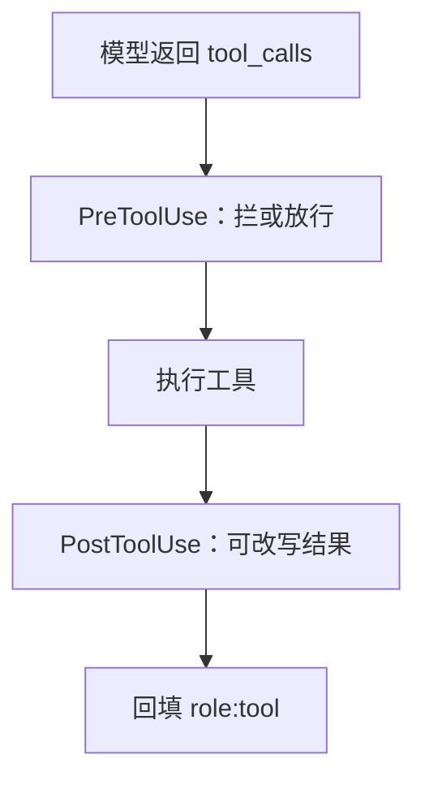
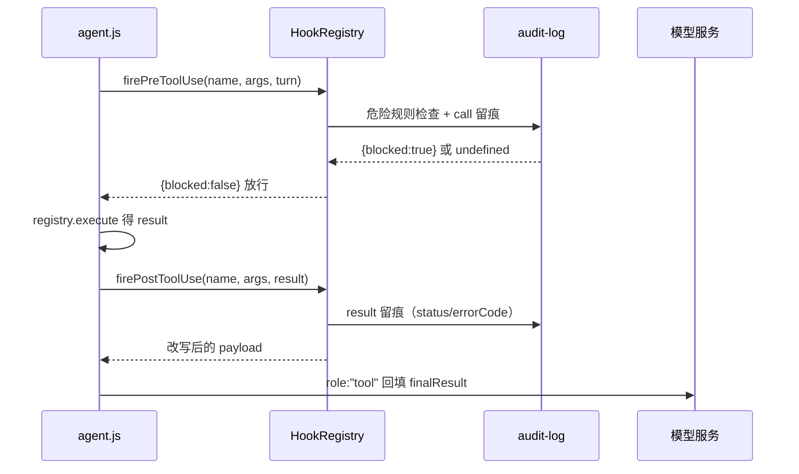

# 第 8 章 · Plugin 系统：给 Agent 装插座

## 这一章要解决的事

上线的第一周，运维会连着问三个问题：昨天那条 `rm -rf` 是谁让它跑的？工具一天调了多少次、失败几次？日志里为什么有明文 token？这三个问题都不是"Agent 会不会干活"的问题，而是"它干活的过程能不能被看见、被拦住、被统计"的问题。前七章的 Agent 在这个层面是裸的：模型发出 `tool_calls`，框架查注册表、走权限、校验参数、执行、回填，中间没有任何第三方可以插一脚的地方。

把审计代码写进六个工具里能解决第一个问题，代价是每个工具都要改一遍，而且第二个需求（成本统计）来了还要再改一遍。工具是"业务逻辑"，审计、拦截、限流、脱敏这些是"横切关注点"——它们不改变工具做什么，只关心工具被调用的前后发生了什么。横切逻辑的正确放法是在调用链上留钩子点（Hook，生命周期回调的挂载位），让关心它的代码自己订阅。

插件系统就是这件事的落地形态：框架定义事件名、注册 API 和触发位置，插件拿到注册 API 后自己决定"在这个时刻做什么"，框架一行不用改。本章写两个文件把这条路走通，再配一个真解决合规问题的插件 `audit-log`。

放在 13 章项目里的位置：

课程全景和章节先后关系见[入门者学习指南](../../docs/beginner-guide.md)。

第一次学习本章，先按本章 README 的“快速开始”运行离线版本，再读本页开头的问题和流程，沿调用关系打开入口文件，最后完成文末练习。逐文件说明和完整测试列表可以留作查阅，不必第一遍从头读完。

学完本章你应该能做到：说清 Hooks 为什么是插件系统的核心而不是"一种回调写法"；手写一个 `install(hooks)` 返回卸载函数的插件；解释 PreToolUse 拦截后为什么把 `HOOK_BLOCKED` 当工具结果回填而不是静默跳过；指着代码讲清 `firePostToolUse` 那一次 `await` 为什么必须取返回值。

第 7 章结尾留了一张表，本章回到它，补上"放在哪一章"这一列：

| 机制 | 本质 | 谁写 | 加载时机 | 放在哪一章 |
|---|---|---|---|---|
| MCP | 协议（JSON-RPC） | 工具提供方 | 连接时发现 | 第 9 章 |
| Plugin | 代码（钩子/工具） | 开发者 | 启动时注入 | 本章 |
| Skill | 知识（提示词 + 步骤） | 领域专家 / 用户 | 按需加载、自动触发 | 第 7 章 |

一句话记法不变：MCP 是"协议"、Plugin 是"代码"、Skill 是"知识"。技能教模型怎么用已有的手，插件改变手本身——它能在工具真正执行前把它拦下来。

## 文件都在哪

```
lesson08-plugin/
├── hooks/
│   └── hook_registry.js        65 行   HookEvent + HookRegistry：add / firePreToolUse / firePostToolUse
├── plugins/
│   └── audit-log/
│       ├── plugin.js          136 行   ★ 插件本体：留痕 / 危险拦截 / 脱敏 / 统计 + install 返回卸载函数
│       └── manifest.json       14 行   清单：name / version / hooks / config（三组危险规则）
├── agent.js                   218 行   ★ 接线：执行前 firePreToolUse、执行后 firePostToolUse（本章改 +20 行）
├── main.js                    124 行   入口：装插件、三个审计元命令、退出卸载
├── test.js                    358 行   10 个用例
├── skills/                            第 7 章的三个 SKILL.md（数据）
├── tools/  core_tools.js  registry*.js  第 7 章带过来的工具链，逐字节没动
└── docs/course.md                     当前文件
```

除上面列出的，其余 22 个根目录 `.js`（工具、执行流水线、上下文、记忆、委派）从第 7 章原样复制，`diff` 出来完全一致；技能那一组里 `skill_registry.js`、`skill_trigger.js` 也相同，`skill_store.js`、`skill_tool.js` 各差一处（见增量表）。阅读顺序按依赖走：`hooks/hook_registry.js`（插座长什么样）→ `plugins/audit-log/plugin.js`（一个真实插件怎么插上去）→ `plugins/audit-log/manifest.json`（规则的另一份副本）→ `agent.js:133-203`（两个触发点接在主循环的哪里）→ `main.js`（装配与元命令）→ `test.js`（怎么把看不见的钩子行为测出来）。

## 钩子点在主循环里的位置



插件只有这两个位置可选。位置选得少是刻意的：插件再往里就走进了推理循环内部（改消息、改预算、改轮次），那已经不是"扩展"而是"重写框架"；而这两个点刚好覆盖了真实插件 90% 的需求——执行前要检查和记录，执行后要脱敏和统计。第 13 章的观测、第 10 章的会话恢复会用同一套思路往别的生命周期位置加挂点。

## hooks/hook_registry.js：插座长什么样

整个框架 65 行，核心是这个类：

```js
// hooks/hook_registry.js:15-18
export const HookEvent = {
  PRE_TOOL_USE: "preToolUse",
  POST_TOOL_USE: "postToolUse",
};

// hooks/hook_registry.js:38-45
  add(event, fn) {
    if (!this.hooks[event]) throw new Error(`未知钩子事件: ${event}`);
    this.hooks[event].push(fn);
    return () => {
      const i = this.hooks[event].indexOf(fn);
      if (i >= 0) this.hooks[event].splice(i, 1);
    };
  }
```

四个决定都值得解释。第一，事件名用常量对象而不是裸字符串分发：`add("pre_tool_use", fn)` 这种拼错会立刻抛错，而不是静默注册一个永远不会被触发的钩子——那种 bug 的表现是"插件装了但没反应"，能查半天。第二，`add` 返回的是移除函数而不是返回 boolean：插件卸载时不需要记住"我注册过哪个事件、哪个函数"，直接把返回值调一次就行。

第三，`firePreToolUse` 遇到第一个 blocked 就返回（`hook_registry.js:48-56` 里的 `return { blocked: true, ... }`），后面的 pre 钩子不再跑。拦截是一票否决，继续跑完剩下的钩子没有意义，还有可能让后面的钩子以为"这个调用会执行"而写出错误记录。第四，post 钩子不改返回值，它们原地改 `payload.result`，`firePostToolUse` 最后把整个 payload 返回给调用方（`hook_registry.js:63`）。

```js
// hooks/hook_registry.js:59-64
  async firePostToolUse(payload) {
    for (const fn of this.hooks[HookEvent.POST_TOOL_USE]) {
      await fn(payload);
    }
    return payload;
  }
```

pre 用"返回值"表达拦截、post 用"改参数"表达改写，原因是两个时刻手里的东西不一样：执行前还没有结果，钩子只能回答"放不放行"；执行后结果已经存在，钩子直接改它更直接。这个返回值后来成了本章第二个 bug 的现场，后面单独讲。

多个钩子按注册顺序串行执行，没有优先级字段也没有并发。串行是为了让顺序可预测：审计插件要在拦截插件之后跑还是之前跑，结果不一样（先留痕后放行，还是先放行后留痕），串行 + 注册顺序至少给了确定的语义。代价是慢钩子会拖慢工具调用，本章的缺口表里记着这一条。

卸载函数的语义可以实测：同一个插件 `install` 两次，卸载其中一次，另一次注册的钩子仍然生效——因为 `remove` 闭包只 `splice` 掉自己捕获的那个函数引用（`hook_registry.js:42-43`）。运行输出贴在后面 `plugin.js` 一节里，那是插件可插拔的底层机制。

## plugins/audit-log/plugin.js：一个真解决问题的插件

本章用一个小插件演示四种常见需求：记录工具调用、拦截特定命令、遮盖参数中的敏感字段、统计调用结果。它适合学习 Hooks 的调用方式；当前日志没有身份认证、可靠持久化或完整的敏感数据识别，不能直接作为企业合规审计系统。

| 能力 | 解决什么 | 挂在哪个钩子 |
|---|---|---|
| 合规留痕 | "谁在什么时候让它调了什么、结果如何"要能查 | Pre + Post |
| 危险拦截 | `rm -rf` / `shutdown` / fork bomb 挡在执行之前 | Pre（返回 blocked） |
| 参数脱敏 | 参数对象中键名带 token、password 等字样的字段打码 | Pre（maskArgs） |
| 使用统计 | 每工具 调用 / 错误 / 拦截 次数，成本与质量分析的基础 | 汇总内存记录 |

插件用的是**工厂函数 + 闭包**而不是 class（`plugin.js:46` 的 `createAuditLogPlugin`）：`records` 数组、`dangerRules`、时间戳函数都关在闭包里，外部只能通过返回的 `{ install, query, summary, records }` 访问（`plugin.js:124`）。这样两个插件实例天然隔离，测试里互不污染。

`record()` 是唯一的写入口，它同时写两处：内存 `records` 数组和磁盘 `audit.log`（`plugin.js:54-62`）。写文件那行包在 try/catch 里静默失败，这条守卫比它看起来重要——审计日志的目录没权限、磁盘满，都不该让用户的对话挂掉。插件是旁路，旁路不能拖垮主线。

```js
// plugins/audit-log/plugin.js:54-62
  function record(entry) {
    records.push(entry);
    const line = JSON.stringify({ ts: now(), ...entry });
    try {
      appendFileSync(logFile, line + "\n"); // 写失败不影响主流程
    } catch {
      /* 日志写失败静默 */
    }
  }
```

脱敏用的是递归键名匹配，不检查字符串值本身。键名带 `token`、`secret`、`api_key` 等字样时会替换成 `***`；超过 100 字符的字符串会截断。工具结果正文不写入日志，因为读文件或 HTTP 响应可能含有密钥和个人信息。参数脱敏也不是完整防线：如果密钥被塞进 `command` 这样的通用字段，键名规则仍识别不出来。真实系统还要限制凭据流向，并控制审计日志的访问权限。

`preToolUse` 里两个动作有固定顺序（`plugin.js:65-78`）：先跑危险规则，命中就留一条 `blocked` 记录并返回拦截；没命中才写 `call` 记录。顺序反过来就会把"被拦下的调用"记成"已发起的调用"，统计出来的调用量会虚高。

```js
// plugins/audit-log/plugin.js:66-77（节选）
    for (const rule of dangerRules) {
      if (name === rule.tool) {
        const value = String(args?.[rule.field] || "");
        if (rule.pattern.test(value)) {
          record({ event: "blocked", name, reason: rule.reason, args: maskArgs(args) });
          return { blocked: true, reason: `[audit-log] ${rule.reason}` };
        }
      }
    }
    // 2. 调用留痕（参数已脱敏）
    record({ event: "call", name, args: maskArgs(args) });
```

规则是 `{tool, field, pattern, reason}` 四元组：哪个工具的哪个参数、匹配什么正则、拦截时给模型看什么理由。`reason` 会被拼成 `[audit-log] 拦截递归删除 rm -rf` 回填给模型——理由要具体，模型看到"这条命令被判定为递归删除"才会换方案，看到"被拦截"只会重试。

`postToolUse` 只做记录（`plugin.js:81-89`），写入 `status`（`result.error` 存在就是 `error`）和 `errorCode`，不保存工具结果正文或预览。它不返回 blocked——执行完的事实无法撤销；本插件选择只保留状态，避免把读到的文件或网页内容写进日志。

`install` 与 `query`：

```js
// plugins/audit-log/plugin.js:92-98
  function install(hooks) {
    const removers = [
      hooks.add(HookEvent.PRE_TOOL_USE, preToolUse),
      hooks.add(HookEvent.POST_TOOL_USE, postToolUse),
    ];
    return () => removers.forEach((remove) => remove());
  }
```

插件要挂两个钩子，卸载也必须成对摘掉两个。返回一个 `() => removers.forEach(...)` 而不是把 removers 数组暴露出去，是为了让调用方只有一个动作可选：装是这一下，卸也是这一下。`query` 的 `slice(-limit)`（`plugin.js:109`）取最近 N 条，配合 `tool` 过滤就能回答"run_shell 最近调了什么"。

把上面这些动作串起来实跑，真实输出是这样（装了三条默认危险规则，日志写到临时文件）：

```text
== ① 正常调用：firePreToolUse(search_files) ==
{"blocked":false}

== ② 敏感参数：api_key 脱敏 ==
[{"event":"call","name":"fetch_url","args":{"url":"https://api.example.com","api_key":"***"}}]

== ③ 危险命令：rm -rf 被拦截 ==
{"blocked":true,"reason":"[audit-log] 拦截递归删除 rm -rf"}

== ④ 结果留痕：firePostToolUse(ok / error) ==
[{"event":"result","name":"run_shell","status":"ok"},
 {"event":"result","name":"run_shell","status":"error","errorCode":"EXEC_FAILED"}]

== ⑤ summary() 使用统计 ==
{"search_files":{"calls":1,"errors":0,"blocked":0},
 "fetch_url":{"calls":1,"errors":0,"blocked":0},
 "run_shell":{"calls":0,"errors":1,"blocked":1}}

== ⑥ 卸载后再触发 ==
卸载后 pre 触发结果: {"blocked":true,"reason":"[audit-log] 拦截递归删除 rm -rf"}
卸载后（audit 首次 install 仍在）records 条数: 6
```

（④ 的 JSON 为排版换过行，其余原样。）三种事件——`call`、`blocked`、`result`——就是审计的全部词汇表，任何"谁在什么时候干了什么"的问询都能用这三个词回答。⑤ 里 `run_shell` 的 `calls` 是 0 而 `blocked` 是 1，这正是"被拦的调用不算调用"的账面体现。⑥ 是两次 `install` 只卸掉一次的结果：钩子还在，说明移除函数只摘自己那一个。

## manifest.json：规则的另一份副本

清单文件只有 14 行：

```json
{
  "name": "audit-log",
  "version": "1.0.0",
  "description": "安全审计插件：工具调用留痕、危险命令拦截、敏感信息脱敏、使用统计",
  "hooks": ["preToolUse", "postToolUse"],
  "config": {
    "logFile": "audit.log",
    "dangerRules": [
      { "tool": "run_shell", "field": "command", "pattern": "rm\\s+-rf\\b", "reason": "拦截递归删除 rm -rf" },
      { "tool": "run_shell", "field": "command", "pattern": "\\bshutdown\\b", "reason": "拦截关机命令" },
      { "tool": "run_shell", "field": "command", "pattern": ":\\?\\(\\)\\s*\\{", "reason": "拦截 fork bomb" }
    ]
  }
}
```

`hooks` 声明这个插件要订阅哪些事件，`config` 放它的配置。真实情况是：JSON 里没有正则类型，`pattern` 只能写成字符串，要用还得 `new RegExp(pattern)` 再处理转义——所以 `loadAuditLogPlugin()`（`plugin.js:128-136`）把三条规则用正则字面量重新写了一遍，manifest 目前是"声明"而不是"加载源"。把 manifest 变成加载源需要配套的插件发现机制（扫 `plugins/` 目录、读清单、加载入口、注入配置），那是本章缺口表里的一条，也是为了不让读者先理解一套目录约定才能读懂钩子本身。

## agent.js：两个触发点接在主循环哪儿

插件与框架的耦合面只有三处。构造时注入注册表（`agent.js:55`）：

```js
// agent.js:55
    this.hooks = hooks || new HookRegistry();
```

不传就是空注册表，`firePreToolUse` 遍历空数组直接返回 `{blocked:false}`——Agent 完全不知道有没有插件。这是"框架零改动"的语义口径：`agent.js` 里没有任何 `if (有插件)` 分支。

执行前那一处（`agent.js:163-174`）：

```js
// agent.js:163-174（节选）
          const pre = await this.hooks.firePreToolUse({ name, args, turn });
          if (pre.blocked) {
            this.cm.append({
              role: "tool",
              tool_call_id: tc.id,
              content: JSON.stringify({
                error: { code: "HOOK_BLOCKED", message: pre.reason },
              }),
            });
            continue;
          }
```

被拦下的调用不执行，但**必须回填一条 `role:"tool"` 消息**，否则下一条 assistant 消息里的 `tool_calls` 就有一条没有对应结果，真实服务端会直接拒绝这次请求。回填的内容是结构化错误而不是空字符串：模型看到 `HOOK_BLOCKED` 加具体原因，才有可能自己换一条安全的路；静默跳过让模型以为命令执行成功了，它会基于"已经清理完"这个错误前提继续推理，这比报错更危险。这里是 `continue` 而不是 `break`——同一条响应里可能有多个 `tool_calls`，一个被拦不该中断其余调用。

执行后那一处（`agent.js:176-201`）：

```js
// agent.js:176-183
          const result = await this.registry.execute(name, rawArgs);

          // ── Hooks：PostToolUse（可改写结果）──
          // 必须用返回值：钩子替换 payload.result 时局部变量 result 不会跟着变，
          // 只 await 不看返回值会让"可改写"这个契约静默失效
          const { result: finalResult } = await this.hooks.firePostToolUse({
            name, args, result,
          });
```

后面所有用到结果的地方——重试预算判断（`agent.js:187`）、超长截断（`agent.js:197`）、回填给模型——用的都是 `finalResult`。这个改动是本章修掉的一处 bug，下一节讲。

触发顺序上有一处取舍：Loop 检测（`agent.js:147-149` 的 `_checkLoop` 调用）在 `firePreToolUse` 之前。所以同一条危险命令连调三次，第三次先报 `LOOP_DETECTED` 而不是 `HOOK_BLOCKED`。把拦截放在计数之前更符合直觉（被拦的调用不该计入死循环），本章保留现状并写进缺口表，是为了让人看到"防失控"和"扩展点"这两条链路的先后顺序本身是个设计决定。

## 四处改动：都长着"看起来没问题"的样子

这一章改的四处代码都不是崩溃型 bug，跑一遍测试也是绿的，问题藏在多工具调用、特定钩子写法、前缀匹配和参数取值这些角落。四处都留了可复现的证据。

**第一处：Loop 检测用 `break` 跳出，同一条响应里靠后的 `tool_calls` 丢了回填。** 场景要两个条件同时满足——一次响应里带多个 `tool_calls`，其中一个撞上死循环阈值。命中时旧代码回填了当前那条 `LOOP_DETECTED` 就 `break`，同响应里排在它后面的调用既没执行也没回填，于是这段历史里出现一条 assistant 消息带着两个 `tool_calls`、却只有一个 `role:"tool"` 结果。下一次请求把这个历史发出去，服务端按协议判定配对不完整，直接 400。修法是加一个 `loopDetected` 标记，判死循环后不再检测、不执行，但继续逐条回填 `LOOP_DETECTED`（`agent.js:138-160`）：

```js
// agent.js:138-160（节选）
        let loopDetected = false;
        for (const tc of toolCalls) {
          ...
          const loopReason = loopDetected
            ? `本轮已判定死循环，跳过执行: ${name}`
            : this._checkLoop(guards, name, args);
          if (loopReason) {
            loopDetected = true;
            this.cm.append({ role: "tool", tool_call_id: tc.id, content: ... });
            continue;
          }
```

回归用例在 `test.js:218`，配对断言单独抽成 `assertToolCallPairs`（`test.js:204`）：扫一遍消息数组，每条带 `tool_calls` 的 assistant 消息后面必须跟齐所有 id 的 tool 消息，且不能多出不属于它的孤儿 tool 消息。修复前跑这条用例的真实失败输出：

```text
✖ Loop 检测触发后，同一响应的剩余 tool_calls 也逐条回填
  AssertionError [ERR_ASSERTION]: tool_call 没有回填: b2
      at assertToolCallPairs (test.js:214:39)
```

这一族缺陷第 2~4 章就修过（对照 `lesson03-context/agent.js:84-96`、`lesson04-core-tools/agent.js:83-93`），第 5~7 章的 agent.js 里这段一度还是 `break`（例如 `lesson07-skill/agent.js:152`），本轮把这三章一起改成 `loopDetected + continue`：`lesson05-memory/agent.js:98-124`、`lesson06-multi-agent/agent.js:110-136`、`lesson07-skill/agent.js:136-162`，三章各自的测试里也补了同款配对断言。

**第二处：`firePostToolUse` 的返回值被丢掉，post 钩子的"可改写"契约静默失效。** 旧代码是 `await this.hooks.firePostToolUse({ name, args, result })`，钩子把 `payload.result` 换成新对象后，局部变量 `result` 仍指向旧对象，后面回填给模型的是旧结果。原地改（`payload.result.field = x`）两种写法都能生效，替换写法（`payload.result = {...}`）只有取返回值才行——同一个契约两种表现，正好是难查的那类。修法是解构返回值并用 `finalResult`（`agent.js:181`）。修复前的真实失败输出：

```text
✖ PostToolUse 改写的结果被回填给模型（改写生效）
  AssertionError [ERR_ASSERTION]: The expression evaluated to a falsy value:
    assert.ok(sawReplaced)
      at test.js:303:10
```

这条用例（`test.js:268`）的假模型只做一件事：拿到 tool 结果后检查里面有没有 `replaced` 这个键，有就回答"改写生效"。它不看插件的内部状态，看的是"模型眼里的事实"，这样钩子的效果可断言、可回归。

**第三处：`/audit-summary` 是死代码。** `main.js` 的分支顺序是先判 `line.startsWith("/audit")` 处理记录查询（`main.js:74`），再判 `line === "/audit-summary"` 打印统计（`main.js:87`）。`"/audit-summary"` 也以 `/audit` 开头，永远被前一个分支吞掉，统计分支一行都跑不到——用户看到的是一串记录而不是统计表。谓词实跑确认过：`"/audit-summary".startsWith("/audit")` 为 `true`，改成 `line === "/audit" || line.startsWith("/audit ")` 后为 `false`。这处没有自动化用例：`main.js` 是 REPL 入口，导入即启动读循环，元命令的分发逻辑没有被抽成可测函数——把 REPL 逻辑与分发拆开是可测性的代价换来的，本章没做，README 的缺口表里记了这一条。

**第四处：上下文预算回到了第 6 章的 4096。** 第 7 章把 `maxTokens / reserveForOutput` 从第 6 章的 `4096 / 512` 改成 `40960 / 5120`，原因是真实会话里压缩几乎每轮触发。本章的 `agent.js` 是从第 6 章那条线复制过来的，这个值又回到了 4096。实跑 `countTokens` 对比：旧预算压缩水位线 2867，新预算 28672；而本章注入技能与记忆之后的 system 提示是 469 token（705 字符），工具结果的截断上限是 1000 token——两个满额工具结果就压过旧水位线，真实会话里会出现"每轮压缩一次"的抖动。改回 40960 / 5120（`agent.js:80`），与第 5、7 章保持一致。

## main.js：装插件的三行，和三个审计命令

入口的装配部分只多了三行（`main.js:44-47`）：

```js
// main.js:44-47
  const audit = loadAuditLogPlugin();
  const uninstallAudit = audit.install(hooks);
  console.log("[plugin] audit-log 已安装（审计 + 危险拦截 + 脱敏）");
```

`hooks` 注册表本身在 `main.js:42` 创建，随后作为构造参数传给 Agent（`main.js:49-58` 的 `hooks,` 一行）。装插件、卸插件都只碰这一处，`agent.js` 不需要知道装了谁。验收"框架零侵入"的方式很直接：把那三行删掉，Agent 照常跑，只是没有留痕和拦截。

元命令分发表在 `main.js:64-106` 的读循环里：

| 命令 | 位置 | 作用 |
|---|---|---|
| `/plugins` | `main.js:70-73` | 列出已装插件（当前硬编码一行描述） |
| `/audit [工具名]` | `main.js:74-86` | 最近 15 条审计记录，可按工具过滤 |
| `/audit-summary` | `main.js:87-91` | 每工具 调用 / 错误 / 拦截 次数 |
| `/skills` `/memories` `/reset` `/exit` | `main.js:92-106` | 第 5、7 章带过来的会话命令 |

记录打印用的是同一套事件词汇（`main.js:80-83`）：`[blocked] run_shell → 拦截递归删除 rm -rf`、`[call] search_files` 后面再补一行脱敏后的参数。退出前调一次 `uninstallAudit()`（`main.js:116`）——这是可插拔的完整生命周期演示，进程活着的最后一条语句把插件摘掉，不留残留钩子。


一次完整往返：



## 动手练习

按[第 8 章练习](../../docs/beginner-practice.md#chapter-08)完成任务。练习页列出了起始文件、操作目标和自检标准；先用假数据完成，再按本章 README 运行完整示例。

## 下一章

第 9 章做 MCP：用标准协议把外部进程提供的工具接进来。钩子解决的是"现有工具被调用时的横切点"，MCP 解决的是另一件事——工具根本不在这个进程里。数据库查询网关、浏览器控制、公司内部的运维服务，它们的实现是别人写好的服务，要接进来就得有个协议约定怎么发现工具、怎么调用、怎么传错误，而不是往 `core_tools.js` 里再抄一个函数。第 7 章结尾的预告里，插件与 MCP 是两条独立的路：本章做 Plugin，MCP 排到第 9 章。

换掉本章实现的触发场景很具体。当你要写的是"工具执行完之后把结果发到别处"或者"某类调用必须先审批"这类流程，钩子够用；当你要拦的是"工具被调用之前根本不该出现在模型的工具列表里"（按用户权限动态裁剪工具集），Hooks 就只能拦调用、不能改工具清单，那时候要在 registry 的 schema 生成这一步动手。同样，`manifest.json` 现在只是声明，要让它真驱动加载，需要一套插件目录约定与生命周期管理——那是"扩展点的治理"问题，本章给的是扩展点本身。
