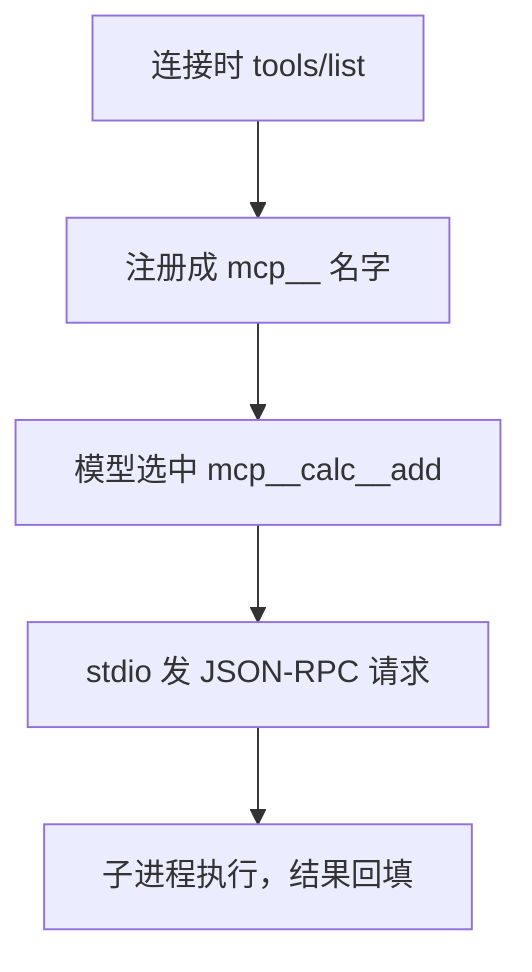
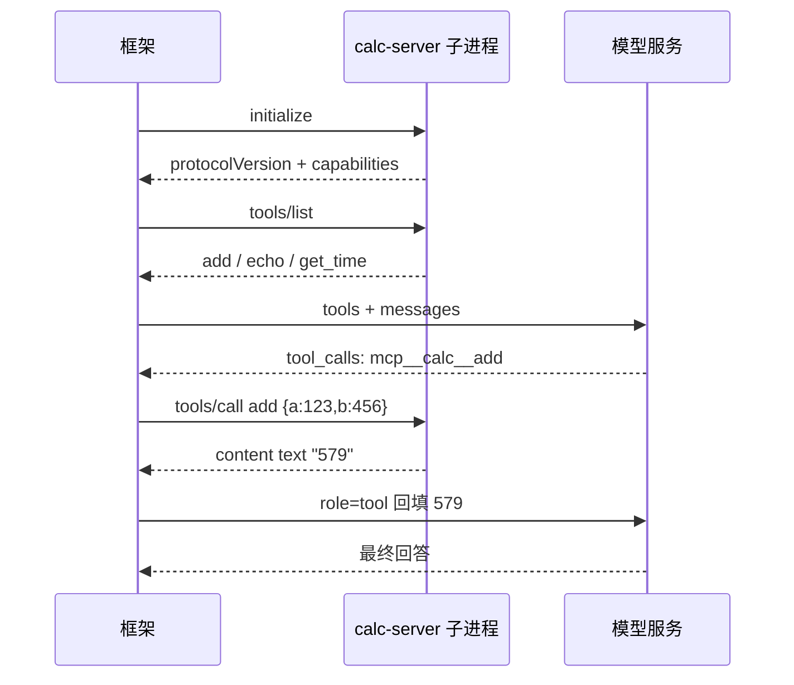

# 第 9 章 · MCP：把别的进程的工具接进来

## 这一章要解决的事

前八章里，Agent 的手都是自己长出来的。`run_shell`、`read_file`、`search_files` 写在 `core_tools.js` 里，跟着代码一起发版。想接一个新系统——公司内部的工单服务、一个 Python 写的模型服务、别人已经做好的数据库工具——只有两条路：把它的逻辑抄成 JS 塞进 registry，或者给它写一层 HTTP 包装。抄代码要跟着对方改，写包装是每个系统写一遍，彼此还不一样。

MCP（Model Context Protocol，模型上下文协议）把这件事标准化：外部系统按协议实现一个 server 进程，自己声明有哪些工具、参数长什么样；Agent 这边只实现一个客户端，连接时问一句"你有什么工具"，然后照单注册。接入成本从"每个系统写一套适配"变成"写一个 server，任何支持 MCP 的客户端都能用"。

放在 13 章项目里的位置，它属于"像产品"这一段的收尾：

课程全景和章节先后关系见[入门者学习指南](../../docs/beginner-guide.md)。

第一次学习本章，先按本章 README 的“快速开始”运行离线版本，再读本页开头的问题和流程，沿调用关系打开入口文件，最后完成文末练习。逐文件说明和完整测试列表可以留作查阅，不必第一遍从头读完。

学完本章你应该能做到：讲出三步协议（`initialize` 握手 → `tools/list` 发现 → `tools/call` 调用）以及每一步谁声明什么；说清 JSON-RPC 客户端靠什么把响应配回请求；用实测结果说明外部工具与内建工具"完全平等"；解释这条链路加进来，Agent 主循环为什么一行都不用改。

## 文件都在哪

```
lesson09-mcp/
├── mcp/
│   ├── mcp_server.js      92 行   外部系统：独立进程，stdin 读请求行 / stdout 写响应行
│   ├── mcp_client.js     109 行   客户端：spawn 子进程 + 自增 id + pending Map + 逐请求超时
│   └── mcp_tools.js       47 行   入籍处：tools/list 发现 → mcp__<server>__<tool> 注册进 registry
├── hooks/hook_registry.js 65 行   两个扩展点 PreToolUse / PostToolUse（第 8 章带过来的）
├── agent.js              217 行   主循环：钩子拦在工具执行前后（本章改了 Loop 回填）
├── subagent.js           164 行   子 Agent 执行器（同款 Loop 回填一并修掉）
├── main.js               122 行   入口：连 MCP server + 注册两段钩子 + /mcp 命令
├── test.js               297 行   8 个用例，前两个真的 spawn 子进程
└── skills/**/SKILL.md             三个示例技能，第 7 章的数据
```

其余 28 个源文件（`core_tools.js`、`registry_full.js`、`permissions.js`、`tools/`、`context_manager_v2.js`、记忆与委派那一整组）从第 8 章原样带过来，本课一行没动。

阅读顺序按数据流走：`mcp/mcp_server.js` 先看外部世界长什么样，`mcp/mcp_client.js` 看两边怎么对话，`mcp/mcp_tools.js` 看工具怎么变成 `mcp__calc__add`，`main.js` 看这些怎么装进一次启动，最后回到 `agent.js` 看钩子拦在哪。

## 三个方法名撑起一次外部调用



这张图里没有 Agent 主循环，因为整条链路确实不经过它。工具在启动时就已经注册进 registry，模型看到的只是 tools 列表里几个多出来的名字；等模型真的选了 `mcp__calc__add`，registry 里挂着的那个函数会去写子进程的 stdin，再把 stdout 上回来的结果显示成工具结果。跨进程这件事被包在工具的 `fn` 里，主循环感知不到。

## mcp/mcp_server.js：一个装成外部系统的进程

这个文件运行时不是被 import 的，而是被 spawn 成一个独立进程（`main.js` 启动时做的事）。它的全部输入输出是两行文本：从 stdin 读一行 JSON-RPC 请求，处理完往 stdout 写一行 JSON。

```js
// mcp/mcp_server.js:51-77（节选）
function handleRequest(method, params) {
  switch (method) {
    case "initialize":
      return {
        protocolVersion: "2025-03-26",
        capabilities: { tools: {} },
        serverInfo: { name: "calc-server", version: "1.0.0" },
      };
    case "tools/list":
      return { tools: TOOLS };
    case "tools/call": {
      const { name, arguments: args } = params;
      if (name === "add") {
        return { content: [{ type: "text", text: String(args.a + args.b) }] };
      }
      // ... echo / get_time ...
      return { content: [{ type: "text", text: `未知工具: ${name}` }], isError: true };
    }
    default:
      throw Object.assign(new Error(`未知方法: ${method}`), { code: -32601 });
  }
}
```

它暴露三个工具（`mcp/mcp_server.js:21-48`）：`add` 两个整数相加、`echo` 原样回显、`get_time` 返回当前时间戳。选这么朴素的能力，是因为本章要看的不是计算能力，而是这条跨进程链路本身。

三个方法名对应协议的三段生命周期。`initialize` 换的是协议版本和能力声明，客户端拿到 `protocolVersion` 就知道对面按哪版规则说话。`tools/list` 是动态发现的来源——工具清单不在客户端代码里，而在 server 的 `TOOLS` 常量里，这意味着加一个工具只改 server 这一边。`tools/call` 才是执行。

值得留意的是错误走哪条路。JSON-RPC 协议自己有一层错误（请求 id 对不上、方法不存在、JSON 解析失败），MCP 又在结果里定义了业务错误 `isError`。这里给未知工具返回的是 `{content: [...], isError: true}`，而不是抛异常（`mcp/mcp_server.js:72`）。工具调错名字在真实场景里很常见，把它做成结果，模型下一轮能读到"未知工具: nope"这句文本自己纠正——这是第 2 章"错误当结果回传"的思路，在跨进程场景下的再次复用。

stdio 那一层短到只有一个 `readline` 循环（`mcp/mcp_server.js:80-92`）：读到一行就 `JSON.parse`，处理完把 `{jsonrpc, id, result}` 序列化写回，行尾的 `\n` 就是消息边界。MCP 规范里的 stdio transport 也是这样按行分隔，教学代码没有简化协议形状。

未知方法会进入 JSON-RPC 的 `error` 字段；工具名无效则作为 MCP 工具结果中的 `isError: true` 返回。这两种错误对应不同层次：前者是协议调用失败，后者是工具执行失败。

## mcp/mcp_client.js：把"发一条等一条"换成 id 匹配

客户端最核心的十行是发请求那一段：

```js
// mcp/mcp_client.js:66-78
  _request(method, params, { timeoutMs = 5000 } = {}) {
    const id = this.nextId++;
    return new Promise((resolve, reject) => {
      const timer = setTimeout(() => {
        this.pending.delete(id);
        reject(new Error(`MCP 请求超时: ${method}`));
      }, timeoutMs);
      this.pending.set(id, { resolve, reject, timer });
      this.proc.stdin.write(
        JSON.stringify({ jsonrpc: "2.0", id, method, params }) + "\n",
      );
    });
  }
```

每发一条请求，先取一个自增 id，再把 `{resolve, reject, timer}` 存进 `pending` 这张表里，最后才写 stdin。另一半是响应回来的分发（`mcp/mcp_client.js:46-59`）：每读到一行就按 `msg.id` 去表里取对应的 Promise，取到了就删除表项、清掉定时器，然后把 `result` 交给 `resolve`。请求和响应之间没有别的联系，只有这个 id。

不做 id 匹配也能跑通——发一条、等一条、收到就返回。本课的 server 是逐行处理的，响应顺序实际上是稳定的，所以顺序做法在演示里看不出问题。id 匹配买到的是两样东西：一是单个请求超时不拖垮别的请求（每个 id 挂自己的 timer），二是服务端只要可能乱序（异步处理、一个客户端接多个 transport）客户端就不用改。报文里的 id 是 2、3、4、5、6、7 这样一路涨上去的，握手那次是 1（`connect` 里第一个请求）。

超时用的是 `reject`，不是静默失败。子进程卡住时，报错文本是 `MCP 请求超时: initialize` 这种带方法名的形式（`mcp/mcp_client.js:71`），排查时能直接看出卡在哪一步。

调用工具时还有一层转换。MCP 规范把工具的业务错误放在结果的 `isError` 字段里，客户端把它翻成内部的 `{error}`（`mcp/mcp_client.js:87-99`）：

```js
// mcp/mcp_client.js:87-92
  async callTool(name, args) {
    const res = await this._request("tools/call", { name, arguments: args });
    // MCP 规范：错误在结果里（isError），不抛异常
    if (res.isError) {
      return { error: res.content?.[0]?.text || `工具 ${name} 调用失败` };
    }
```

这一步翻译的意义在于让下游无感：`registerMcpTools` 拿到的 `{error}` 和 `run_shell` 返回的 `{error}` 是同一个形状的兄弟，接进 registry 既有的错误分层之后，模型看到的错误消息格式一致。外部世界什么样，到这一层为止。

生命周期只有四个方法：`connect` 负责 spawn 子进程并完成 `initialize` 握手（`mcp/mcp_client.js:40-63`），`listTools` 和 `callTool` 是日常调用（`mcp/mcp_client.js:81-99`），`close` 杀掉子进程（`mcp/mcp_client.js:102-108`）。`close` 必须被调用，否则父进程退出后子进程会变成孤儿——`main.js:114` 在 REPL 退出时做这件事。

## mcp/mcp_tools.js：接入即循环

这个文件总共 47 行，主体是一个 for 循环：

```js
// mcp/mcp_tools.js:18-38
export async function registerMcpTools(registry, client, serverName = "ext") {
  const tools = await client.listTools();

  for (const t of tools) {
    registry.register(
      {
        name: `mcp__${serverName}__${t.name}`,
        description: `${t.description}（来自 MCP 外部服务器 ${serverName}）`,
        params: t.inputSchema || { type: "object", properties: {} },
        fn: async (args) => {
          const res = await client.callTool(t.name, args);
          return res.error ? { error: res.error } : { text: res.text };
        },
      },
      // 外部系统调用可能有副作用 → 默认 write（需确认）
      "write",
    );
  }

  return tools.map((t) => t.name);
}
```

注册用的定义对象就是第 2 章的 `name` / `description` / `params` / `fn`。客户端把 MCP 工具的 `inputSchema` 交给注册表校验，没有再造一套参数格式。工具多了以后唯一变的是循环圈数。

客户端启动后先发送 `initialize` 请求，声明协议版本和客户端信息；服务端返回能力信息后，客户端再发送 `notifications/initialized`。只有握手完成后才调用 `tools/list`。这几步是连接流程，不是用户工具调用；`notifications/initialized` 没有请求 ID，因此服务端不应为它返回 JSON-RPC 响应。本章示例采用固定协议版本，真实接入时要按服务端支持的版本协商。

名字里的 `mcp__${serverName}__` 前缀是命名空间。作用有两个：两台 server 都提供 `echo` 时不会互相覆盖（`mcp__calc__echo` 和 `mcp__git__echo` 是两个 key），以及日志和审计里一眼能看出这次调用出了进程。`description` 后面那句"（来自 MCP 外部服务器 calc）"是给模型看的，它在决定用哪个工具时能看到来源。

权限等级给了 `write`。这个选择的依据不是"外部工具都危险"，而是外部调用可能产生副作用——写数据库、下单、发消息，这些都不能像 `read_file` 那样自动放行。所以外部工具默认需要用户确认一次，而不是默认放行之后再想怎么收回来。反过来，如果确定某个 MCP 工具是只读的，把这一行的等级改成 `"read"` 是允许的（`registry_full.js:33-37` 把等级和工具名一起记进权限表）。

`connectMcpServer` 是上面这个循环的一行包装（`mcp/mcp_tools.js:41-47`）：建客户端、握手、注册、把 client 和工具名一起返回。`main.js` 用它一行完成接入，退出时用返回的 client 关闭子进程。分开写这两个函数的原因是可测性——`test.js:75` 只测"注册"，不需要模型，也不需要走 `connectMcpServer`。

## main.js：启动连一次，退出收一次

接入现场只有一段：

```js
// main.js:54-58
  // ── 连接 MCP 外部服务器（模拟计算器系统）──
  const { client: mcpClient, toolNames } = await connectMcpServer(registry, {
    serverName: "calc",
  });
  console.log(`[mcp] 已连接外部服务器，发现工具: ${toolNames.join(", ")}`);
```

下面构造 Agent 的九行（`main.js:60-69`）和第 8 章的版本逐字相同，没有为 MCP 增加任何参数。这是本章想强调的那个点：外部工具从 registry 进来，Agent 看 tools 列表、按名字执行、拿结果回填，全程不需要知道工具背后是谁。

`/mcp` 元命令列出了当前注册进来的外部工具（`main.js:81-85`）：

```js
// main.js:81-85
    if (line === "/mcp") {
      const mcpTools = registry.getSchemas().filter((s) => s.function.name.startsWith("mcp__"));
      console.log(mcpTools.map((s) => `  - ${s.function.name}：${s.function.description}`).join("\n"));
      continue;
    }
```

它靠前缀筛，所以这段代码同样适用于以后接的第二台、第三台 server：不用在 main.js 里维护一张外部工具清单，registry 才是唯一事实来源。

Hooks 依旧在 `main.js:43-52` 注册，两段都挂在 `PRE_TOOL_USE` 上。第一段只打印一行审计日志，函数体没有 return，返回 `undefined` 就等于放行；第二段检查 `run_shell` 加 `rm -rf`，命中就返回 `{blocked: true, reason}`。两段钩子互不感知，各管一件事，谁先返回 `blocked` 谁生效（`hooks/hook_registry.js:48-56` 按注册顺序依次 await）。

## agent.js：MCP 到手之后，它一行都没改

先看工具执行那几行。钩子插在 registry 调用前后（`agent.js:167-184`），拦住之后回填的不是异常，是一条 `role="tool"` 的错误结果：

```js
// agent.js:168-178
          const pre = await this.hooks.firePreToolUse({ name, args, turn });
          if (pre.blocked) {
            this.cm.append({
              role: "tool",
              tool_call_id: tc.id,
              content: JSON.stringify({
                error: { code: "HOOK_BLOCKED", message: pre.reason },
              }),
            });
            if (this.verbose) console.log(`  [hook] 拦截 ${name}: ${pre.reason}`);
            continue;
          }
```

拦截必须回填，不能静默跳过。工具调用是"要有回音"的：模型这轮发了几条 `tool_calls`，下一轮历史里就得有几条对应的 `role="tool"`。少一条不只是丢了信息，还会让服务端拒绝整个请求（下面的配对缺陷讲的就是同一件事）。回填而不是抛异常，模型还能读到 `HOOK_BLOCKED` 和 reason，自己换策略。

本地工具和外部工具在这里没有分支：`registry.execute` 只认名字（`agent.js:181`），不管这个名字来自 `core_tools.js` 还是来自子进程。

这一章对 `agent.js` 唯一的改动是修一处配对缺陷。原来的写法在 Loop 检测命中时 `break` 跳出工具循环：

```js
// agent.js:139-165（修复后）
      const toolCalls = msg.tool_calls;
      if (toolCalls && toolCalls.length > 0) {
        // 本轮已判定死循环：剩下的 tool_calls 不再执行，但仍逐条回填 role="tool"。
        // 少回填一条，下一轮 assistant(tool_calls) 与 tool 的配对就断了，服务端 400。
        let loopDetected = false;
        for (const tc of toolCalls) {
          // ...
          const loopReason = loopDetected
            ? `本轮已判定死循环，跳过执行: ${name}`
            : this._checkLoop(guards, name, args);
          if (loopReason) {
            loopDetected = true;
            this.cm.append({
              role: "tool",
              tool_call_id: tc.id,
              content: JSON.stringify({
                error: { code: "LOOP_DETECTED", message: loopReason },
              }),
            });
            continue;
          }
```

触发条件是"一条响应里带多个 tool_calls，且循环判定命中的不是最后一条"。模型一次想调三个工具，前两条正常执行，第三条撞上 `LOOP_THRESHOLD`（`agent.js:27`）——`break` 让第三条之后的调用既没执行、也没有 tool 消息。下一轮请求里那条 assistant 消息仍然带着全部 `tool_calls`，服务端一数配对数量就对不上，直接 400。改成 `loopDetected` 标志加 `continue`：判定命中后剩下的调用不再执行（防死循环的目的达到了），但每条都补一条 `LOOP_DETECTED` 错误结果，让消息成对。

第 2、3、4 章有同一处缺陷，第 4 章先修并留了同款回归用例（`lesson04-core-tools/test.js:237`，修复点在 `lesson04-core-tools/agent.js:69-95`）。本章把 `agent.js` 和 `subagent.js`（子 Agent 侧同一处，`subagent.js:122-151`）都改掉，并补了两个用例；第 10 章用的是同一套写法（`lesson10-session/agent.js:138`、`lesson10-session/test.js:122`），三章的修复形态可以互相对照。其余章节的现状顺手查了一遍：第 5 章的 `agent.js`、第 6/7 章的 `agent.js` 与 `subagent.js`、第 8 章的 `subagent.js` 还是旧写法（第 8 章的 `agent.js` 已经改过，`lesson08-plugin/agent.js:138`），这些不在本章改动范围。

一个诚实的边界：本章没有对着真实 API 复现这个 400。联网跑 `node main.js` 这条命令在本次交付里被权限层拒绝了，配对完整性是离线用例断言出来的——用例把 `cm.build()` 拿下来，逐条检查每个 `tool_calls` 的 id 都有对应的 tool 消息（`test.js:34` 的 `assertAllToolCallsPaired`）。第 4 章文档里记过这个 400 的真实形态。


一次完整往返：



## 动手练习

按[第 9 章练习](../../docs/beginner-practice.md#chapter-09)完成任务。练习页列出了起始文件、操作目标和自检标准；先用假数据完成，再按本章 README 运行完整示例。

## 下一章

第 10 章做会话持久化。这一章的 cm 三层（system / summary / recent）只活在进程内存里，Ctrl+C 之后这段对话就没了，也没法同时开两条线。第 10 章新增 `session_state.js` 和 `session_manager.js`，把三层状态加元数据写成一个 `sessions/<id>.json`，用 `.tmp` + `rename` 保证原子写，`/use` 切回旧会话。有个细节和本章直接相关：会话文件可能在写到一半时被打断，恢复时必须把消息截断到完整的配对边界上——本章刚刚修的那个 Loop 配对缺陷，本质上是同一个约束的另一面。

换掉本章实现的触发点很具体：当"一次对话活多久"要从"进程活多久"变成"用户说了算"时，就得动这一层。另一个触发点来自对话的发起方——本章的 REPL 是终端里人敲一句、Agent 答一句，等到第 11 章把 Agent 接到 QQ 机器人上，发起方变成外部消息，那时需要按用户切上下文，第 10 章的会话管理正好是落点。
