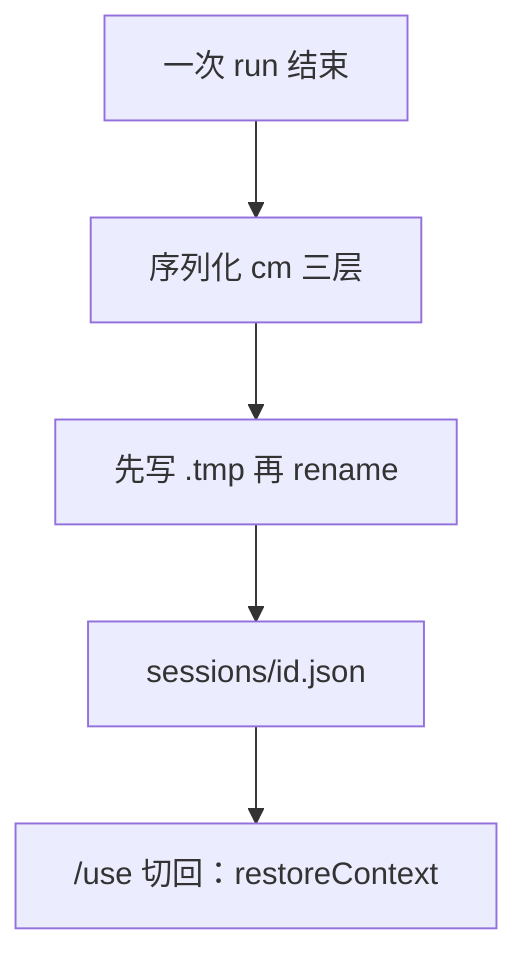
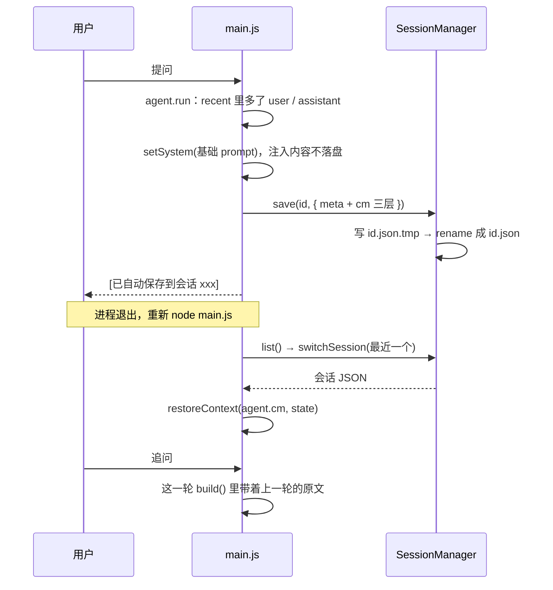

# 第 10 章 · 多会话 + 保存恢复：让 Agent 记住上次聊到哪

## 进程关掉之后，这段对话去哪了

前九章攒下来的这个 Agent 能调工具、有记忆、能派子 Agent、能读技能、能连 MCP，但它有一个和第一版一样的毛病：上下文只活在内存里。终端一关，刚才那二十轮对话连同其中读过的文件、算过的结论一起消失，下次打开又是从零开始。想同时跟它聊两件事也做不到——只有一个上下文，两条线会互相污染。

这一章给 Agent 装上一个存盘层：会话 = 一个 `sessions/<id>.json` 文件，里面装着这次对话的完整状态；进程重启后启动就恢复最近一个会话，`/use` 能切到任意一个历史会话接着聊。这是"玩具 demo"和"产品"之间的分水岭，ChatGPT 左侧那个会话列表、Qwen Code 的 `session.ts`，本质都是这一章的东西。

放在 13 章项目里的位置，它是"能上线"这一段的第一块：前面九章解决"能干得对"，从这里开始解决"能一直用"。

课程全景和章节先后关系见[入门者学习指南](../../docs/beginner-guide.md)。

第一次学习本章，先按本章 README 的“快速开始”运行离线版本，再读本页开头的问题和流程，沿调用关系打开入口文件，最后完成文末练习。逐文件说明和完整测试列表可以留作查阅，不必第一遍从头读完。

学完本章你应该能做到：说清四层运行时状态里哪两层该落盘、哪两层该重建；解释为什么每轮注入的记忆和技能不能写进会话文件；指着代码讲清序列化的两个坑（配对完整性、原子写）；讲清切会话时内存里发生了什么，以及为什么记忆是刻意共享的。

## 文件都在哪

```
lesson10-session/
├── session_state.js     69 行  cm 三层 ↔ JSON：serializeContext / restoreContext / truncateToCompletePairs
├── session_manager.js  142 行  会话仓库：CRUD + 原子写 + 损坏文件跳过 + autoTitle
├── main.js             225 行  多会话 REPL：自动保存、切换、跨进程恢复（本章重写）
├── agent.js            216 行  主 Agent（本章修一处 400 级 bug）
├── subagent.js         164 行  子 Agent（同一个 bug 的第二处）
├── sessions/                  两个真实会话文件，人类可读
├── test.js             325 行  12 个用例
└── docs/course.md             当前文件
```

除上面这些，其余 30 个源文件（工具、注册表、权限、上下文、记忆、委派、技能、Hooks、MCP）从第 9 章原样带过来，一行没动。阅读顺序按依赖走：先翻一个真实会话文件看清"存下来的东西长什么样"，再 `session_state.js`（怎么序列化）→ `session_manager.js`（存哪、怎么原子写）→ `main.js`（谁在什么时候调用它们）→ `agent.js` 和 `subagent.js` 里那处修复 → `test.js`。

## 一次存储与切回的骨架



上半条是保存：每轮对话跑完把三层状态序列化后落盘。下半条是恢复：切换会话时把文件内容填回内存里的 cm，下一个问题就带着历史上下文发出去。中间的 `.tmp` + `rename` 是防"写一半崩溃"的，下面会讲清楚为什么非它不可。

## 状态有四层，只有两层该落盘

Agent 运行时的东西看起来都要存，其实分四层，判断标准是"崩了之后能不能重建"：

| 层 | 例子 | 落盘？ | 为什么 |
|---|---|---|---|
| 对话上下文（cm 三层） | system + summary + recent | 是，核心 | 这是对话本身，丢了就断了 |
| 会话元数据 | session_id / 标题 / 创建与更新时间 / 模型 / 消息数 | 是 | 列表面板和恢复调度要用 |
| 记忆 | 用户偏好、项目约定 | 已经在盘上 | 第 5 章就是文件持久化，天然跨会话 |
| 工具 / 技能 / 运行时守卫 | registry、skills、loop 计数、错误预算 | 不落盘 | 静态资产启动时重建；守卫每次 run 重建（`agent.js:125` 里的 `guards`） |

一句可以直接背的面试话术：**状态要存，资产要建**。分不清这条线的人，要么把 registry 序列化进文件（复原时没法还原函数），要么漏掉 summary 层，恢复后模型看不到被压缩过的旧历史。

## session_state.js：cm 三层怎么变成 JSON

序列化本体只有三十行，`serializeContext`（`session_state.js:39`）把三个字段搬进一个 plain object：

```js
// session_state.js:39-45
export function serializeContext(cm) {
  return {
    system: (cm.system || []).map((m) => ({ ...m })),
    summary: cm.summary || "",
    recent: truncateToCompletePairs(cm.recent || []).map((m) => ({ ...m })),
  };
}
```

两个细节值得停一下。`{ ...m }` 是浅拷贝：不引用活着的 cm 里的对象，序列化产物被外部改动不会回写污染正在跑的对话，反过来 `restoreContext` 填进去的也是新对象。另一个是 `recent` 外面套的 `truncateToCompletePairs`。

那个函数要按**整组工具调用**检查（`session_state.js`）：

```js
// session_state.js:19-32
export function truncateToCompletePairs(messages) {
  const out = [];
  for (let i = 0; i < messages.length; i++) {
    const m = messages[i];
    if (m.role === "assistant" && m.tool_calls?.length) {
      const replies = messages.slice(i + 1, i + 1 + m.tool_calls.length);
      const complete = replies.length === m.tool_calls.length &&
        replies.every((r, j) => r.role === "tool" && r.tool_call_id === m.tool_calls[j].id);
      if (!complete) break;
      out.push(m, ...replies);
      i += replies.length;
      continue;
    }
    if (m.role === "tool") break;
    out.push(m);
  }
  return out;
}
```

一条 assistant 消息可以同时发起多个 `tool_calls`，程序要按 ID 为每个调用回填一条 `role: "tool"` 消息。若只保存了第一个结果，恢复后仍是坏历史。现在序列化器会核对整组调用：数量和 ID 都匹配才保留；缺一条就连这条 assistant 调用和部分结果一起截掉。

`restoreContext`（`session_state.js:52`）做同样的事，方向相反。序列化和恢复两个方向都截一次不是冗余：前者的理由是崩溃，后者的理由是"文件可能被人手工改坏"，数据入口再拦一道比信任上游便宜。这条双向防御有专门用例（`test.js:111`）。

同一个文件里还有一个 `rebuildContext`（`session_state.js:60`），它按固定预算（`maxTokens: 4096`）新造一个 cm 再把状态填进去。当前没有调用方——`main.js` 恢复会话走的是 `restoreContext(agent.cm, state)`，直接覆盖活着那个 cm（`main.js:87`），预算沿用 Agent 自己的 `agent.js:81-88`。两处预算的数值相同，差别在恢复路径用的是活着的 cm，这个工厂造的是新实例——接口上留了口子但没接线，属于本章如实标注的缺口。

## session_manager.js：会话存哪、怎么原子写

`SessionManager` 只做一件事：把一个个 plain object 安全地放进 `sessions/` 目录。

```js
// session_manager.js:29-53（节选）
  constructor({ dir = DEFAULT_DIR } = {}) {
    this.dir = dir;
    this.ready = mkdir(this.dir, { recursive: true });   // 异步预创建目录
  }

  async create({ title = "新会话", model = "" } = {}) {
    await this.ready;
    const id = randomUUID().slice(0, 8);                  // 8 位短 id，够人抄
    const meta = { session_id: id, title, model, created_at: now, updated_at: now, message_count: 0 };
    await this._atomicWrite(id, meta);
    return meta;
  }
```

id 取 uuid 前 8 位：uuid 保证不撞，8 位够人读——`/use 833be714` 比抄 36 位顺手得多。构造函数把 `mkdir` 的 promise 存成 `this.ready`（`session_manager.js:31`），每个公开方法开头 `await this.ready`，于是"目录还没建好就被调用"这种情况不会出现，也不会为了兼容它到处写 try/catch。

所有读写入口都会验证 ID 是 8 位十六进制字符。这样 `/use`、`/delete` 等用户输入不会被直接拼成任意文件路径。

原子写在这里（`session_manager.js:95-101`）：

```js
// session_manager.js:95-101
  async _atomicWrite(id, state) {
    await mkdir(this.dir, { recursive: true });
    const target = this._path(id);
    const tmp = `${target}.tmp`;
    await writeFile(tmp, JSON.stringify(state, null, 2), "utf8");
    await rename(tmp, target);
  }
```

为什么不能直接 `writeFile` 目标文件：写到一半进程被杀，留下半个 JSON，下次 `load` 时 `JSON.parse` 抛错——整个会话报废，比丢最后一轮严重一个量级。先写 `.tmp` 再 `rename`，同一文件系统内 rename 是原子操作，目标文件要么是完整的旧版本、要么是完整的新版本，不存在中间态。`JSON.stringify` 带缩进是为了让文件人类可读（第 5 章的记忆文件同样理由）。第二行再 mkdir 一次，是防"目录被外部删掉"。

`list()`（`session_manager.js:56-75`）遍历目录、逐个 parse，单个文件坏了 catch 掉继续，最后按 `updated_at` 倒序：最近聊过的排最前，启动时取第一个就是"上次那个会话"。一个坏文件不该让整个列表崩掉，代价是坏了不报错，只表现为列表里少一个（用例 `test.js:278` 把跳过行为钉住）。

标题生成在 `autoTitle`（`session_manager.js:138-142`）：空白折叠、超 20 字截断加省略号、空输入兜底"新会话"。零依赖零延迟，代价是不理解语义——"帮我查一下杭州天气"只是被截短，不是被概括。生产常见的两段式是先用截取把标题显示出来，后台再异步用 LLM 润色替换。

文件里还有个 `touch`（`session_manager.js:126-134`），读-改-写元数据、`context` 原样保留。`main.js` 的保存路径走的是 `save`（一次写完整个状态），`touch` 目前只被测试用到（`test.js:291`）——留着是因为它回答了一个常见问题："只想改标题，不想重写整个上下文"。

## main.js：什么时候保存，切换时发生什么

整个多会话 REPL 由三个函数撑起来。保存是这一个（`main.js:66-80`）：

```js
// main.js:66-80（节选）
  async function saveActiveSession() {
    if (!activeId) return;
    // 只持久化基础 system（注入内容每轮重建，不落盘）
    agent.cm.setSystem([{ role: "system", content: agent.systemPrompt }]);
    const current = await sessions.load(activeId).catch(() => ({ title: "新会话" }));
    const state = {
      ...current,
      ...serializeContext(agent.cm),
      message_count: agent.cm.recent.filter((m) => m.role === "user").length,
      updated_at: Date.now(),
    };
    await sessions.save(activeId, state).catch(() => {
      console.log("[warn] 会话保存失败（不影响对话）");
    });
  }
```

第三行那记 `setSystem` 是本章最容易写错的地方。`agent.run` 每轮都会把 system 重建成"基础提示 + 记忆召回 + 技能注入 + 可用技能清单"（`agent.js:120-122`），后三段是运行时动态生成的；直接序列化当前 cm，落盘的就是这份"注入后的快照"。后果有两个：恢复时它已经过期（那之后记忆库可能变了），以及恢复后第一轮 run 又拼一次注入，新旧两份叠在上下文里。

所以保存前先把 system 还原成基础 prompt，注入内容留在内存、不进文件。恢复后第一轮 run 照常重新召回，和正常对话走同一条路径，没有额外的补偿代码。这就是"注入 vs 持久"的边界：注入答的是"这一轮需要什么背景"，持久答的是"这段对话说过什么"，前者每轮重算，后者只在轮次边界落盘。

切换是第二个函数（`main.js:83-90`）：先 `saveActiveSession()` 把当前会话写回去，再 `load(id)` 拿目标状态，`restoreContext(agent.cm, state)` 覆盖三层，最后把 system 换回基础 prompt。同一时刻内存里只有一个会话的 cm，`/use` 的语义就是"存旧的、装新的"。启动复用走同一条路径（`main.js:107-117`）：`list()` 取最近一个、`switchSession` 顶上去，于是有了跨进程续聊。

对话主循环里挂着三个会话钩子（`main.js:199-213`）：第一条用户消息触发懒创建，标题用 `autoTitle(line)`；当前标题还是"会话 N"这类占位时，run 结束后用首句改名（`main.js:208-211`）；每轮 run 返回后立刻保存并打印 `[已自动保存到会话 xxx]`（`main.js:213`）。

保存失败那条路径是静默的（`main.js:77-79` 的 catch 只打一行 warn）。会话存储是辅助功能，磁盘写不进去不该把对话打断；崩溃最多丢当前这一轮，和 ChatGPT 最多丢最后一条是同一个取舍。要更细就每轮推理后保存再加防抖，代价是 IO 频率。

`/rename` 顺手补了一处兜底（`main.js:164-176`）：原来直接 `await sessions.rename(id, ...)`，用一个不存在的 id（或漏参）会抛到 `repl()` 的顶层 catch，整个进程退出。现在缺标题提示用法、id 不存在提示"会话不存在"，和 `/use` 的行为对齐。

## Loop 判定后不能 break：本章修的一个 400

写这一章时顺手扫了一遍同族代码，发现一个只在"一条响应带多个工具调用"时才现身的 bug，主 Agent 和子 Agent 各有一处，都在本章的文件里。

原来的写法（修复前）：Loop 检测判定死循环后，往上下文回填一条 `LOOP_DETECTED` 的 tool 消息，然后 `break` 跳出工具循环。单条 tool_call 时没问题；但模型一条响应里同时要调两个工具、第一个刚好触发判定时，`break` 会让第二个调用**一条 tool 消息都没有**。下一轮请求发出去，`assistant(tool_calls: [c2a, c2b])` 后面只跟了 `tool c2a`，服务端直接 400。

实跑抓的消息序列（探针工具只回 `{ok:true}`，同签名连调两次触发判定；脚本放在课程目录外，不新增项目文件）：

```text
修复前：
assistant | tool_calls=c1a,c1b | tool_call_id=-   | （第一轮两个调用，都执行了）
tool      | tool_call_id=c1a  | {"result":{"ok":true}}
tool      | tool_call_id=c1b  | {"result":{"ok":true}}
assistant | tool_calls=c2a,c2b | tool_call_id=-   | （第二条响应）
tool      | tool_call_id=c2a  | {"error":{"code":"LOOP_DETECTED",...}}
assistant | tool_call_id=-     | 已放弃重复调用      （c2b 始终没有回填 → 下一个请求 400）

修复后：
assistant | tool_calls=c2a,c2b | tool_call_id=-   |
tool      | tool_call_id=c2a  | {"error":{"code":"LOOP_DETECTED","message":"检测到死循环: probe({}) 重复调用 3 次"}}
tool      | tool_call_id=c2b  | {"error":{"code":"LOOP_DETECTED","message":"本轮已判定死循环，跳过执行: probe"}}
assistant | tool_call_id=-     | 已放弃重复调用
```

修法是加一个 `loopDetected` 标记：判定之后同一条响应里剩下的调用不再执行，但仍然逐条回填（`agent.js:151-163`）。

```js
// agent.js:151-163
          const loopReason = loopDetected
            ? `本轮已判定死循环，跳过执行: ${name}`
            : this._checkLoop(guards, name, args);
          if (loopReason) {
            loopDetected = true;
            this.cm.append({
              role: "tool",
              tool_call_id: tc.id,
              content: JSON.stringify({
                error: { code: "LOOP_DETECTED", message: loopReason },
              }),
            });
            continue;
          }
```

`continue` 而不是 `break` 是关键：消息协议的配对要求比"省几次工具调用"重要。剩下的调用不再真的执行（第一个已经证明在死循环），但每条都要有一条错误消息交代过去；措辞也分开——第一条是"检测到死循环"，后面的是"本轮已判定死循环，跳过执行"，模型看得到区别，不会收到三条一模一样的错误。

`subagent.js:133-145` 是同一个模式、同一处 bug。子 Agent 有自己的推理循环和一份 Loop 检测，能力对齐的代价就是修 bug 得修两遍。两个修复各配一个回归用例（`test.js:122`、`test.js:180`），断言的不是最终回答，而是"每条 `tool_calls` 都能找到配对的 `tool` 消息"——把 `continue` 改回 `break`，这两个用例立刻变红并报出漏配对的 `tool_call_id`。


一次完整往返：



## 动手练习

按[第 10 章练习](../../docs/beginner-practice.md#chapter-10)完成任务。练习页列出了起始文件、操作目标和自检标准；先用假数据完成，再按本章 README 运行完整示例。

## 下一章

第 11 章把 Agent 接进消息网关：不在终端里对话，而是让它挂在 QQ 机器人上，用户从聊天窗口发消息，Agent 在服务端跑完再把结果发回去。这一章攒下的会话层在那里换了用法——一个进程要同时服务多个用户，会话不是按终端算的，而是按 `channelId` 映射（谁发来的消息就恢复谁的会话），`restoreContext` 从"用户敲 `/use` 时手动切"变成"每条消息进来前自动切"。

换掉本章实现的具体信号有几个：会话要支持并发写（多进程或多实例部署时 JSON 文件会互相覆盖），要按租户隔离数据目录，要能分页和搜索。真到那一步，`_atomicWrite` / `load` / `list` 这三个方法换成 SQLite 实现就行，`SessionManager` 的 CRUD 签名不用动——接口挡住变化，这是本章把存储细节关在一个类里的直接收益。
