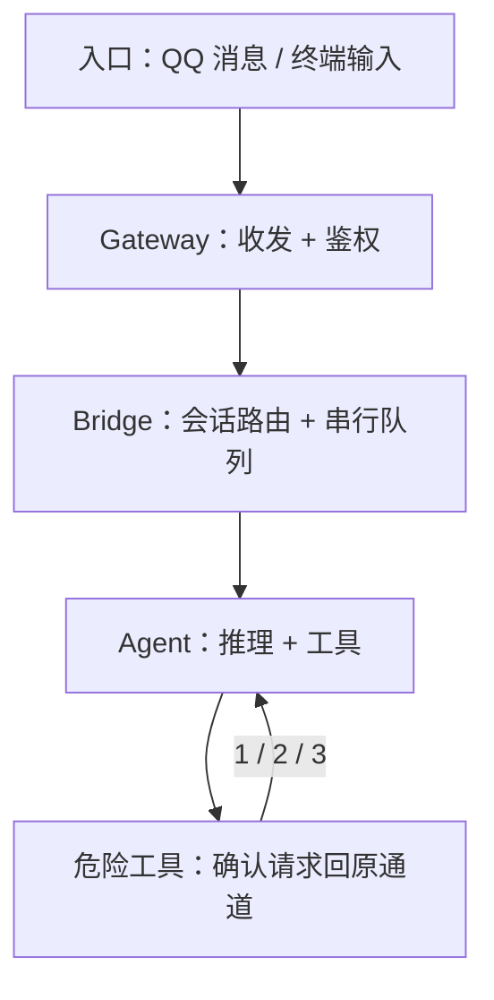

# 第 11 章 · 消息网关：让 Agent 在 QQ 里跟你说话

## 这一章要解决的事

前十章的入口一直是终端 REPL：你在服务器上开着这个进程，敲一句，Agent 回一句。真实产品不长这样。用户不会 ssh 到你的机器上，他们在 QQ 里私聊机器人、在群里 @ 机器人、在企业微信里发一句话。你要么把 Agent 做成一个能被这些平台调用的服务，要么它就只能是个玩具。

把入口搬过去，第一件挡路的事是平台协议。QQ 机器人用 WebSocket 长连接推事件，握手阶段就要带 `Authorization` 和 appid 头；消息事件有七八种类型，`GROUP_AT_MESSAGE_CREATE` 和 `C2C_MESSAGE_CREATE` 的载荷结构还不一样；群聊消息的正文自带一个 `<@!机器人ID>` 前缀。这些细节如果直接写进 Agent，换个平台就得改主循环。

第二件事是多用户。终端里只有一个"你"，QQ 里有一堆 openid，用户 A 的对话历史不能出现在用户 B 的回答里。而 Agent 只有一个实例、一份上下文管理器——这个矛盾必须在中层解决。

第三件事是权限确认。Agent 的 `run_shell` 是 danger 级，第 2 章起就要人工批准。在终端里这件事很简单，`rl.question` 弹一行就行。用户跑到 QQ 里以后，终端没人看，确认请求必须发到他所在的那个通道，还得等他回复、超时兜底。

本章的三件事就是解决这三件事：`gateway/` 收平台细节，`agent_bridge.js` 收会话路由，`approval_flow.js` 收权限确认。QQ 是第一个真实适配器，终端作为第二个通道并存——两通道跑通，才说明抽象是真的平台无关，而不是"为 QQ 写死的代码"。

放在 13 章项目里的位置，它属于"能上线"这一段的第一站：

课程全景和章节先后关系见[入门者学习指南](../../docs/beginner-guide.md)。

第一次学习本章，先按本章 README 的“快速开始”运行离线版本，再读本页开头的问题和流程，沿调用关系打开入口文件，最后完成文末练习。逐文件说明和完整测试列表可以留作查阅，不必第一遍从头读完。

学完本章你应该能做到：说清统一消息模型里四个字段各自的用途；解释 Node 内置 WebSocket 为什么接不上 QQ，以及手写客户端的四步（TLS、Upgrade 握手、帧解析、掩码）；讲出 IM 审批流的死锁点在哪儿、怎么绕；指着代码说明"单实例服务多用户"为什么靠上下文切换而不是共享。

## 文件都在哪

```
lesson11-gateway/
├── gateway/
│   ├── gateway.js           42 行   抽象基类：connect / onMessage / send / close
│   ├── ws_client.js        253 行   ★ 手写 WebSocket 客户端（RFC 6455 最小子集）
│   ├── qq_gateway.js       286 行   ★ QQ 实现：换 token、握手、心跳、事件解析、被动回复
│   ├── mock_gateway.js      39 行   本地替身，把"收到消息"变成一次方法调用
│   └── terminal_gateway.js 159 行   终端通道：readline 循环、/命令、打字机收尾
├── approval_flow.js        120 行   ★ 确认请求发到通道，三态回复，超时拒绝
├── agent_bridge.js         129 行   ★ channelId → 会话、串行队列、确认回复绕过队列
├── main.js                 167 行   组装两个通道 + 注册终端命令
├── verify_qq.js             24 行   连接自检：换 token → 握手 → READY
├── agent.js                212 行   主循环（本章修 Loop 判定后的回填，见后文）
├── subagent.js             167 行   子 Agent（与 agent.js 同一处 Loop 回填）
├── llm.js                   69 行   模型调用层（本章加了 60 秒超时）
└── test.js                 803 行   25 个用例，全部离线
```

其余 29 个源文件（工具、上下文、记忆、技能、Hooks、会话、MCP）从第 10 章原样带过来，一行没改。

阅读顺序按依赖方向：先看 `gateway.js` 定了什么接口，再看 `mock_gateway.js` 这个最小的实现长什么样，然后进 `ws_client.js` 和 `qq_gateway.js` 看协议细节，接着是 `approval_flow.js` 与 `terminal_gateway.js`，最后 `agent_bridge.js` 和 `main.js` 把前面所有零件接起来。`test.js` 放到最后，它是对全链路的验证。

## 谁把消息送到 Agent 手里



这张图的四条边分别对应本章的四个文件族。`Gateway` 只关心"消息从平台来、回复回平台去"，它不知道 Agent 是什么；`Bridge` 只关心"这条消息属于谁"和"什么时候能处理"；`Agent` 完全不改，它拿到的还是一条文本。

备选做法是先做插件式的"平台适配层 + 事件总线"，把 QQ、企微做成可热插拔的模块。那套结构在平台数量上双位数时才划算，本章只有两个通道，一个基类加两个子类足够说明问题，多出来的那层抽象读者得先理解它才能读懂主流程。

## gateway/gateway.js：四个方法定下平台边界

```js
export class MessageGateway {
  async connect() { throw new Error("未实现 connect"); }           // 建立连接
  onMessage(callback) { this._onMessage = callback; }              // 注册收消息回调
  async send(channelId, text) { throw new Error("未实现 send"); }   // 发回复
  close() {}                                                       // 关连接
  _emit(message) { if (this._onMessage) this._onMessage(message); } // 子类收到平台消息时调它
}
```

四十行里没有任何业务。`connect` / `onMessage` / `send` / `close` 是"一个通道的一生"，`_emit` 是子类唯一需要主动调的方法——把平台推送翻译成统一消息模型之后交给上层。前四个方法定为抛异常，是为了让漏实现的方法在启动时就炸掉，而不是在收到第一条消息时才静默失败。

统一消息模型是这一层真正的内容，五个字段各有分工。`channelId` 决定会话归属：私聊里它就是用户 openid，群聊里它是群 openid（一个群共享一个会话，这样群里多个人 @ 机器人才有连贯的上下文）。`userId` 是"这条消息是谁发的"，群聊里和 `channelId` 不同，用来做审计和后续的权限控制。`text` 是归一化后的正文——各平台的后缀、前缀、@ 标记在这一步被剥掉。`msgId` 是原消息的 id，QQ 的被动回复必须带上它，否则发送会被拒；把它放进统一模型，是因为"回复哪一条消息"这件事每个 IM 都有。`type` 记来源事件类型，网关自己拿它决定回复走群端点还是私聊端点（`gateway.js:8-12`）。

## gateway/ws_client.js：手写的 WebSocket 客户端

这一章最"低层"的文件，起因是一个具体限制：**Node 内置的全局 `WebSocket` 是浏览器 API 形态**，构造函数只有 `(url, protocols)` 两个参数，`protocols` 只能放子协议字符串，塞不进自定义请求头。QQ 的网关要求在**握手阶段**就带 `Authorization: QQBot <token>` 和 `X-Union-Appid`，内置实现做不到。官方推荐的 `undici` 包在 Node 22 里也不能直接 `import`。

所以握手请求自己拼：

```js
const request = [
  `GET ${path} HTTP/1.1`,
  `Host: ${hostHeader}`,
  "Upgrade: websocket",
  "Connection: Upgrade",
  `Sec-WebSocket-Key: ${key}`,
  "Sec-WebSocket-Version: 13",
  ...Object.entries(this.headers).map(([k, v]) => `${k}: ${v}`),   // ← 鉴权头加在这
  "",
  "",
].join("\r\n");
```

`Sec-WebSocket-Key` 是 16 字节随机数的 base64，服务端拿它拼上固定 GUID 做 SHA-1 再 base64 返回，客户端校验这个 `Sec-WebSocket-Accept` 才算握手成立（`ws_client.js:114-145`）。`Host` 头在默认端口上省略端口号，带上 `:443` 会被部分网关拒。

TLS 那一行是踩出来的：

```js
this._socket = (isTls ? tls : net).connect(
  {
    host: u.hostname,
    port,
    // 必须显式传 servername（SNI），否则多租户 IP 上服务器返回默认证书
    servername: isTls ? u.hostname : undefined,
  },
  () => this._socket.write(request),
);
```

QQ 网关的 IP 上挂着多个租户，SNI（TLS 握手里声明"我要访问哪个域名"的字段）没发出去时服务器只能给默认证书 `*.ias.tencent-cloud.net`，客户端拿它去校验证书里没有 `api.sgroup.qq.com`，于是 `ERR_TLS_CERT_ALTNAME_INVALID`。症状很迷惑：域名解析正常、证书本身也没过期。定位办法是写两个连接对比——一个只给 `host`，一个额外给 `servername`，后者能通就说明是 SNI。

帧解析是协议里最简单的部分，读两个字节的头就行：

```js
const fin = (buf[0] >> 7) & 1;
const opcode = buf[0] & 0x0f;
const masked = (buf[1] >> 7) & 1;
let len = buf[1] & 0x7f;
let offset = 2;
if (len === 126) { len = buf.readUInt16BE(offset); offset += 2; }        // 16 位长度
else if (len === 127) { len = Number(buf.readBigUInt64BE(offset)); offset += 8; }  // 64 位长度
```

长度分三档（7 位直接用、126 走 16 位、127 走 64 位），有掩码位就再读 4 字节 mask key，然后 XOR 还原 payload（`ws_client.js:156-191`）。缓冲区不够一条完整帧时直接返回，等下一个 TCP 段——WebSocket 的帧边界和 TCP 段边界没有任何关系，粘包和拆包都得自己处理。

发送方向的规则不对称：**客户端发出的每一帧都必须带掩码**，服务端发的不带。所以 `_sendFrame` 每次都生成 4 字节随机 mask 再 XOR（`ws_client.js:223-243`），这条规则反了的话服务端会直接断开连接，测试里用本地假服务器抓这个错最方便。

控制帧要自动应答：收到 ping 回一个 pong，收到 close 回执之后再断开（`ws_client.js:193-215`）。腾讯的网关会周期性 ping，不回 pong 连接会被判死。

这个实现有边界：解析时读到了 `FIN` 位但没做分片重组，服务端把一条消息拆成续帧（opcode 0x0）时会被当成独立帧。QQ 的文本帧都在单帧内，暂时没撞上，缺口表和 README 里都记着，生产要补状态机。

## gateway/qq_gateway.js：把 QQ 的事件翻译成统一消息

凭证先要换一次。新版 union 机器人的 appid + appsecret 不是 token，得先拿它们换：

```js
export async function getAppAccessToken(appid, clientSecret) {
  const resp = await fetch("https://api.bot.qq.com/app/getAppAccessToken", {
    method: "POST",
    headers: { "Content-Type": "application/json" },
    body: JSON.stringify({ appId: String(appid), clientSecret }),
  });
  const data = await resp.json();
  if (!data.access_token) {
    throw new Error(`获取 access_token 失败: ${JSON.stringify(data)}`);
  }
  return data.access_token;   // 有效期 7200 秒，生产要缓存 + 到期前刷新
}
```

把 appsecret 直接当 token 用是最常见的错法，症状链是"握手 101 成功 → HELLO 正常 → 收到 op 9 表示会话无效 → 连接断开重连"。失败时把服务端的原始响应拼进错误信息，是因为 QQ 的错误码不查文档看不懂，原文里那句 `invalid appid or secret` 才是线索。

`connect()` 里跑的是一个四步状态机：

```js
if (op === 10) {                                   // HELLO：拿到心跳间隔，发 IDENTIFY
  const interval = payload.d?.heartbeat_interval || 45000;
  this._startHeartbeat(interval);
  this._send({
    op: 2,
    d: {
      token: `QQBot ${this.token}`,
      intents: 1 << 25,                            // C2C 单聊 + 群@；1<<30 是频道消息
      shard: [0, 1],
    },
  });
  return;
}
if (op === 11) return;                             // 心跳 ACK
if (op === 0 && payload.t === "READY") { /* resolve，就绪 */ }
```

`intents` 是事件订阅的位掩码，选错的后果最隐蔽：连接一切正常、心跳也正常，就是收不到任何消息。`1 << 25`（GROUP_AND_C2C_EVENT）覆盖私聊和群 @，`1 << 30` 是频道消息，两者不是包含关系。这个字段调试时应该第一个怀疑。

事件到统一消息的转换放在纯函数 `parseDispatch` 里（`qq_gateway.js:43-69`），它不碰网络也没有状态，所以能离线测：

```js
export function parseDispatch(payload) {
  if (!payload || payload.op !== 0 || !payload.t) return null;   // 心跳/READY 不是消息
  const d = payload.d || {};
  if (payload.t === QQ_EVENTS.C2C) {
    // 兼容新旧结构：新版 openid 在 d.author.user_openid（d.openid 可能缺失）
    const openid = d.openid || d.author?.user_openid || d.author?.id || "";
    return { type: "c2c", channelId: openid, userId: openid, text: String(d.content || "").trim(), msgId: d.msg_id || d.id || "" };
  }
  if (payload.t === QQ_EVENTS.GROUP_AT) {
    return {
      type: "group_at",
      channelId: d.group_openid,
      userId: d.author?.member_openid || d.author?.user_openid || "",
      text: String(d.content || "").replace(/^<@![^>]+>\s*/, "").trim(),   // 去掉 <@!机器人ID>
      msgId: d.msg_id || d.id || "",
    };
  }
  return null;                                                   // 其他事件（READY 等）不是消息
}
```

三个字段各有陷阱来源。`openid` 在老版事件里在 `d.openid`，新版搬到了 `d.author.user_openid`，两个都读才不会在平台升级后突然收不到消息；消息 id 同理，`d.msg_id` 和 `d.id` 都要兜。群 @ 的正文自带 `<@!机器人ID> ` 前缀，必须正则剥掉，否则模型会看到一串它看不懂的标记。群聊里 `channelId` 取群 id、`userId` 取发消息的人，这样"一个群一个会话、但知道是谁在问"。

转换函数只接收字段齐全的消息：私聊缺少用户 ID 或消息 ID、群聊缺少群 ID／发送者 ID／消息 ID 时会返回 `null`，消息不会进入桥接层。WebSocket 客户端也会拒绝超过 2 MiB 的入站帧，避免单个超大消息占用过多内存。这些是本课程示例的边界保护，不是完整的网关限流或平台协议兼容层。

回消息的端点是两个：私聊 `POST /v2/users/{openid}/messages`，群聊 `POST /v2/groups/{group_openid}/messages`（`qq_gateway.js:245-249`）。QQ 的群 id 和用户 id 长得一样（都是不带前缀的 hex 串），从值上分不出来，所以这里靠"收到过群消息"的记账：

```js
const isGroup = this.groupChannels.has(channelId) || channelId.startsWith("group");
```

这句是这一章书化时唯一改错的代码。原来的写法只有 `channelId.startsWith("group")`——本地测试用的假通道叫 `group_001`，能过；真实群 id 不带这个前缀，于是群里的回复会被打到私聊端点，服务端返回 404 之类的错误。现在 `parseDispatch` 认出群 @ 事件时顺手把 channelId 记进 `groupChannels`（`qq_gateway.js:181`），`send` 先查这本账，再退回前缀启发式给本地演示兜底。

被动回复还有两条协议规则，写在 `send()` 里：回复必须带原消息的 `msg_id`，否则发送被拒；同一个 `msg_id` 的多次回复（一次确认请求加一次最终回复）`msg_seq` 必须递增，相同会被判成重复消息、错误码 40054005（`qq_gateway.js:253-257`）。

```js
const seq = (this.msgSeqs.get(msgId) || 0) + 1;
this.msgSeqs.set(msgId, seq);
body.msg_id = msgId;
body.msg_seq = seq;
if (this.msgSeqs.size > 1000) this.msgSeqs.clear();   // 防 Map 无限增长
```

重连走指数退避，1 秒起步翻倍、30 秒封顶，但**有次数上限**（`qq_gateway.js:196-202`）。原因是鉴权失败这类错误重连一万次也没用，上限到了就把 close code 和一句"检查 env.json 的 QQ_APPID/QQ_TOKEN"打出来，比无限重试更容易定位。

## approval_flow.js：把权限确认搬进聊天

第 2 章起 `run_shell` 这类 danger 级工具要人工批准，终端里的做法是 `rl.question` 弹一行。用户跑到 QQ 里之后这条路断了——终端没人看。确认请求得跟着用户走。

```js
createConfirm(channelId, msgId = "") {
  return async (name, args) => {
    return new Promise((resolve) => {
      const timer = setTimeout(() => {
        this.pending.delete(channelId);
        resolve(false);          // 安全默认：超时 = 拒绝
      }, this.timeoutMs);        // 默认 60000
      this.pending.set(channelId, { resolve, timer, name });   // 先注册 pending
      const gw = this._gatewayFor(channelId);
      void gw.send(channelId, `⚠️ 需要你的批准：…回复：1 (批准) / 2 (拒绝) / 3 (始终允许)`, msgId).catch(() => {});
    });
  };
}
```

`pending` 是 `channelId → {resolve, timer}` 的挂起表（`approval_flow.js:59`），回复由 `handleReply` 解析（`approval_flow.js:85`），三态映射写在 `approval_flow.js:93-107`：`1` → `true`（批准一次）、`2` → `false`（拒绝）、`3` → `"always"`（本会话内不再问）。这三态对应第 2 章的 `ProceedOnce` / `Cancel` / `ProceedAlways`，`y` / `n` / `a` 这些旧写法仍然认，其它任何输入一律按拒绝——未知输入给通过的权限系统迟早出事。超时也走拒绝（`approval_flow.js:53-57`），`timeoutMs` 在 `main.js:101-104` 保持默认的 60 秒。

两个实现细节容易写反。

**pending 必须先同步注册，再异步发消息**（`approval_flow.js:52-70`）。如果在 `await gw.send(...)` 之后才 `pending.set`，用户手速快时会先命中 `handleReply`，那时 `pending` 里还没有这条记录，函数返回 false 让回复进了主队列，确认就永远等不到——只能等超时。现在的写法是在 Promise executor 里同步 `set`，`send` 用 `void ... .catch()` 发出去不阻塞。

**确认回复不能进串行队列**，这是本章最值钱的一个坑，见下一节。

确认请求要发到哪条通道由 `_gatewayFor` 决定（`approval_flow.js:38-40`）：先查 `gateways` 这张 `channelId → gateway` 表，查不到走 `defaultGateway`。终端通道注册在表里（`main.js:102`），QQ 用户落到默认通道，于是两个通道各收到自己的确认。

## gateway/terminal_gateway.js：第二个通道

只做 QQ 一个适配器说明不了"平台无关"，所以终端也实现同一个 `MessageGateway`：`channelId` 固定是 `"terminal"`（`terminal_gateway.js:21`），用户输入变成一条消息 `_emit` 出去（`terminal_gateway.js:125`），`send` 打印到屏幕（`terminal_gateway.js:135`）。终端这一个通道就服务一个会话，QQ 那边每个用户一个。

readline 的 `question` 是异步的，`await` 让出事件循环，QQ 的 WebSocket 事件照常处理——两个通道在同一个进程里互不阻塞。`/` 开头的输入不进消息流，命中 `onCommand` 注册的命令直接执行（`terminal_gateway.js:104-122`），`main.js:120-154` 用它挂了 `/sessions /new /use /delete /help` 这一套第 10 章的会话管理命令。

这个文件里有两处是为体验打的补丁，都能对应到第 13 章记的问题。`waitReplyDone`（`terminal_gateway.js:64-69`）让 `_loop` 在普通消息处理完之后才显示下一个"你>"（`terminal_gateway.js:87-91`），否则提示符会抢在 Agent 回复之前冒出来；`bridge.attach` 的 `finally` 里调 `gateway.onMessageDone?.(msg)`（`agent_bridge.js:53-56`）就是给它的完成信号——审批回复被消费、Agent 没有回复这些情况也要通知，不然要等 90 秒超时。`markStreaming`（`terminal_gateway.js:43`）标记本次回复已由打字机输出过，`send` 检测到就只换行收尾、不把整段再打印一遍。

## agent_bridge.js：会话路由和那个死锁

桥接层只做三件事：把消息变成会话归属、把处理排成串行、把持久化前的 system 还原。

```js
handleMessage({ channelId, text, msgId }) {
  // 审批回复优先：绕过串行队列直接处理
  if (this.approval && this.approval.handleReply(channelId, text)) {
    return Promise.resolve(null);
  }
  const task = this.queue.then(() => this._process({ channelId, text, msgId }));
  this.queue = task.catch(() => {});   // 队列吞掉错误，下一条继续
  return task;
}
```

**死锁是这么来的**：`agent.run` 在等确认时正挂在 `confirm` 返回的 Promise 上，而它已经占着 `this.queue`。用户的确认回复到达 `handleMessage`，如果按普通消息进队列，就要排在正在等确认的那条后面——两条互相等，谁也不动。所以 `handleMessage` 第一行先问 `approval.handleReply`（`agent_bridge.js:64`），消费掉就返回 `null` 不入队。`test.js:222` 钉住这条：确认回复被消费、没有触发新的 `agent.run`、网关只发出确认请求那 1 条消息。

`_process`（`agent_bridge.js:96`）是每用户会话的切换点：`channelToSession` 里没有就建一条（`agent_bridge.js:102-105`，新用户先 `agent.reset()`），有就 `restoreContext` 把该会话的三层填回 `agent.cm`（`agent_bridge.js:109`）。跑完保存前有一个容易漏的步骤——`cm.setSystem` 先把 system 换回基础 prompt（`agent_bridge.js:116-118`），因为 `run` 里注入过记忆和技能，直接序列化会把这份注入快照落盘；这和第 10 章的"注入不落盘"是同一条规则。`currentChannel` / `currentMsgId` 两个字段是给 confirm 回调取用的（`agent_bridge.js:97-98`），确认请求要知道"谁在等"和"回哪条消息"。

`attach`（`agent_bridge.js:40-58`）把上面这些接到网关上，并且刻意给 `.then()` 配了 `.catch()`：LLM 超时或报错时回调 `agent.run` 的 Promise 会 reject，没有 `.catch` 就是 unhandled rejection，Node 22 默认直接让进程退出——服务挂掉，用户消息石沉大海。现在改成记一行日志、再用 `gateway.send` 告诉用户"处理失败请稍后重试"（`agent_bridge.js:46-52`），进程继续。

## main.js：组装

组装顺序按依赖来：先造 `registry` 和 `Agent`，再造通道，再造审批流，最后把通道 attach 到 bridge。

`confirm` 回调有一个绕不开的问题：`buildCoreTools` 在构造时就把 confirm 固化了，而审批方式要等通道建好才知道。这里的做法是传一个 holder 进去（`main.js:64-65`），`registry` 持有的是 `(name, args) => confirmHolder.fn(name, args)`；通道和审批流都就绪后再给 `holder.fn` 赋真正的实现（`main.js:105-106`），从 `bridge.currentChannel` 取通道、`bridge.currentMsgId` 取消息 id。多一层间接换来的是"不动 registry 就能换确认方式"。

QQ 通道只在配了凭证时启用（`main.js:84-95`）：`QQ_SECRET`（机器人 appsecret）先经 `getAppAccessToken` 换成 access_token（`main.js:88`），老版自带 token 的机器人可以直接给 `QQ_TOKEN`；两个都没配就打印一行提示、只跑终端。两个全局兜底挂在文件顶部（`main.js:54-59`）：`unhandledRejection` 和 `uncaughtException` 只记日志不退出，和第 13 章的进程保活是同一思路。

## 动手练习

按[第 11 章练习](../../docs/beginner-practice.md#chapter-11)完成任务。练习页列出了起始文件、操作目标和自检标准；先用假数据完成，再按本章 README 运行完整示例。

## 下一章

这一章所有对话都是被动的——用户发消息，Agent 才动。下一章加的是主动推送：一个 cron 解析器加调度器，到点由系统发起对话，Agent 在目标会话里执行、把结果推回对应通道。会用到本章的两个接口：`bridge.handleSystemMessage` 走系统消息入口（避开审批流会把系统文本误判成"批准/拒绝"的消费逻辑），以及 `bridge.currentChannel` 作为默认推送目标——QQ 用户设的定时任务推回他自己的 QQ。

什么时候该换掉本章的实现：当单个进程的串行队列开始顶不住（一个长任务让所有用户排队），就按 `channelId` 分片，或者干脆每个用户一个 Agent 实例；当发送被 QQ 的频率限制（大约 5 条/秒/机器人）打到 429，就该给 `send` 加发送队列和令牌桶。这两件事本章都留在缺口表里没做，属于负载上来了才需要付的成本。
