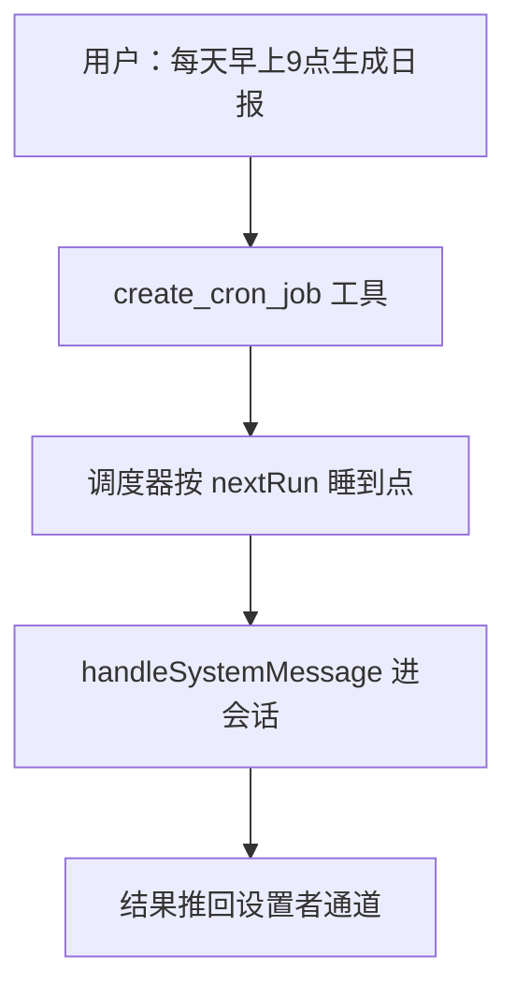
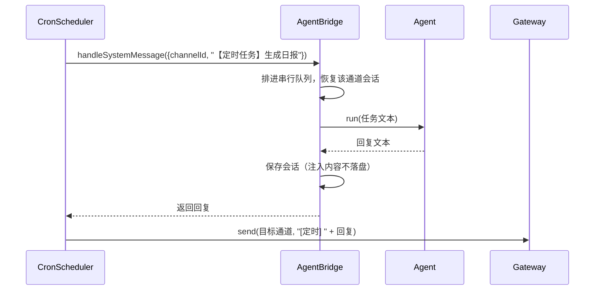

# 第 12 章 · 定时任务：让 Agent 自己到点干活

## 这一章要解决的事

走到第 11 章，这个 Agent 已经会调工具、记得住偏好、能派子任务、接在 QQ 和终端两个通道上。它的一个隐含缺陷是：**永远在等**。用户不问，它就不说；消息不来，它就待着。把"每天早上 9 点生成日报"交给它，前一章的它做不到——它没有时间概念。

真实场景里这类需求很密：产线日报要 22:00 汇总完推到车间群、库存水位每 30 分钟查一次、到期的合同提前三天提醒。做法有两条。一条是把命令写进系统 crontab（Linux 的定时任务表），到点拉起 `node xxx.js`——可靠，但那个新进程只会拿到几个命令行参数，Agent 的会话上下文、记忆、工具、审批流全都够不到，等于把 Agent 降级成裸脚本。另一条是在常驻进程内部做调度，到点直接调 `bridge` 进会话。这一章走第二条，因为定时任务要干的活恰好是最需要运行时的那类：读这个用户的历史、召回他的偏好、必要时调工具并等他批准。

在 13 章项目里的位置，它属于"能上线"这一段的第一章——前面把能力攒齐了，从这里开始让 Agent 从被动应答变成主动服务。

课程全景和章节先后关系见[入门者学习指南](../../docs/beginner-guide.md)。

第一次学习本章，先按本章 README 的“快速开始”运行离线版本，再读本页开头的问题和流程，沿调用关系打开入口文件，最后完成文末练习。逐文件说明和完整测试列表可以留作查阅，不必第一遍从头读完。

学完这一章你应该能做到：写一个支持 `*`、`a,b`、`a-b`、`*/N` 四种写法的 5 字段 cron 解析器；手推 `nextRun` 在分钟、小时、日、月四层上的进位过程；解释 `setTimeout` 那次 24.86 天的静默提前触发，以及分段 sleep 怎么绕开它；说清定时任务为什么必须走 `handleSystemMessage` 而不是复用 `handleMessage`。

## 新加的只有 cron/ 这三个文件

另外 44 个源文件从第 11 章带过来，调度器要用的会话、记忆、工具、审批都在里面（本章只动了其中五个：`agent.js`、`subagent.js`、`agent_bridge.js`、`main.js`、`test.js`）。

```
lesson12-cron/
├── cron/
│   ├── cron_parser.js      86 行   表达式 → 每字段一个匹配值集合
│   ├── cron_scheduler.js  198 行   nextRun 进位计算 + 睡到点的触发循环
│   └── cron_tool.js        81 行   两个工具：create_cron_job / list_cron_jobs
├── agent_bridge.js        139 行   新增 handleSystemMessage 系统消息入口
├── main.js                172 行   装配调度器、注册工具、终端元命令
├── agent.js               208 行   （本章补了死循环回填，见「本章增量」表）
├── subagent.js            161 行   （同一处修复同步过来）
├── test.js                554 行   25 个用例
└── docs/course.md                 当前文件
```

阅读顺序按依赖走：`cron_parser.js`（时间怎么变成数据）→ `cron_scheduler.js`（算下一次 + 睡到点）→ `cron_tool.js`（怎么交到模型手里）→ `agent_bridge.js:72-80`（消息到了怎么进会话）→ `main.js:109-124`（装配）。测试放在最后看，它是对前面每一步的固定证据。

## 一张图看这一章在干什么



五个方框就是这一章的五个环节。用户那句话先由模型翻译成 cron 表达式和任务描述，交给工具落地；调度器拿着表达式算出下一个触发时刻，睡到那一刻再醒；醒来之后任务文本作为一条系统消息送进 Agent，跑在设置者的会话里；跑完的结果按通道推回去。中间没有一处改动主循环——时间只是一条新的消息来源。

## cron_parser.js：把"每天 9 点"变成数据

cron 是 Unix 世界用了五十年的时间表达法，五个字段从左到右是**分、时、日、月、周**。文件头把四种写法和例子列在一起（`cron_parser.js:1-19`），字段的取值域单独声明在 `CRON_FIELDS` 里（`cron_parser.js:22-28`）：

```js
// cron_parser.js:22-28
export const CRON_FIELDS = [
  { name: "minute", min: 0, max: 59 },
  { name: "hour", min: 0, max: 23 },
  { name: "day", min: 1, max: 31 },
  { name: "month", min: 1, max: 12 },
  { name: "weekday", min: 0, max: 6 }, // 0=周日
];
```

顺序即字段顺序，解析循环按位置对号入座，每个字段的上下界也由这里提供——`*` 展开成什么、步进从哪里起步都靠它。

真正干活的是 `expandField`（`cron_parser.js`）。它按逗号切段，识别步进（`*/5`）、范围（`1-5`）、通配（`*`）和单个数字，并检查数字是否在该字段允许的范围内。步长为 0、倒序范围、越界数字或无法识别的写法都会报错，不会被静默忽略。

```js
// 实跑 expandField 的产物（parseCron 拆字段后打印）
"*/15 * * * *"  → minute: [0, 15, 30, 45]
"0 9 1,15 * *"  → day:    [1, 15]
"0 9 * * 1-5"   → weekday:[1, 2, 3, 4, 5]
"0 9 * * *"     → {"raw":"0 9 * * *","minute":[0],"hour":[9],
                   "day":[1..31],"month":[1..12],"weekday":[0..6]}
```

`parseCron` 先检查表达式有 5 个字段，再逐字段验证格式和取值范围。比如分钟允许 `0–59`，星期允许 `0–6`；本课不支持 `mon` 这样的英文缩写，遇到就明确报错。工具注册之前就会解析，因此非法表达式不会留下一个永远不触发的任务。

产出的"值集合"是这一章第一个值得记住的设计。cron 解析的产物不是能匹配时间的正则，而是每字段一组可判定的数字。理由在下游：`nextRun` 需要问"比当前分钟大的下一个匹配值是多少"，集合上是一次 `find`，正则上只能一分钟一分钟试。集合能直接找，正则只能撞。

`matches`（`cron_parser.js:78-86`）是同一份数据的另一种用法：五个 `includes` 全真才算命中。它不在调度主路径上（主路径在 `nextRun` 里逐字段比），专门给测试当校验函数用——`test.js:109` 就是拿它断言"`nextRun` 给的时间一定合法"。

## cron_scheduler.js 上半段：nextRun 是这一章的灵魂

`nextRun(spec, from)` 回答一个问题：给定表达式和此刻，下一次触发是什么时候。骨架只有三行（`cron_scheduler.js:20-28`）：

```js
// cron_scheduler.js:20-28（节选）
export function nextRun(spec, from = new Date()) {
  const d = new Date(from);
  d.setSeconds(0, 0);                 // ① 对齐到分钟：cron 的最小粒度就是分钟
  d.setMinutes(d.getMinutes() + 1);   // ② 从下一分钟起找，保证结果严格大于 from
  const limit = 5 * 366 * 24 * 60;    // ③ 扫描上限，约 5 年的分钟数
```

第 ② 步从"下一分钟"出发而不是"这一分钟"，是为了让返回值严格晚于起点。少了它，一个刚好落在触发点上的 `from` 会返回它自己，调度器睡 0 毫秒就醒，然后无限循环。

朴素写法是让 `d` 每分钟加一，撞上匹配就返回。最坏情况要空转 52 万次（一年），而这台机器上每次循环都在做五次 `includes`。真正省事的是进位：每一圈先看分钟集合里有没有比当前分钟大的值，有就直接跳过去（`cron_scheduler.js:43-45`），没有就把小时加一并让分钟归零（`cron_scheduler.js:47`）。分钟对了、小时不对时同理——今天还有更大的匹配小时就跳过去，没有就明天第一个匹配小时（`cron_scheduler.js:53-59`）。时分都对上而日、月不匹配，加一天重来（`cron_scheduler.js:63-64`）。

拿 `0 9 * * *` 从下午出发走一遍：当前分钟是 10:00 那一分钟的 0，分钟集合只有 `[0]`，本小时没有更大的匹配值，于是跳到 11:00；分钟对上了，小时集合只有 `[9]`，11 点不在里面且今天没有更大的匹配小时，于是跳到次日 9:00；这一圈全中，返回。三跳到答案，中间那些分钟一次都没空转。

```js
// 实跑 nextRun（起固定起点 2026-08-25 10:00，周二）
30 14 * * *    → 2026/8/25 14:30:00     距今 0.19 天
0 9 * * *      → 2026/8/26 09:00:00     距今 0.96 天   ← 当天已过，滚到次日
0 9 1 * *      → 2026/9/1  09:00:00     距今 6.96 天   ← 跨月进位
30 8 * * 1-5   → 2026/8/26 08:30:00     距今 0.94 天   ← 周字段过滤
*/15 * * * *   → 2026/8/25 10:15:00     距今 0.01 天   ← 对齐步进网格
0 0 30 2 *     → null（5 年内无匹配）                   ← 2 月没有 30 日
0 0 1 1 *      → 2027/1/1  00:00:00     距今 128.58 天
```

倒数第二行是那个"扫描上限"的作用（`cron_scheduler.js:28`、`:30`）：表达式永不匹配时循环必须能出来，否则一次用户输入就能把进程锁死。5 年扫完返回 `null`，调用方据此打日志跳过。这一行现在有回归用例（`test.js:462`）——写这一章之前它只是注释里的承诺。

有一处简化必须在文档里说清：日和周两个字段本课用 **AND**（`cron_scheduler.js:35-36` 的 `&&`），标准 cron 是 OR。差别在 `0 9 13 * 5` 这种写法上——标准语义是"每月 13 号或者每周五"，本课只在"13 号且恰好是周五"触发，频率低很多。被问到时要主动交代，知道自己简化了什么比假装实现了全部可信。

## cron_scheduler.js 下半段：睡到点、触发、再算

`CronJob`（`cron_scheduler.js:70-86`）是任务的数据形态：名字、表达式产物、回调、定时器句柄、已触发次数、上次触发时间。`spec` 与 `intervalMs` 二选一——有 `spec` 走 cron，`spec` 为 `null` 就是固定间隔任务，`describe()` 据此输出 `日报 (cron: 0 9 * * *)` 或 `心跳 (每 20ms)`，`list()` 拿它当展示文案。

调度器本身（`cron_scheduler.js:95-197`）对外只有六个方法：

| 方法 | 用途 |
|---|---|
| `schedule(expr, cb, {name})` | 注册 cron 任务，`parseCron` 在入口校验，非法表达式当场抛 |
| `scheduleInterval(ms, cb, {name})` | 注册间隔任务；上次回调未结束时跳过本次触发 |
| `fire(job)` | 触发一次：计数加一、记时间、回调异常被 catch 只打日志 |
| `list()` / `remove(name)` | 查看与移除 |
| `stopAll()` | 清掉所有定时器，测试和退出时用 |

`fire` 里那个 `try/catch`（`cron_scheduler.js:157-161`）是个容易被忽略的位置：任务回调里跑的是完整的一次 Agent 调用，可能超时、可能抛错，但一个任务炸了不能让调度器跟着停摆——异常变成一行日志，后面的任务照常。

固定间隔任务用 `setInterval` 计时，但 Agent 回调是异步的，执行时间可能超过间隔。如果上一轮还没结束，`fire()` 会跳过新的一轮，避免同一个定时任务并发调用模型。它不会把跳过的次数排队补跑；如果业务不能漏掉每次触发，需要另外设计持久化队列。

真正体现"睡到点"的是 `_armCron`（`cron_scheduler.js:179-197`）：

```js
// cron_scheduler.js:179-197（节选）
_armCron(job) {
  const next = nextRun(job.spec);                                  // ① 算出下一个触发点
  if (!next) { this.log(`[cron] 任务 ${job.name} 在 5 年内无触发时间，已跳过`); return; }
  const delay = next.getTime() - Date.now();

  if (delay > MAX_TIMEOUT) {                                       // ② 距离超过 24.86 天
    job.timer = setTimeout(() => this._armCron(job), MAX_TIMEOUT); //    只睡一段，醒来再算
    return;
  }
  job.timer = setTimeout(() => {
    void this.fire(job).finally(() => {                            // ③ 到点执行
      if (this.jobs.get(job.name) === job) this._armCron(job);      // ④ 完成后再安排下一次
    });
  }, Math.max(0, delay));
}
```

第 ④ 步会等本次回调完成，再计算下一个匹配时刻。长任务不会和下一次任务重叠；移除或替换任务后，旧回调也不会重新安排自己。调度器按系统本地时间计算，时区和夏令时行为仍需由部署环境决定。

`MAX_TIMEOUT` 那个判断（`cron_scheduler.js:89`、`:187`）是这一章最值钱的一处修复。Node 的 `setTimeout` 把 delay 当 32 位有符号整数处理，上限 2^31-1 毫秒，也就是 24.86 天。超过这个值时按 Node 文档的行为，定时器会**立即执行**并附一条溢出警告——不报错、不截断，直接提前触发。注册一个年度任务（`0 0 1 1 *`）时实测距离下次触发 110.28 天，没有这道判断，"每年 1 月 1 日"的年度总结会在注册的那一刻就发出去。

诚实交代一句：那条"溢出即触发"的裸复现命令（单独写一个 `setTimeout` 试大数）在本机验证时被权限层拦下没有执行，这一行为以 Node 官方文档为准。**修复之后的回归测试是实测的**——`test.js:149` 注册年度任务后等 50 毫秒，断言 `fired === 0`；修复前这条断言会拿到 1。

分段 sleep 的写法是"睡满一段就回来重新武装"：目标时刻不变，剩余距离每次递减一整段，直到小于上限再对准触发。视觉上像是把一个长闹钟拆成若干个 24.86 天的闹钟，每次醒来重新看一眼还剩多久。

`stopAll()`（`cron_scheduler.js:137-142`）看着像随手加的清理方法，其实是被真实事故逼出来的。定时器是事件循环上的句柄，`node:test` 的 runner 默认要等事件循环清空才退出——测试里注册过一个指向 14 小时后的 `0 9 * * *` 任务，测试断言全绿，进程却永远不结束，也不输出任何东西。定位过程是最小复现二分：空测试文件正常退出，带定时器的就挂。修法是调度器提供 `stopAll()` 清掉每个 `job.timer`，凡创建过任务的测试末尾都调它（`test.js:163`、`test.js:219`、`test.js:230`、`test.js:247`），`package.json` 的 test 脚本再加 `--test-force-exit` 当第二道兜底。这条教训可以推广：测试里的 server、socket、timer 都是资源句柄，失败会红，没清理只会沉默，后者难查得多。

`schedule` 和 `scheduleInterval` 各多了一行 `this.remove(name)`（`cron_scheduler.js:112`、`:121`），这是写这一章时发现的同族问题。任务存在 `Map<name, CronJob>` 里，同名注册会覆盖 Map 条目，但旧任务已经武装好的定时器没人清——它变成 `stopAll` 遍历不到的孤儿句柄，到点照常触发回调，而且 cron 任务触发后还会自己重新武装，永远停不下来。修法就是覆盖前先清掉旧句柄，回归用例在 `test.js:536`（同名注册两次，断言旧句柄进过 `clearTimeout`）。

## cron_tool.js：把调度器做成模型能调的工具

调度器的 API 是给程序员看的，用户不会写 cron。这一章的产品形态是让用户说人话：

```
"每天早上9点帮我生成日报"
      ↓ 模型推理（system prompt 里已声明有 create_cron_job）
create_cron_job(cron="0 9 * * *", task="生成今天的日报")
      ↓ 工具函数（cron_tool.js:42-69）
校验 → 注册进调度器 → 返回 { created, job, nextRun, channel }
```

工具的 `description` 里塞了三个表达式示例（`cron_tool.js:29-32`）：每天 9 点、工作日 8 点半、分字段步进 5。这段文字是提示工程的一部分——模型对 cron 语法的熟悉度参差，示例能明显提高"人话到表达式"的翻译正确率。工具 schema 就是模型眼里的接口契约，写清楚用法比写清楚参数类型更能减少误用。

函数体（`cron_tool.js:42-69`）的顺序有讲究：

```js
// cron_tool.js:42-61（节选）
fn: async ({ cron, task, channel }) => {
  const spec = parseCron(cron);                     // ① 先校验，非法直接抛
  const next = nextRun(spec);                       // ② 算一次，让模型看到下次触发时间
  const target = channel || bridge.currentChannel || defaultChannel;  // ③ 推送目标路由
  scheduler.schedule(cron, async () => {            // ④ 注册：到点走系统消息入口
    const reply = await bridge.handleSystemMessage({ channelId: target, text: `【定时任务】${task}` });
    const gw = gatewayFor(target);
    if (reply && gw) await gw.send(target, `[定时] ${reply}`);
  }, { name: task });
```

第 ① 步是"校验前置于注册"：`parseCron` 抛出的 `cron 表达式必须是 5 字段` 会被 registry 转成结构化错误回填给模型（第 2 章的错误回传机制），模型看到原因通常自己改对重试。这一步跑在 `schedule` 之前，所以失败的注册不会留下半成品任务——`test.js:222` 同时断言了"抛错"和"任务列表为空"两件事。

第 ③ 步把任务绑定到 `bridge.currentChannel`（正在处理这条消息的通道），没有活动会话时才使用终端默认值。工具不再接受模型指定另一个 channel ID，避免一个用户把定时结果发到其他用户的会话。

第 ④ 步的回调是整章集成的地方，它做两件事：把任务文本以系统消息送进 Agent，再把回复推回目标通道。点开看这条链路在 `main.js:113-120` 的注册方式：

```js
// main.js:113-121
registry.register(
  createCronJobTool({
    scheduler: cron,
    bridge,
    gatewayFor: (ch) => approval._gatewayFor(ch),   // 推送复用审批流的通道路由
  }),
  "write",                                          // 会持续改变未来行为 → 走审批
);
registry.register(createListCronJobsTool({ scheduler: cron }), "read");
```

`write` 级（对应第 2 章的权限分级）意味着用户必须在自己所在的通道里回复 `1` 批准，任务才真正注册。定这个级别的理由是影响面：一次工具调用顶多改一个文件，而一个定时任务会在未来每一天自动执行并推送，属于"持续改变系统行为"，确认一次是划算的。审批交互完全复用第 11 章的 `ApprovalFlow`，没有为定时任务新写一行确认逻辑。

这一段实跑（离线，用假 LLM 与会话目录）可以看到工具的真实返回：

```js
// 实跑输出
create_cron_job({cron:'0 9 * * *', task:'生成今天的日报'}) →
  {"created":true,"job":"cron: 0 9 * * *","nextRun":"2026/9/13 09:00:00","channel":"terminal"}
list_cron_jobs() →
  {"jobs":[{"name":"生成今天的日报","desc":"生成今天的日报 (cron: 0 9 * * *)","runs":0,"lastRunAt":null}]}
create_cron_job({cron:'not-a-cron'}) →
  抛错 "cron 表达式必须是 5 字段（分 时 日 月 周），收到: "not-a-cron""，已注册任务数 = 1（没有新增）
```

`list_cron_jobs`（`cron_tool.js:74-81`）只有七行，读级，返回 `scheduler.list()`。它解决的是"用户问起我设过哪些任务时模型只能瞎猜"的问题。工具集要成对——一个能写，一个能读，这是可运维性的最小闭环。

## agent_bridge.js：系统消息为什么要单独开一个入口

这一章对第 11 章桥接层的改动只有十行，但它是全章架构含量最高的一处。

先看原来的入口。`handleMessage`（`agent_bridge.js:61-70`）在把消息交给 Agent 之前夹了一道审批判断：

```js
// agent_bridge.js:61-66
handleMessage({ channelId, text, msgId }) {
  // ── 审批回复优先：绕过串行队列直接处理 ──
  if (this.approval && this.approval.handleReply(channelId, text)) {
    return Promise.resolve(null);   // 这条是审批回复，已消费，不进 Agent
  }
```

这道判断是第 11 章为了解开"Agent 等确认时占用串行队列、确认回复排不进来"的死锁加的。它带来一个副作用：**每条进 `handleMessage` 的消息，都要先回答"你是不是某个待确认任务的批复"**。而审批流的判定逻辑里，识别不出的输入按安全默认当拒绝处理（`approval_flow.js:104-106`）。

把定时任务塞进这个入口会怎样：终端用户手上正挂着一个 `run_shell` 待批准，此时定时任务到点，文本 `【定时任务】巡检` 进了 `handleMessage`——`handleReply` 找不到"批准/拒绝/1/2/3"这些词，按安全默认把它当"拒绝"消费掉。结果一边是用户还没表态，审批被一条定时任务拒了；另一边任务文本本身被吞，永远不会执行。一条通道上混着两种语义（用户批复和系统指令），互相踩。

解法是给系统消息开一个平行入口（`agent_bridge.js:72-80`）：

```js
// agent_bridge.js:76-80
handleSystemMessage({ channelId, text }) {
  const task = this.queue.then(() => this._process({ channelId, text, system: true }));
  this.queue = task.catch(() => {});
  return task;
}
```

和 `handleMessage` 的差异只有三处，每处都有理由。跳过 `handleReply` 消费，因为系统消息不是谁的批复；共用同一个 `this.queue`，保证它与用户消息互斥执行，单 Agent 实例不并发；把回复文本返回给调用方而不是在桥接层直接发出，因为定时任务没有"原消息"可以回复，推送到哪个通道是工具层的事（`cron_tool.js:57-58`）。`_process` 只是多了一个没被使用的 `system` 形参（`agent_bridge.js:106`），语义标记留在签名上，方便以后按来源分流。

回归用例复刻了整个踩踏场景（`test.js:413`）：先挂一个 pending 确认，再让系统消息进来，断言 Agent 正常返回而 `flow.waitingCount` 仍然是 1（pending 没被吃掉），最后用户回"批准"照常生效。

顺带说清审批在定时任务里怎么走。`_process` 一开始就把当前通道写进 `bridge.currentChannel`（`agent_bridge.js:107`），而 `main.js:101-102` 用 holder 包装的 confirm 回调正是读这个字段——所以定时任务里如果 Agent 要调 `run_shell`，确认请求会发到这条任务所属的通道（终端里就打印在终端，QQ 用户就发到他的 QQ），等人回复或 60 秒超时自动拒绝。危险操作不会因为"是系统发起的"就绕过确认。


一次完整往返：



## 动手练习

按[第 12 章练习](../../docs/beginner-practice.md#chapter-12)完成任务。练习页列出了起始文件、操作目标和自检标准；先用假数据完成，再按本章 README 运行完整示例。

## 下一章

第 13 章做生产化：LLM 调用加重试与熔断、流式输出、调用链观测、离线评测。这一章留下的最直接的债是"NL 到 cron 没有评测"——模型把"每月最后一个工作日"翻错时只能靠工具报错纠正，而那属于用户已经等了一轮之后才发现的问题。评测集能把这类错误前置到发布前。

换掉本章实现的触发点也很具体。任务现在活在内存里，进程重启用户设的日报就没了，所以第一件要补的是任务落盘与启动重载（第 10 章的原子写现成可用）。再往下走会遇到进程守护与多实例去重，那时调度不再是一个类的事，而要变成一个能被观测、被补偿、能被多个副本安全共享的组件。
